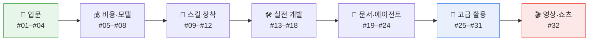

# 🚀 시니어 직장인의 AI 탐구기: 오픈코드(OpenCode) 완벽 실전 가이드


> **"코딩을 몰라도 괜찮습니다. 내 컴퓨터 옆자리에 든든한 AI 신입사원을 두고 퇴근 시간을 앞당겨 보세요!"**  
> 본 블로그는 시니어 직장인의 현실적인 눈높이에서 오픈소스 AI 에이전트 **오픈코드(OpenCode)**의 설치부터 글로벌 AI 모델 연동, 고급 스킬(Skills) 확장, 한글(HWP) 공문서 자동화, Plan 모드를 활용한 실전 웹앱 개발, 클로드 코드(Claude Code)를 0원에 체험하는 방법, 그리고 AI 이미지·영상으로 쇼츠를 만드는 방법까지 체계적으로 정리한 실무 지침서입니다.
>
> 🆕 **최신 업데이트 (2026-11-27)**: **[#32편]** [사진 한 장이 8초 쇼츠로! OpenCode + Google Flow로 AI 영상과 한글 자막 만들기](오픈코드32.md)가 추가되었습니다. 이미지 생성부터 영상·한글 자막까지, 도구를 나눠 숏폼을 완성하는 실습 편입니다.

---

## 📊 시리즈 한눈에 보기

| 구분 | 내용 |
| :--- | :--- |
| **연재 규모** | 전 11개 파트 · **32편** + 실전 사례 1편 |
| **주요 도구** | OpenCode Desktop, Claude Code, Gemini, ChatGPT, HWP/HWPX, Firebase, Google Flow, Git/GitHub |
| **관통 주제** | ① 설치와 연동 ② 비용 0원 최적화 ③ 한국형 문서 자동화 ④ 실전 프로젝트 ⑤ 이미지·영상 제작 |
| **읽는 순서** | 입문(#01~#08) → 스킬(#09~#12) → 실전(#13~#24) → 고급(#25~#31) → 콘텐츠(#32) |
| **업데이트 기준** | 2026년 11월 27일 (가격·한도·UI는 수시로 변동) |



---

## 🎯 목적별 빠른 찾기

처음부터 정주행하지 않아도, 지금 필요한 글만 골라 읽을 수 있습니다.

| 지금 필요한 것 | 바로 가기 | 한 줄 설명 |
| :--- | :--- | :--- |
| **오픈코드를 처음 설치한다** | [#01](오픈코드01.md) · [#02](오픈코드02.md) · [#16](오픈코드16.md) | 개념 → OS별 설치 → 첫 프로젝트 |
| **돈을 쓰지 않고 시작한다** | [#06](오픈코드06.md) · [#31](오픈코드31.md) | 내장 무료 모델, 9Router 무료 API 조합 |
| **구글·ChatGPT 구독을 연결한다** | [#03](오픈코드03.md) · [#04](오픈코드04.md) · [#08](오픈코드08.md) | Antigravity, ChatGPT Desktop, `/connect` |
| **한글(HWP) 공문서를 다룬다** | [#11](오픈코드11.md) · [#21](오픈코드21.md) | kordoc MCP, 이음오피스 통합 편집 |
| **보고서를 그림으로 만든다** | [#10](오픈코드10.md) | archify 인터랙티브 다이어그램 |
| **PDF·오피스 문서를 요약한다** | [#19](오픈코드19.md) · [#26](오픈코드26.md) | MarkItDown, Smart RAG |
| **웹앱을 직접 만든다** | [#13](오픈코드13.md) · [#14](오픈코드14.md) · [#28](오픈코드28.md) | 프로젝트 생성, Plan 모드, Firebase |
| **AI 코드 리뷰를 붙인다** | [#30](오픈코드30.md) | Alibaba OCR 플러그인, 오탐 검증 |
| **Git/GitHub을 정리한다** | [#27](오픈코드27.md) | 설치·브랜치·복구·OpenCode 연동 |
| **클로드 코드를 0원에 써본다** | [#31](오픈코드31.md) | 9Router + Gemini·Groq·OpenRouter |
| **AI 쇼츠·영상을 만든다** | [#32](오픈코드32.md) | OpenCode 이미지 + Flow 영상 + FFmpeg 한글 자막 |

---

## 📚 전체 연재 시리즈 목차 (Table of Contents)

### [Part 1] 기초 입문 & 필수 AI 환경 세팅

기초 개념 이해부터 Mac/Windows 설치, 구글 제미나이 및 ChatGPT 데스크탑 환경 구축까지 다룹니다.

* **[#01편]** [코딩 몰라도 든든한 업무 비서, 오픈소스 AI 에이전트 '오픈코드(OpenCode)' 소개](오픈코드01.md)
* **[#02편]** [Mac & Windows 완벽 가이드: 오픈코드 데스크탑 및 CLI 설치법](오픈코드02.md)
* **[#03편]** [제미나이 구독자 필독! 구글 안티그래비티(Antigravity) 설치 완벽 가이드](오픈코드03.md)
* **[#04편]** [ChatGPT 구독자 필독! ChatGPT Desktop 및 CLI 설치 완벽 가이드](오픈코드04.md)

---

### [Part 2] 비용 최적화 & 모델 연동, 인터페이스 마스터

선결제 요금 통제, 자체 무료 모델(DeepSeek V4.1) 활용, 2분할 화면 조작법 및 `/connect` 원클릭 연동을 배웁니다.

* **[#05편]** [요금 폭탄 걱정 끝! 오픈코드 콘솔 가입 및 최소 금액($10) 선결제 가이드](오픈코드05.md)
* **[#06편]** [비용 0원으로 시작하기! 오픈코드 데스크탑 자체 무료 모델 'DeepSeek V4.1' 활용법](오픈코드06.md)
* **[#07편]** [오픈코드 데스크탑(Mac) 2분할 화면 정복: 화면 요소 & Open file·Terminal 가이드](오픈코드07.md)
* **[#08편]** [클릭 몇 번으로 AI 삼총사 합체! '/connect' 명령어로 구글·ChatGPT·콘솔 연동](오픈코드08.md)

---

### [Part 3] 파워 스킬(Skills) 장착 & 한국형 문서 자동화

오픈소스 우선 탐색, 고품질 인터랙티브 다이어그램 생성, HWP 공문서 파싱 및 만능 메타 스킬을 구축합니다.

* **[#09편]** [바퀴를 다시 발명하지 마라! 스마트 검색 스킬 'research-first' 설치 및 실전 활용](오픈코드09.md)
* **[#10편]** [보고서 시각화의 끝판왕! 인터랙티브 다이어그램 스킬 'archify' 설치 및 활용](오픈코드10.md)
* **[#11편]** [한국 직장인 필수템! 깃허브에서 'kordoc' 복사해 오픈코드에 HWP 파서 MCP 설치](오픈코드11.md)
* **[#12편]** [스킬을 찾아주고 만들어주는 마법의 메타 스킬! 'find-skills' 설치 및 활용](오픈코드12.md)

---

### [Part 4] 실전 프로젝트 개발 & AI 페어 프로그래밍

내 컴퓨터 전용 작업대(프로젝트 폴더) 구축부터 Plan(계획) 모드를 통한 안전한 코드 제어, 인앱 브라우저 실시간 검증 및 로컬스토리지 칸반 보드 구축까지 다룹니다.

* **[#13편]** [내 컴퓨터에 전용 AI 작업대 만들기! 오픈코드 새 프로젝트 생성 및 폴더 연결 완벽 가이드](오픈코드13.md)
* **[#14편]** ["말 한마디로 앱이 진화한다!" 오픈코드 Plan 모드로 만드는 로컬스토리지 칸반 보드 실전 가이드](오픈코드14.md)

---

### [Part 5] 유튜브 학습 & OpenCode 초보자 튜토리얼

유튜브 영상 자막 추출부터 OpenCode 설치, 모델 연결, Plan/Build 모드, Skills·MCP·AGENTS.md·GitHub까지 초보자용 튜토리얼로 살펴봅니다.

* **[#15편]** [유튜브 자막 추출 및 AI 요약 스킬 'baoyu-youtube-transcript' 설치·활용](오픈코드15.md)
* **[#16편]** [OpenCode 데스크톱 첫걸음: 설치부터 모델 연결, 프로젝트 만들기까지](오픈코드16.md)
* **[#17편]** [Plan·Build 모드와 Git으로 안전하게 앱 만들기](오픈코드17.md)
* **[#18편]** [Skills와 MCP, 슬래시 명령어부터 AGENTS.md·GitHub까지](오픈코드18.md)

---

### [Part 6] 문서 처리·토큰 최적화, 멀티 에이전트 & 오피스 통합

MarkItDown으로 PDF·오피스 문서를 처리하고 서브에이전트와 협업하는 방법, 한글(HWP)·오피스 통합 편집을 다룹니다.

* **[#19편]** [uv로 완성하는 PDF·오피스 문서 처리! Microsoft MarkItDown 설치부터 OpenCode MCP 연동 & 토큰 절약 노하우](오픈코드19.md)
* **[#20편]** [혼자 일하는 AI에서 전문가 팀으로: 오픈코드 데스크톱 서브에이전트(Subagents) 실전 구축 가이드](오픈코드20.md)
* **[#21편]** [한글(HWP)부터 오피스·다이어그램까지 한 창에서! 국어 교사가 만든 무료 오픈소스 '이음오피스(IeumOffice)' 완벽 가이드 & 오픈코드 연동](오픈코드21.md)

---

### [Part 7] AI 핵심 용어 사전 & 브라우저 자동화

AI 필수 용어를 정리하고, 내장 브라우저 기초 제어(`#23`)와 실제 Chrome 로그인 연동(`#24`)을 구분해 익힙니다.

* **[#22편]** [AI 대화가 술술 풀리는 마법의 사전: 시니어 직장인을 위한 생성형 AI 핵심 필수 용어 30선](오픈코드22.md)
* **[#23편]** [AI에게 브라우저를 맡겨보세요: OpenCode @browser 사용법과 따라 하는 실습](오픈코드23.md)
* **[#24편]** [내 진짜 크롬(Chrome)을 AI 비서에게 연결하다: anomalyco/browse 완벽 설치 및 실전 활용 가이드](오픈코드24.md)

---

### [Part 8] 지식 그래프·Smart RAG & Git/GitHub

프로젝트 구조를 그래프로 탐색하고 사내 문서를 근거로 검색하는 법, Git과 GitHub로 변경 이력을 관리하는 방법을 다룹니다.

* **[#25편]** [수백 개 파일도 한눈에 꿰뚫는 AI 지식 지도: Graphify 스킬 완벽 설치 및 실전 활용 가이드](오픈코드25.md)
* **[#26편]** [AI가 거짓말하지 않고 똑똑하게 일하는 법: Smart RAG & Vector Search 완벽 정리](오픈코드26.md)
* **[#27편]** [유튜브 명강의 3선으로 끝내는 Git & GitHub 완벽 정복 가이드](오픈코드27.md)

---

### [Part 9] 클라우드 개발·최신 모델 & AI 코드 리뷰

Firebase 무료 티어로 실전 파일 포털을 구축하고, 제미나이 4 모델 선택 전략과 AI 코드 리뷰어 연동까지 다룹니다.

* **[#28편]** [에뮬레이터 없이 무료 클라우드 직결! Firebase 콘솔과 오픈코드로 만드는 실전 파일 포털 'ClientVault'](오픈코드28.md)
* **[#29편]** [이름부터 바뀐 '제미나이 4(Gemini 4)' 완벽 해부: 내 지갑과 업무에 딱 맞는 모델 고르기](오픈코드29.md)
* **[#30편]** [OpenCode에 Alibaba 오픈소스 코드 리뷰어(OCR) 붙이기: 공식 플러그인 연동부터 위임·네이티브 모드와 오탐 검증까지](오픈코드30.md)

---

### [Part 10] 구독료 0원 & 크로스 툴 활용

오픈코드에서 익힌 무료 API 재료를 그대로 활용해, 클로드 코드(Claude Code)를 로컬 게이트웨이 9Router로 0원에 체험하고 두 도구를 상황에 맞게 나눠 쓰는 방법을 다룹니다.

* **[#31편]** [클로드 코드(Claude Code) 구독료 0원으로 쓰기: 9Router 로컬 게이트웨이 + 무료 공식 API 조합](오픈코드31.md)

---

### [Part 11] AI 이미지·영상 제작 & 숏폼 콘텐츠

OpenCode로 인물 이미지를 만들고, Google Flow로 움직이는 영상을 생성한 뒤, FFmpeg로 한글 자막을 합성해 세로형 쇼츠를 완성하는 전 과정을 다룹니다.

* **[#32편]** [사진 한 장이 8초 쇼츠로! OpenCode + Google Flow로 AI 영상과 한글 자막 만들기](오픈코드32.md)

---

### 🎁 [실전 실습 프로젝트]

* **[실전 사례]** [특정소방대상물의 관계인이 설치·관리해야 하는 소방시설 (법령 HWP → MD 자동 변환)](관계인이%20설치%20관리해야할%20소방시설.md)

---

## 📑 전체 연재 글 한눈에 보기

| 회차 | 주제 및 제목 | 바로가기 | 핵심 학습 내용 |
| :---: | :--- | :---: | :--- |
| **#01** | 오픈코드(OpenCode) 소개 | [읽어보기](오픈코드01.md) | AI 코딩 에이전트 개념 및 시니어 직장인 활용 가치 |
| **#02** | 오픈코드 데스크탑 & CLI 설치 | [읽어보기](오픈코드02.md) | Mac / Windows 운영체제별 설치 및 첫 실행 |
| **#03** | 구글 안티그래비티 (Gemini) 설치 | [읽어보기](오픈코드03.md) | 제미나이 모델을 오픈코드 에이전트로 업그레이드 |
| **#04** | ChatGPT 데스크탑 & CLI 설치 | [읽어보기](오픈코드04.md) | OpenAI 유료 구독자 데스크탑 및 터미널 인증 |
| **#05** | 오픈코드 콘솔 가입 & 선결제 | [읽어보기](오픈코드05.md) | 요금 폭탄 없는 $10 선불 크레딧 충전 및 관리 |
| **#06** | 무료 모델 DeepSeek V4.1 활용 | [읽어보기](오픈코드06.md) | 비용 0원으로 고성능 추론 모델 10초 만에 선택 |
| **#07** | 오픈코드 Mac 2분할 화면 가이드 | [읽어보기](오픈코드07.md) | 좌우 분할 창 명칭, Open file 및 Terminal 단축키 |
| **#08** | `/connect` 3대 제공자 연동 | [읽어보기](오픈코드08.md) | 구글, ChatGPT, 콘솔 원클릭 브라우저 OAuth 인증 |
| **#09** | 검색 스킬 'research-first' | [읽어보기](오픈코드09.md) | 오픈소스 라이브러리와 템플릿 우선 검색 습관 |
| **#10** | 다이어그램 스킬 'archify' | [읽어보기](오픈코드10.md) | Workflow, Timeline 인터랙티브 HTML 시각화 |
| **#11** | HWP 파서 MCP 'kordoc' | [읽어보기](오픈코드11.md) | 맥북에서도 한컴오피스 없이 HWP/HWPX 읽기·요약 |
| **#12** | 메타 스킬 'find-skills' | [읽어보기](오픈코드12.md) | 전 세계 skills.sh 레지스트리 자동 탐색 및 설치 |
| **#13** | 새 프로젝트 생성 & 폴더 연결 | [읽어보기](오픈코드13.md) | 보안 격리 및 AI 작업대 배정, 폴더 열기 3단계 |
| **#14** | Plan 모드로 칸반 보드 제작 | [읽어보기](오픈코드14.md) | Plan 모드(diff 사전 검토), 브라우저 검증, 로컬 칸반 보드, AGENTS.md |
| **#15** | 유튜브 자막 추출·요약 스킬 | [읽어보기](오픈코드15.md) | `baoyu-youtube-transcript` 검색·설치, 자막과 영상 정보 활용 |
| **#16** | OpenCode 설치와 첫 프로젝트 | [읽어보기](오픈코드16.md) | 데스크톱 시작, 제공자·모델 연결, 프로젝트 작업대 준비 |
| **#17** | Plan·Build 모드와 Git | [읽어보기](오픈코드17.md) | 계획 검토, 실습 앱 구현, 변경 사항 확인 및 Git 관리 |
| **#18** | Skills·MCP·AGENTS.md·GitHub | [읽어보기](오픈코드18.md) | 슬래시 명령어, 확장 기능 구분, 프로젝트 규칙과 GitHub 연결 |
| **#19** | MarkItDown & 토큰 최적화 | [읽어보기](오픈코드19.md) | uv로 MarkItDown MCP 설치, PDF/Office 문서 변환 및 토큰 절약 5대 수칙 |
| **#20** | 데스크톱 서브에이전트 구축 | [읽어보기](오픈코드20.md) | explore 기본 탐색부터 math·reviewer·tester 전문가 팀 등록 및 권한 통제 |
| **#21** | 이음오피스(IeumOffice) 가이드 | [읽어보기](오픈코드21.md) | 한글·오피스 한 창 통합 편집, 인터넷 반응 5대 호평, OS별 설치 및 OpenCode MCP·CLI 연동 |
| **#22** | AI 핵심 필수 용어 30선 | [읽어보기](오픈코드22.md) | LLM·RAG·토큰·MCP·에이전트 등 5대 테마 30대 필수 용어 및 프롬프트 실전 팁 |
| **#23** | @browser 사용법과 실습 | [읽어보기](오픈코드23.md) | 내장 브라우저 기초 제어, 공개 웹 탐색, 로컬 웹앱 UI 및 입력폼 점검 |
| **#24** | anomalyco/browse 실전 가이드 | [읽어보기](오픈코드24.md) | 실제 Chrome 로그인 세션·탭 연동, Handoff, 확장 프로그램 설치 및 실무 예제 |
| **#25** | Graphify 지식 그래프 가이드 | [읽어보기](오픈코드25.md) | 수백 개 파일 지식 지도 시각화, AST 로컬 파싱, 토큰 80% 절감 및 질의·경로 분석 |
| **#26** | Smart RAG & Vector Search | [읽어보기](오픈코드26.md) | 벡터 검색 원리, 오픈북 RAG 3단계, Smart RAG 4대 기술(하이브리드·재순위화·GraphRAG) 및 OpenCode 연동 |
| **#27** | Git & GitHub 완벽 정복 가이드 | [읽어보기](오픈코드27.md) | 유튜브 명강의 3선 통합, GitHub 가입·OS별 Git 설치·초기 설정, 3대 작업 공간, 브랜치·복구 및 OpenCode 연동 |
| **#28** | Firebase 콘솔로 ClientVault 만들기 | [읽어보기](오픈코드28.md) | 에뮬레이터 없는 Firebase 무료 티어 직결, Auth·Firestore·Storage 및 보안 규칙 배포 |
| **#29** | 제미나이 4(Gemini 4) 모델 해부 | [읽어보기](오픈코드29.md) | 화학 원소 모델 라인업(Neon/Hydrogen/Carbon), 직급별 역할, 토큰 가계부 절약 전략 및 `/connect` 연동 |
| **#30** | Alibaba 오픈소스 코드 리뷰어(OCR) | [읽어보기](오픈코드30.md) | 알리바바 OCR 공식 플러그인 연동, 위임 vs 네이티브 모드 비교 및 AI 오탐 검증 교훈 |
| **#31** | 클로드 코드 0원 사용 (9Router) | [읽어보기](오픈코드31.md) | 로컬 게이트웨이 설치, 무료 공식 API 3종 등록, Combo 폴백 및 Claude Code·OpenCode 연결 |
| **#32** | OpenCode + Flow AI 쇼츠 제작 | [읽어보기](오픈코드32.md) | 이미지 생성, Flow 9:16 영상·크레딧 확인, MP4 다운로드 및 FFmpeg 한글 자막 합성 |

---

## 🧭 처음 읽는 분께: 3가지 추천 경로

| 경로 | 추천 대상 | 읽을 순서 |
| :--- | :--- | :--- |
| **A. 왕초보 정주행** | 오픈코드를 처음 접하는 분 | [#01](오픈코드01.md) → [#02](오픈코드02.md) → [#05](오픈코드05.md) → [#06](오픈코드06.md) → [#13](오픈코드13.md) → [#14](오픈코드14.md) |
| **B. 실무 자동화 직행** | 당장 문서·보고서 업무를 줄이고 싶은 분 | [#11](오픈코드11.md) → [#19](오픈코드19.md) → [#20](오픈코드20.md) → [#21](오픈코드21.md) → [#10](오픈코드10.md) |
| **C. 개발·확장 트랙** | 웹앱과 코드 품질까지 다루고 싶은 분 | [#25](오픈코드25.md) → [#26](오픈코드26.md) → [#27](오픈코드27.md) → [#28](오픈코드28.md) → [#30](오픈코드30.md) → [#31](오픈코드31.md) |
| **D. 콘텐츠 제작 트랙** | AI 이미지·영상으로 쇼츠를 만들고 싶은 분 | [#23](오픈코드23.md) → [#24](오픈코드24.md) → [#29](오픈코드29.md) → [#32](오픈코드32.md) |

> 💡 이미 OpenCode를 설치했다면 **#13~#32**의 프로젝트 실습과 활용법부터 보셔도 좋습니다. 글마다 기능과 화면이 달라질 수 있으므로, 설치·요금·모델 관련 내용은 해당 서비스의 최신 공식 안내도 함께 확인하세요.

---

## 🛠️ 권장 실습 환경

| 구분 | 권장 사양 및 환경 |
| :--- | :--- |
| **운영체제** | macOS (Apple Silicon / Intel) 또는 Windows 10/11 |
| **필수 소프트웨어** | OpenCode Desktop (v2.x 이상), Node.js (v18 이상), Git |
| **연동 계정** | Google 계정, OpenAI(선택), OpenCode Console(선택) |
| **무료 API(선택)** | Google AI Studio, Groq, OpenRouter — [#31편](오픈코드31.md) 참고 |
| **영상 도구(선택)** | Google Flow(크레딧 필요), FFmpeg, Pillow — [#32편](오픈코드32.md) 참고 |
| **추가 도구(선택)** | Claude Code CLI/데스크톱 앱, IeumOffice, Firebase 콘솔 |
| **문서 에디터** | OpenCode 내장 뷰어, Obsidian(옵시디언), VS Code |

---

## 🗂️ 저장소 구조

```text
opencode-guide/
├── README.md                 # 시리즈 안내 및 전체 목차
├── 오픈코드01.md ~ 32.md      # 연재 본문 (32편)
├── 관계인이 설치 관리해야할 소방시설.md
├── scripts/
│   ├── check-links.mjs       # 내부 링크 검사
│   └── check-unicode.mjs     # 파일명 NFC 검사
├── youtube-transcript/       # 자막 실습 보조 자료
├── .github/                  # GitHub 설정
├── package.json
└── .markdownlint.json
```

---

## ✅ 콘텐츠 품질 체크

이 저장소는 글을 추가할 때마다 아래 검사를 통과시키고 있습니다.

```bash
# 내부 링크 + 파일명 NFC 검사
npm run check

# 마크다운 스타일 검사
npm run lint:md
```

| 검사 항목 | 스크립트 | 확인 내용 |
| :--- | :--- | :--- |
| **내부 링크** | `check:links` | 마크다운 내부 링크의 대상 파일 존재 여부 |
| **파일명 유니코드** | `check:unicode` | 한글 파일명의 자소 분리(NFD) 방지 |
| **마크다운 스타일** | `lint:md` | 목록·표·코드 블록·제목 규칙 준수 |

---

## ⚠️ 읽기 전 안내

> **기준일 고지**: 모든 글은 작성 시점의 화면과 정책을 기준으로 합니다. AI 모델명·가격·무료 한도·앱 UI는 예고 없이 바뀝니다.
>
> **보안 주의**: 회사 기밀·고객 개인정보·API 키를 프롬프트나 스크린샷에 넣지 마세요. 무료 티어는 입력 데이터 활용 정책이 유료와 다를 수 있습니다.
>
> **도구 이용약관**: 각 서비스의 공식 API 키와 정식 기능을 사용하세요. OAuth 우회, 계정 공유, 유료 구독 우회는 약관 위반이 될 수 있습니다.
>
> **AI 결과 검증**: AI가 자신 있게 말해도 사실과 다를 수 있습니다. 중요한 판단은 공식 문서와 사람의 확인을 거치세요. ([#30편](오픈코드30.md)의 오탐 사례 참고)

---

## 👤 작성자 및 라이선스 안내

* **작성자**: JeongGooi Lee ([gilson0516@gmail.com](mailto:gilson0516@gmail.com))
* **블로그 저장소**: [gilson0516/opencode-guide](https://github.com/gilson0516/opencode-guide)
* **라이선스**: 본 가이드의 모든 내용은 자유롭게 참고 및 공유하실 수 있습니다. (MIT License)
* **피드백**: 오탈자·깨진 링크·최신 정보 반영은 GitHub [Issues](https://github.com/gilson0516/opencode-guide/issues) 또는 Pull Request로 알려 주세요.

도움이 되셨다면 저장소에 ⭐를 눌러 주세요. 새로운 편이 추가될 때 알림을 받으실 수 있습니다.

---

Last Updated: 2026-11-27
