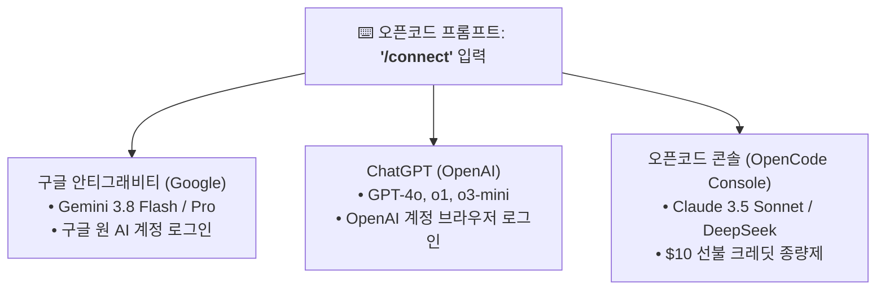

# [시니어 직장인의 AI 탐구기 #08] 클릭 몇 번으로 AI 삼총사 합체! '/connect' 명령어로 구글·ChatGPT·콘솔 연동

> **핵심 요약**: 복잡한 API 키 복사 없이 오픈코드 프롬프트에 `/connect` 단 8글자만 입력하여 구글 안티그래비티, ChatGPT, 오픈코드 콘솔을 원클릭 브라우저 로그인(OAuth)으로 연동하는 방법을 정리합니다.
> **준비물**: Google/OpenAI 계정, OpenCode Console 계정 · **소요 시간**: 약 5분

오픈코드의 **`/connect`** 명령어는 복잡한 영문 API 키를 직접 복사-붙여넣을 필요 없이, 웹 브라우저의 **간편 로그인(OAuth) 방식**으로 주요 AI 두뇌들을 단 1분 만에 연결해 줍니다.



---

## 1. 3대 AI 제공자 한눈에 비교

| 제공자 (Provider) | 주요 지원 모델 | 과금 및 요금 체계 | 추천 업무 영역 |
| :--- | :--- | :--- | :--- |
| **구글 안티그래비티**<br>(Google) | Gemini 3.8 Flash<br>Gemini 3.8 Pro | 구글 원 AI 구독 연동<br>또는 무료 할당량 | 대용량 문서 분석, 긴 기획서 검토, 구글 작업 |
| **ChatGPT**<br>(OpenAI) | GPT-4o<br>o1, o3-mini | ChatGPT 유료 구독(Plus/Team)<br>또는 API 잔액 | 비즈니스 이메일, 창의적 기획, 자연스러운 보고서 |
| **오픈코드 콘솔**<br>(OpenCode Console) | Claude 3.5 Sonnet<br>DeepSeek V4.1 | $10 선불 충전 방식<br>(사용한 만큼만 차감) | 복잡한 코딩 및 데이터 처리, 논리 추론 및 검수 |

---

## 2. 실전! '/connect'로 3대 제공자 연동하기

오픈코드 프롬프트 입력창에 아래 명령어를 입력합니다:

```text
/connect
```

목록 팝업이 나타나면 아래 절차로 각 서비스를 차례로 연동합니다:

1. **Google (안티그래비티)**: 목록에서 `Google` 선택 → 열리는 브라우저에서 구글 계정 로그인 및 접근 [허용] 클릭.
2. **OpenAI (ChatGPT)**: `/connect` 입력 → `OpenAI` 선택 → 브라우저에서 ChatGPT 구독 계정 로그인 및 [Authorize] 클릭.
3. **OpenCode Console**: `/connect` 입력 → `OpenCode Console` 선택 → 콘솔 구글 로그인 후 [Personal] 워크스페이스 승인 클릭.

---

## 3. 연동 상태 확인 (5초 확인법)

- **모델 선택창 확인**: 단축키 `Cmd/Ctrl + P`를 누르거나 채팅창에 `/models`를 입력해 Google, OpenAI, Claude 모델 목록이 활성화되었는지 확인합니다.
- **터미널 계정 목록 조회**: 내장 터미널(`Control + Option + T`)에서 `opencode auth list`를 실행해 3개 제공자가 모두 `stored` 상태인지 확인합니다:

  ```text
  Google            your-email@gmail.com        stored
  OpenAI            OpenAI                      stored
  OpenCode Console  Personal                    stored
  ```

---

## 4. 자주 묻는 질문 (FAQ)

- **Q1. 여러 개를 연동하면 요금이 동시에 빠져나가나요?**  
  아닙니다. 현재 대화창 상단에서 선택된 단 하나의 활성 모델에 대해서만 요청과 과금이 이루어집니다.
- **Q2. 어떻게 배분해 쓰는 게 가장 알뜰한가요?**  
  단순 질문·정리는 **무료 모델(DeepSeek V4.1)**, 대용량 문서 분석은 **구글 제미나이**, 복잡한 코딩·정밀 검수는 **Claude 3.5 Sonnet** 또는 **GPT-4o**를 추천합니다.
- **Q3. 공용 PC에서 연동을 해제하려면?**  
  터미널에서 `opencode auth logout`을 실행해 특정 제공자의 인증 정보를 즉시 파기할 수 있습니다.

---

[← 이전 글: [#07편] 오픈코드 데스크탑(Mac) 2분할 화면 정복: 화면 요소 & Open file·Terminal 가이드](오픈코드07.md) · [다음 글: [#09편] 바퀴를 다시 발명하지 마라! 스마트 검색 스킬 'research-first' 설치 및 실전 활용](오픈코드09.md) · [전체 연재 목차](README.md)
