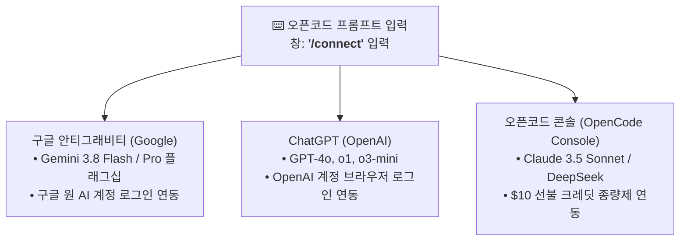

# [시니어 직장인의 AI 탐구기 #08] 클릭 몇 번으로 AI 삼총사 합체! '/connect' 명령어로 구글 안티그래비티·ChatGPT·오픈코드 콘솔 완벽 연동 가이드

> **"앞선 글에서 구글 안티그래비티, ChatGPT, 오픈코드 콘솔 준비를 마쳤는데, 이걸 오픈코드에서 어떻게 하나로 묶어 쓰나요?"**  
> 복잡한 영문 API 키를 복사해서 붙여넣을 필요가 없습니다. 오픈코드 대화창에 단 8글자, `/connect`만 입력하면 세계 최정상급 AI 엔진들이 내 PC 안으로 즉시 들어옵니다.

안녕하세요. 시니어 회사원의 시선에서 AI 실무 도구를 가장 쉽고 안전하게 안내하는 블로그의 여덟 번째 글입니다.

우리는 지난 연재를 통해 실무에 꼭 필요한 3대 AI 인프라를 하나씩 갖추었습니다.

- **#03편**: 제미나이의 막강한 추론력을 지닌 **구글 안티그래비티(Google Antigravity)**
- **#04편**: 전 세계 직장인들이 가장 신뢰하는 **ChatGPT(OpenAI)**
- **#05편**: 요금 폭탄 없이 $10 선결제로 안전하게 쓰는 **오픈코드 콘솔(OpenCode Console)**

이제 흩어져 있던 이 세 가지 강력한 AI 두뇌들을 오픈코드(OpenCode) 한곳에 모아 필요할 때마다 자유롭게 골라 쓸 수 있도록 **'원클릭 합체'**를 진행할 차례입니다.

오늘은 오픈코드의 핵심 마법 명령어인 **`/connect`**를 사용하여 구글 안티그래비티, ChatGPT, 오픈코드 콘솔을 1분 만에 연동하는 방법을 완벽하게 정리해 드립니다.

---

## 1. '/connect' 명령어란 무엇인가요?

기존의 개발자 도구들은 AI 서비스를 연결하려면 복잡한 영문 API 키를 직접 발급받아 환경 변수나 설정 파일에 붙여넣어야 했습니다. 오타가 나거나 키가 유출될까 봐 불안하기 짝이 없었죠.

하지만 오픈코드의 **`/connect`** 명령어는 웹 브라우저의 **간편 로그인(OAuth) 방식**을 지원합니다.



- **복사-붙여넣기 NO**: 브라우저 창이 열리면 [로그인] 및 [승인] 버튼만 클릭하면 끝납니다.
- **철저한 로컬 보안**: 인증된 정보는 내 컴퓨터의 안전한 암호화 영역(OS 키체인/자격 증명)에 저장되어 외부로 노출되지 않습니다.
- **영구 보관**: 한 번만 연결해 두면 매번 프로그램을 켤 때마다 다시 로그인할 필요가 없습니다.

---

## 2. 한눈에 비교하는 3대 AI 제공자 특징

연동을 시작하기 전에, 각 제공자가 어떤 특징과 장점을 지니고 있는지 표로 깔끔하게 정리해 드립니다.

| 제공자 (Provider) | 주요 지원 모델 | 과금 및 요금 체계 | 추천 업무 영역 |
| :--- | :--- | :--- | :--- |
| **구글 안티그래비티**<br>(Google Antigravity) | Gemini 3.8 Flash<br>Gemini 3.8 Pro | 구글 원 AI 프리미엄 구독 연동<br>또는 무료 할당량 제공 | 대용량 문서 분석, 긴 기획서 검토,<br>구글 생태계 작업 |
| **ChatGPT**<br>(OpenAI) | GPT-4o<br>o1, o3-mini | ChatGPT 유료 구독(Plus/Team)<br>또는 OpenAI API 잔액 | 비즈니스 이메일 작성, 창의적 기획,<br>자연스러운 국문 보고서 작성 |
| **오픈코드 콘솔**<br>(OpenCode Console) | Claude 3.5 Sonnet<br>DeepSeek V4.1 | $10 선결제 충전 방식<br>(사용한 만큼만 1원 단위 차감) | 복잡한 코딩 및 엑셀 데이터 처리,<br>논리적 추론 및 정밀 검수 |

---

## 3. 실전! '/connect'로 3대 제공자 연결하기 (단계별 가이드)

오픈코드 데스크탑(또는 CLI)을 실행하고 하단 프롬프트 입력창(Composer)을 클릭합니다.

```text
Ask anything, / for commands, @ for context...
> /connect
```

입력창에 **`/connect`**를 타이핑하고 엔터(`Enter`)를 치면, 화면 중앙에 연결 가능한 제공자(Provider) 목록 팝업이 나타납니다.

---

### [제공자 1] 구글 안티그래비티 (Google Antigravity) 연결

구글의 초고성능 제미나이 모델을 오픈코드의 기본 두뇌로 장착하는 단계입니다.

1. `/connect` 팝업 목록에서 **`Google`** 또는 **`Google Antigravity`**를 키보드 방향키로 이동해 선택합니다.
2. 선택 즉시 기본 웹 브라우저(Chrome, Safari 등)가 자동으로 열립니다.
3. 03편에서 준비했던 **구글 계정(Gemini 사용 계정)**을 선택하고 로그인합니다.
4. **"오픈코드(OpenCode)가 계정에 접근하도록 허용하시겠습니까?"** 승인 화면에서 **[허용(Allow)]** 또는 **[계속]**을 클릭합니다.
5. 브라우저에 *"인증이 성공적으로 완료되었습니다. 오픈코드로 돌아가세요"*라는 문구가 뜨면 완료!

> 💡 **확인**: 이제 오픈코드 상단 모델 선택창에서 `Gemini 3.8 Flash (Medium)` 및 최신 제미나이 모델들을 바로 호출할 수 있습니다.

---

### [제공자 2] ChatGPT (OpenAI) 연결

직장인들의 국민 비서인 ChatGPT의 최신 플래그십 모델들을 연결합니다.

1. 다시 입력창에 **`/connect`**를 입력합니다.
2. 목록에서 **`OpenAI`** (또는 `ChatGPT`)를 선택합니다.
3. 웹 브라우저가 열리며 OpenAI 로그인 화면이 나타납니다.
4. 04편에서 준비한 **ChatGPT 유료 계정(또는 API 계정)**으로 로그인합니다.
5. 오픈코드와의 연동 권한 승인 창에서 **[Authorize / 확인]**을 클릭합니다.
6. 인증 완료 창이 뜨면 브라우저를 닫고 오픈코드로 복귀합니다.

> 💡 **확인**: 이제 `GPT-4o`, `o1`, `o3-mini` 등 강력한 추론 모델들을 채팅창에서 마음껏 선택할 수 있습니다.

---

### [제공자 3] 오픈코드 콘솔 (OpenCode Console) 연결

05편에서 커피 두세 잔 값($10)으로 선결제 충전해 둔 통합 콘솔을 연동합니다. 현존 최고 성능의 코딩 모델인 `Claude 3.5 Sonnet`을 가장 안전하게 쓸 수 있는 방법입니다.

1. 입력창에 **`/connect`**를 입력합니다.
2. 목록에서 **`OpenCode Console`** (또는 `OpenCode`)을 선택합니다.
3. 웹 브라우저가 열리며 오픈코드 콘솔(opencode.ai/console) 인증 페이지가 나타납니다.
4. 05편에서 가입했던 구글 아이디로 **[Continue with Google]**을 눌러 로그인합니다.
5. 워크스페이스 선택 창이 나오면 기본 개인 워크스페이스(**Personal**)를 선택하고 **[승인(Approve)]**을 클릭합니다.
6. 오픈코드 화면에 연결 완료 알림이 뜨면서 모든 설정이 종료됩니다.

---

## 4. 제대로 연결되었는지 5초 만에 확인하는 2가지 방법

세 가지 서비스가 모두 안전하게 연결되었는지 눈으로 확인해 보겠습니다.

### 방법 A: 모델 선택창 열기 (가장 직관적)

- Mac 단축키: **`Cmd + P`** (Windows: `Ctrl + P`)
- 또는 채팅창에 **`/models`** 입력
- 검색창 아래에 Google, OpenAI, OpenCode Console(Claude)의 모델 목록이 환하게 활성화되어 있는지 확인합니다.

### 방법 B: 터미널에서 계정 목록 조회 (Terminal 활용)

오픈코드 우측 `Terminal` 창(단축키: `Control + Option + T`)에서 아래 명령어를 입력합니다:

```sh
opencode auth list
```

명령어를 실행했을 때 아래와 같이 3개 제공자가 모두 **`stored` (저장됨)** 상태로 출력되면 100점 만점으로 연동된 것입니다:

```text
Google            your-email@gmail.com        stored
OpenAI            OpenAI                      stored
OpenCode Console  Personal                    stored
```

---

## 5. 시니어 직장인을 위한 핵심 명령어 & 단축키 총정리표

자주 쓰는 연동 관련 명령어와 관리 방법을 표로 정리했습니다.

| 명령어 / 단축키 | 실행 위치 | 역할 및 설명 |
| :--- | :--- | :--- |
| **`/connect`** | 대화 입력창 (Composer) | 새로운 AI 제공자(구글, OpenAI, 콘솔 등) 간편 연동창 호출 |
| **`/models`** | 대화 입력창 (Composer) | 현재 연결된 모든 AI 모델 목록 조회 및 모델 즉시 변경 |
| **`Cmd + P`** (Mac)<br>`Ctrl + P` (Win) | 키보드 어디서든 | 모델 빠른 검색 및 전환 팝업창 호출 |
| **`opencode auth list`** | 우측 터미널 (Terminal) | 현재 내 PC에 인증 저장된 모든 AI 계정 상태 확인 |
| **`opencode auth logout`** | 우측 터미널 (Terminal) | 특정 계정 연동을 안전하게 해제하고 연결 끊기 |

---

## 6. 시니어 안심 Q&A: 이것이 궁금해요

### Q1. 여러 개를 연결해 두면 요금이 동시에 다 빠져나가나요?

**절대로 그렇지 않습니다.**  
오픈코드는 **"현재 내가 선택하여 대화 중인 단 하나의 모델"**에게만 요청을 보냅니다. 예를 들어 구글 제미나이를 선택해 질문하면 구글 계정에서만 처리되고, 오픈코드 콘솔이나 OpenAI에서는 단 1원의 비용도 발생하지 않습니다.

### Q2. 업무에 따라 모델을 어떻게 바꿔가며 쓰는 게 제일 알뜰한가요?

다음과 같은 **'3단계 스마트 배분 전략'**을 추천합니다:

1. **가벼운 일상 질문, 단순 정리**: 06편에서 배운 **무료 모델(`DeepSeek V4.1 Free`)** 사용 (비용 0원)
2. **방대한 분량의 회사 규정집, 기획서 통독**: 컨텍스트 공간이 압도적인 **구글 제미나이(`Gemini 3.8 Flash`)** 사용
3. **복잡한 엑셀 수식 작성, 복합 자동화 코드 생성**: 콘솔의 **클로드(`Claude 3.5 Sonnet`)** 또는 **`GPT-4o`** 사용

### Q3. 회사 PC를 다른 사람과 함께 쓸 때 계정 정보를 지우려면 어떡하나요?

터미널 창에서 `opencode auth logout`을 입력하고 안내에 따라 원하는 제공자를 선택하면 저장된 인증 키가 내 PC에서 즉시 완벽하게 파기됩니다.

---

## 7. 에필로그 & 다음 글 예고

축하드립니다! 이제 여러분의 오픈코드는 구글의 광활한 기억력, ChatGPT의 수려한 문장력, 그리고 클로드의 정교한 논리력을 모두 품은 **'무적의 올인원 AI 작업대'**로 진화했습니다.

도구와 두뇌 준비는 모두 끝났습니다. 이제 실전에 투입할 차례입니다.

다음 **[시니어 직장인의 AI 탐구기 #09]**에서는 본격적인 첫 실무 프로젝트로, **"내 컴퓨터의 뒤죽박죽 폴더를 오픈코드에 연결하고, 수십 개의 업무 문서와 엑셀 파일을 AI에게 직접 읽혀 3초 만에 일목요연한 요약 보고서를 뽑아내는 비법"**을 실습 위주로 흥미진진하게 펼쳐보겠습니다.

---
*작성일: 2026년 10월 31일*  
*태그: #오픈코드 #OpenCode #오픈코드데스크탑 #connect명령어 #구글안티그래비티 #Gemini #ChatGPT #OpenAI #오픈코드콘솔 #직장인생산성 #시니어AI*
