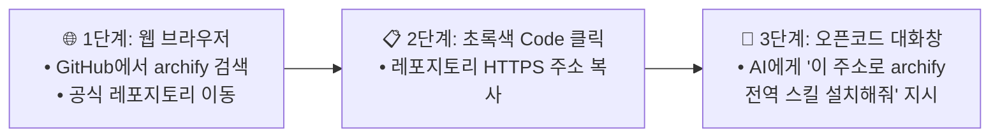

# [시니어 직장인의 AI 탐구기 #10] 보고서 시각화의 끝판왕! 인터랙티브 다이어그램 스킬 'archify' 설치 및 실전 활용 가이드

> **"복잡한 업무 흐름도나 시스템 구조를 말로만 설명하려니 답답하신가요?"**  
> 백 마디 말보다 잘 그린 그림 한 장이 백배 강력합니다. 마우스로 이리저리 둘러보고 다크/라이트 모드까지 지원하는 살아있는 HTML 다이어그램을 단 10초 만에 뽑아내는 비법이 있습니다.

안녕하세요. 시니어 회사원의 시선에서 가장 유용한 AI 생산성 도구를 알기 쉽게 안내하는 블로그의 열 번째 글입니다.

지난 09편에서는 바퀴를 재발명하지 않고 최적의 오픈소스를 먼저 탐색하는 `research-first` 스킬을 배웠습니다. 이번 글에서는 보고서와 기획서의 완성도를 수직 상승시켜 줄 **시각화의 종결자, `archify` 스킬**을 다룹니다.

`archify`는 복잡한 시스템 아키텍처, 업무 프로세스(Workflow), 프로젝트 일정(Timeline), 데이터 흐름 등을 AI가 단순 텍스트로 설명하는 대신, **"브라우저에서 직접 열어볼 수 있는 고품질 단독 실행형 인터랙티브 HTML 다이어그램 웹페이지"**로 즉각 변환해 주는 최고급 스킬입니다.

초보자분들도 따라 하실 수 있도록 **깃허브(GitHub)에서 녹색 'Code' 버튼을 눌러 주소를 복사한 뒤 오픈코드 대화창에서 원클릭으로 설치하는 가장 쉬운 방법**과 함께 실전 예제를 상세히 정리해 드립니다.

---

## 1. 'archify' 스킬이란 무엇인가요?

일반 AI에게 "결제 시스템 흐름도를 그려줘"라고 하면 보통 조잡한 텍스트 아스키(ASCII) 아트나 단순한 표를 던져줍니다. 반면 **`archify`** 스킬이 장착된 AI는 차원이 다른 결과물을 만듭니다.

> ### 💡 archify 핵심 강점
>
> - **인터랙티브 다이어그램**: 확대, 축소, 패닝, 요소 클릭을 지원하는 동적 렌더링
> - **원클릭 테마 전환**: 다크 모드 / 라이트 모드 테마 실시간 전환
> - **즉시 내보내기**: 프레젠테이션용 이미지(PNG, SVG) 및 WebM 동영상 즉시 추출
> - **원페이지 설명서 (Explainer)**: 단 한 페이지로 결론과 핵심 패널을 요약하여 보고용으로 공유 가능

### [표] 'archify'가 지원하는 대표 다이어그램 유형

| 다이어그램 유형 | 국문 명칭 | 실무 추천 활용처 |
| :--- | :--- | :--- |
| **Workflow** | 업무 워크플로우 / 흐름도 | 구매 결재 라인, 품질 검사 절차, 고객 응대 프로세스 |
| **Timeline** | 일정 타임라인 / 로드맵 | 분기별 프로젝트 추진 일정, 마일스톤 계획표, 연간 사업 계획 |
| **Architecture**| 시스템 구성도 / 아키텍처 | 사내 전산망 구성, 클라우드 인프라 아키텍처, 서비스 구조도 |
| **Sequence** | 시퀀스 / 단계별 호출도 | 주문-결제-배송 연동 흐름, API 호출 순서도, 부서 간 협업 순서 |
| **Dataflow** | 데이터 흐름도 | 원천 데이터 수집부터 분석 보고서 생성까지의 데이터 파이프라인 |
| **Explainer** | 원페이지 웹 브리핑 | 임원 보고용 결론 중심 핵심 비교표, 1페이지 의사결정 요약서 |

---

## 2. 깃허브 'Code' 버튼 복사로 오픈코드 안에서 10초 만에 설치하기

깃허브(GitHub) 화면에서 복사한 저장소 링크를 오픈코드 대화창에 전달하기만 하면, AI가 알아서 내 컴퓨터 전역 스킬 폴더에 다운로드하고 환경을 구축해 줍니다.

### 설치 전체 흐름도

---

### [1단계] 깃허브 접속 및 'archify' 레포지토리 이동
1. 웹 브라우저를 열고 깃허브 공식 저장소로 이동합니다:
   - 👉 **저장소 주소:** `https://github.com/tt-a1i/archify`
2. 화면 상단에 `tt-a1i / archify` 레포지토리 메인 화면이 열립니다.

---

### [2단계] 녹색 'Code' 버튼 클릭 후 레포지토리 주소 복사하기
1. 레포지토리 페이지 우측 상단에 위치한 녹색 **`<> Code`** 버튼을 클릭합니다.
2. 드롭다운 팝업 메뉴가 나타나면 **`HTTPS`** 탭이 선택되어 있는지 확인합니다.
3. 표시된 주소(`https://github.com/tt-a1i/archify.git`) 바로 옆에 있는 **'복사 아이콘(네모 2개 겹친 모양)'**을 클릭하여 클립보드에 복사합니다.

---

### [3단계] 오픈코드 대화창에 주소를 알려주고 설치 지시하기
오픈코드 데스크탑을 열고, 하단 프롬프트 입력창(Composer)에 복사한 주소와 함께 아래 문장을 그대로 입력합니다:

> 💬 **초보자 추천 복사 프롬프트:**  
> *"깃허브에서 복사한 아래 레포지토리 주소의 `archify` 스킬을 내 컴퓨터 전역 스킬 폴더(`~/.config/opencode/skills/archify`)에 깔끔하게 설치해줘.*  
> *레포지토리 주소: https://github.com/tt-a1i/archify.git"*

---

### [4단계] AI의 자동 설치 수행 및 완료
- 지시를 받은 오픈코드 AI는 Git 클론(또는 파일 다운로드) 도구를 작동시킵니다.
- `~/.config/opencode/skills/archify` 경로에 `SKILL.md` 및 핵심 렌더러 스크립트들을 자동으로 배치합니다.
- 설치가 끝나면 AI가 대화창에 *"archify 스킬이 전역 경로에 성공적으로 설치되었습니다"*라고 완료 브리핑을 띄웁니다.

---

### [5단계] 설치가 잘 되었는지 3초 검증
1. 대화 입력창에 **`@`**를 입력합니다.
2. 팝업 목록에 **`@archify`**가 환하게 뜨면 모든 준비가 완벽하게 끝난 것입니다!

---

## 3. 실전! 'archify' 간단 사용 예제 3가지

`archify` 스킬은 시각화가 필요한 모든 요청에 대해 전문 디자이너가 작업한 것 같은 깔끔한 `.html` 다이어그램 파일을 만들어 줍니다.

### 📌 예제 1: 사내 전자결재 및 검수 프로세스 흐름도 (Workflow)

- **프롬프트 입력**:
  > *"@archify 우리 회사 직원이 구매 신청서를 작성했을 때 팀장 승인, 재경팀 예산 검토, 최종 결재 및 발주로 이어지는 업무 승인 워크플로우를 다크모드 지원 HTML 다이어그램으로 작성해줘."*
- **AI의 작업 결과**:
  - 프로젝트 폴더 내 `.archify/workflow-approval-.../` 폴더 자동 생성
  - 승인 단계별 조건 분기(반려 시 재작성, 1,000만 원 초과 시 임원 승인 등)가 직관적인 박스와 화살표로 연결된 `workflow.html` 파일 완성
  - 파일을 더블 클릭하면 브라우저에서 마우스로 드래그하고 확대해 볼 수 있는 미려한 웹 화면이 열립니다.

---

### 📌 예제 2: 2026년 하반기 신규 사업 마일스톤 일정표 (Timeline)

- **프롬프트 입력**:
  > *"@archify 2026년 하반기(7월~12월) 동안 진행될 신제품 개발 4대 마일스톤(기획, 프로토타입 제작, 필드 테스트, 정식 출시) 일정을 타임라인 다이어그램으로 시각화해줘."*
- **AI의 작업 결과**:
  - 각 월별 주요 업무와 책임 부서가 시간 축을 따라 일목요연하게 정렬된 타임라인 HTML 생성
  - 프레젠테이션 발표용으로 바로 쓸 수 있도록 SVG/PNG 다운로드 버튼 탑재

---

### 📌 예제 3: 임원 보고용 원페이지 웹 브리핑 (One-Page Explainer)

보고서가 길어지면 임원들은 읽지 않습니다. 단 한 페이지에 결론과 근거를 압축하는 원페이지 웹 리포트를 요청해 보세요.

- **프롬프트 입력**:
  > *"@archify 우리 부서의 클라우드 서버 도입 타당성 검토 결과를 임원 보고용 원페이지 설명서(Explainer) 웹페이지로 만들어줘. 결론을 맨 위에 두고 비용 절감율 비교 차트와 3대 기대 효과 패널을 포함해줘."*
- **AI의 작업 결과**:
  - 결론 요약 배너, 비용 절감 비교 그래프, 3대 효과 카드가 격자형 패널로 배치된 현대적인 웹 대시보드 리포트가 완성됩니다.
  - 팀원이나 상사에게 이 `.html` 파일 하나만 전달하면 별도 프로그램 설치 없이 브라우저에서 깔끔하게 열람할 수 있습니다.

---

## 4. 실무 활용을 위한 호출 방식 및 옵션 요약표

| 호출 방식 | 추천 프롬프트 형태 | 생성되는 결과물 형태 |
| :--- | :--- | :--- |
| **업무 흐름도 요청** | `@archify [업무 프로세스 설명] 흐름도 그려줘` | 상호작용 가능한 인터랙티브 Workflow 다이어그램 (`.html`) |
| **프로젝트 일정 요청** | `@archify [기간 및 일정 내역] 타임라인 만들어줘` | 단계별 일정과 마일스톤이 표시된 Timeline 다이어그램 (`.html`) |
| **원페이지 보고서 요청** | `@archify explainer [보고 주제] 원페이지로 요약해줘` | 결론, 패널, 차트가 포함된 통합 1페이지 Explainer 웹페이지 |
| **이미지 파일 내보내기** | 생성된 HTML 화면 우측 상단 `Export` 클릭 | 보고서/PPT 첨부용 고해상도 PNG 또는 벡터 SVG 파일 |

---

## 5. 에필로그

글자로만 빽빽한 수십 장의 보고서보다, 마우스로 요리조리 둘러볼 수 있는 인터랙티브 다이어그램 한 장이 훨씬 더 큰 설득력을 발휘합니다.

이제 깃허브에서 주소를 복사해 오픈코드에 던져주는 스마트한 스킬 설치법을 완벽히 마스터하셨습니다. 앞으로 회사에서 시스템 기획서나 업무 매뉴얼을 작성할 때, 주저하지 말고 `@archify`를 불러보세요. 여러분의 보고서는 팀 내에서 단연 돋보이는 명품이 될 것입니다.

다음 글에서는 **"실제 사내 엑셀 원본 파일들을 오픈코드에 통째로 연결하고, 데이터 정제부터 피벗 분석 보고서까지 단 10초 만에 끝내는 실전 데이터 분석 비법"**으로 찾아뵙겠습니다.

---
*작성일: 2026년 10월 31일*  
*태그: #오픈코드 #OpenCode #스킬 #Skills #archify #다이어그램 #업무시각화 #Workflow #Timeline #보고서작성법 #직장인생산성 #시니어AI*
