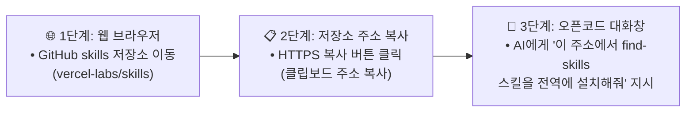

# [시니어 직장인의 AI 탐구기 #12] 스킬을 찾아주고 만들어주는 마법의 메타 스킬! 'find-skills' 설치 및 실전 활용 가이드

> **"내가 필요한 기능이 있을 때마다 인터넷을 뒤져서 스킬을 찾아야 하나요?"**  
> AI에게 "이런 기능의 스킬 찾아줘"라고 말만 하면, 전 세계 수만 개의 스킬 레지스트리를 스스로 검색해 추천하고 설치까지 알아서 척척 끝내주는 마법 같은 '스킬의 스킬'이 있습니다.

안녕하세요. 시니어 회사원의 시선에서 AI 실무 도구를 가장 쉽고 실용적으로 해설하는 블로그의 열두 번째 글입니다.

우리는 앞선 글들에서 오픈소스 탐색 스킬(`research-first`), 시각화 다이어그램 스킬(`archify`), 그리고 한글 공문서 처리 MCP(`kordoc`)까지 다양한 전문 도구를 장착해 왔습니다.

그런데 업무를 하다 보면 *"혹시 리액트 성능 개선 스킬은 없을까?"*, *"단위 테스트 코드를 자동으로 짜주는 스킬은 없을까?"*와 같이 새로운 스킬이 필요한 순간이 계속 찾아옵니다.

오늘 소개해 드릴 **`find-skills`**는 Vercel Labs가 주도하는 오픈소스 생태계의 핵심 도구로, **"AI 비서가 스스로 전 세계 스킬 앱스토어를 검색하고, 검증된 도구를 추천하며, 설치와 새로운 스킬 제작까지 대행해 주는 만능 메타 스킬(Meta-Skill)"**입니다.

이번 글에서는 깃허브 공식 저장소 링크를 이용해 오픈코드에 `find-skills`를 1분 만에 설치하고 실무에 200% 활용하는 방법을 완벽 정리해 드립니다.

---

## 1. 'find-skills'란 무엇인가요?

일반적인 스킬이 하나의 전문 분야(코딩, 문서 파싱, 다이어그램 등)를 수행한다면, **`find-skills`**는 **"다른 스킬들을 관리하는 관리자 스킬"**입니다.

글로벌 클라우드 기업인 **Vercel Labs**는 전 세계 개발자들이 만든 AI 에이전트 스킬들을 한곳에 모은 오픈 레지스트리 플랫폼인 **[skills.sh](https://skills.sh/)**와 전용 패키지 관리자 도구(`npx skills`)를 구축했습니다. `find-skills`는 오픈코드가 이 방대한 생태계와 직접 소통할 수 있도록 연결해 주는 핫라인입니다.

> ### 💡 find-skills 3대 핵심 역량
>
> 1. **스킬 탐색 (Find)**: 전 세계 랭킹 및 키워드 기반으로 내 작업에 꼭 맞는 최적 스킬 자동 검색
> 2. **품질 검증 (Verify)**: 다운로드 1,000회 이상 및 검증된 제작자의 안전한 고품질 스킬 선별
> 3. **원클릭 설치 및 제작 (Install & Create)**: 복잡한 터미널 명령 없이 대화창에서 즉시 설치하고 맞춤 스킬 자동 제작

---

## 2. 깃허브 주소 복사 → 오픈코드 안에서 10초 만에 설치하기

깃허브(GitHub) 공식 저장소 링크를 오픈코드 대화창에 알려주기만 하면, AI가 알아서 전역 스킬 폴더에 다운로드하여 장착합니다.

### 설치 전체 흐름도



---

### [1단계] 깃허브 접속 및 저장소 주소 복사하기
1. 웹 브라우저를 열고 Vercel Labs의 공식 저장소로 이동합니다:
   - 👉 **저장소 주소:** `https://github.com/vercel-labs/skills`
2. 화면 우측 상단의 녹색 **`<> Code`** 버튼을 누르고 `HTTPS` 주소를 복사합니다:
   - 복사할 URL: **`https://github.com/vercel-labs/skills.git`**

---

### [2단계] 오픈코드 대화창에 복사한 주소를 전달하고 설치 지시하기
오픈코드 하단 프롬프트 입력창(Composer)에 복사한 주소와 함께 아래 추천 프롬프트를 그대로 입력합니다:

> 💬 **초보자 추천 복사 프롬프트:**  
> *"아래 깃허브 저장소(https://github.com/vercel-labs/skills.git)에 있는 `skills/find-skills` 스킬을 내 컴퓨터 전역 스킬 폴더(`~/.config/opencode/skills/find-skills`)에 설치해줘."*

---

### [3단계] AI의 자동 설치 수행 및 완료
- 지시를 받은 오픈코드 AI는 깃허브 저장소에서 `find-skills`의 정의 파일(`SKILL.md`)을 읽어와 내 컴퓨터의 전역 스킬 경로(`~/.config/opencode/skills/find-skills/SKILL.md`)에 저장합니다.
- 설치가 완료되면 AI가 *"find-skills 스킬이 성공적으로 설치되었습니다"*라고 완료 메시지를 띄웁니다.

---

### [보너스] 터미널 환경이 편한 사용자를 위한 1줄 설치법
우측 `Terminal` 창(`Control + Option + T`)에서 Git 명령어로 직접 내려받을 수도 있습니다:

```sh
# 1. 깃허브 저장소에서 find-skills 스킬만 전역 폴더로 복제
mkdir -p ~/.config/opencode/skills/find-skills
curl -sSL https://raw.githubusercontent.com/vercel-labs/skills/main/skills/find-skills/SKILL.md -o ~/.config/opencode/skills/find-skills/SKILL.md
```

---

### [확인] 설치가 잘 되었는지 3초 만에 검증하기
1. 오픈코드 대화 입력창에 **`@`**를 입력합니다.
2. 팝업 목록에 **`@find-skills`**가 나타나면 설치가 완벽하게 성공한 것입니다!

---

## 3. 'find-skills' 핵심 명령어 및 기능 요약표

`find-skills` 스킬은 내부적으로 `npx skills` 커맨드라인 엔진을 활용하여 동작합니다.

| 작업 목적 | CLI 실행 명령어 | 역할 및 동작 설명 |
| :--- | :--- | :--- |
| **스킬 검색** | `npx skills find [키워드]` | 전 세계 skills.sh 레지스트리에서 관련 스킬 실시간 검색 |
| **스킬 원클릭 설치** | `npx skills add [저장소@스킬] -g -y` | 검증된 스킬을 내 PC 전역(-g)에 확인 없이(-y) 자동 설치 |
| **스킬 일괄 업데이트** | `npx skills update` | 내 컴퓨터에 설치된 모든 에이전트 스킬을 최신 버전으로 갱신 |
| **커스텀 스킬 제작** | `npx skills init [스킬이름]` | 나만의 독자적인 업무 규칙을 담은 새 스킬 템플릿 생성 |

---

## 4. 실전! 'find-skills' 초간단 사용 예제 3가지

`find-skills`가 설치되면 복잡한 명령어를 칠 필요 없이, 대화창에서 자연어로 원하는 능력을 찾아달라고 부탁하면 됩니다.

---

### 📌 예제 1: 필요한 스킬 자동 검색 및 추천 받기 (Search)

- **프롬프트 입력**:
  > *"@find-skills 웹 프론트엔드 개발할 때 리액트나 Next.js 성능을 최적화하고 코드 품질을 높여주는 검증된 스킬이 있는지 찾아줘."*
- **AI의 작업 결과**:
  1. AI가 `skills.sh` 랭킹 보드와 레지스트리를 즉시 탐색합니다.
  2. 다운로드 수 18만 회 이상을 기록 중인 공식 스킬 `vercel-labs/agent-skills@react-best-practices`를 찾아냅니다.
  3. 스킬의 주요 기능, 신뢰성(Vercel 공식 인증), 설치 명령어를 대화창에 친절하게 브리핑해 줍니다.

---

### 📌 예제 2: 추천받은 스킬을 내 컴퓨터에 바로 설치하기 (Install)

- **프롬프트 입력**:
  > *"방금 추천해 준 `react-best-practices` 스킬을 내 오픈코드 전역 스킬에 지금 바로 설치해줘."*
- **AI의 작업 결과**:
  - AI가 `npx skills add vercel-labs/agent-skills@react-best-practices -g -y` 명령을 백그라운드에서 실행합니다.
  - 내 컴퓨터의 `~/.config/opencode/skills/` 폴더에 해당 스킬이 즉시 내려받아지며 설치가 완료됩니다.

---

### 📌 예제 3: 우리 회사 전용 맞춤형 스킬 템플릿 만들기 (Create)

공개된 스킬 중에 마음에 드는 것이 없다면, AI에게 나만의 스킬을 만들어 달라고 지시할 수 있습니다.

- **프롬프트 입력**:
  > *"우리 회사 신입사원들을 위한 '주간 업무 보고서 작성 가이드'를 담은 새로운 스킬 `weekly-report`를 템플릿으로 만들어줘."*
- **AI의 작업 결과**:
  - 표준 YAML 메타데이터(`name`, `description`)와 보고서 작성 워크플로우가 담긴 `weekly-report/SKILL.md` 파일을 내 스킬 폴더에 자동으로 뚝딱 생성해 줍니다.

---

## 5. 안심하고 쓰는 스킬 품질 검증 3대 기준표

인터넷에 공개된 수많은 스킬 중 안전하고 우수한 스킬을 고르는 `find-skills`의 엄격한 자체 검증 기준입니다.

| 검증 항목 | 합격 기준치 | 설명 및 주의사항 |
| :--- | :---: | :--- |
| **다운로드 / 설치 수** | **1,000회 이상 권장** | 전 세계 개발자들에게 검증된 인기 스킬 우선 추천 (100회 미만 주의) |
| **제작자 신뢰도** | **공식 기관 및 기업** | `vercel-labs`, `anthropics`, `microsoft` 등 검증된 계정 우선 |
| **GitHub Stars** | **100개 이상** | 오픈소스 저장소의 인기도와 커뮤니티 활성도가 높은 프로젝트 |

---

## 6. 에필로그

스마트폰의 진정한 가치가 '앱스토어'에서 무한한 앱을 내려받는 데 있듯, 오픈코드의 진정한 힘은 **'전 세계 개발자들이 만들어 올리는 무수한 스킬들을 자유롭게 장착하는 확장성'**에 있습니다.

오늘 설치한 `find-skills`는 여러분의 오픈코드를 단순한 AI 프로그램을 넘어, **스스로 새로운 능력을 학습하고 진화하는 '살아있는 스마트 워크스테이션'**으로 탈바꿈시켜 줄 것입니다.

앞으로 업무 중 막히는 작업이 있다면 언제든 `@find-skills`를 불러보세요. 여러분이 상상하는 거의 모든 기능이 이미 스킬로 준비되어 있을 것입니다!

---
*작성일: 2026년 10월 31일*  
*태그: #오픈코드 #OpenCode #find_skills #메타스킬 #skills_sh #Vercel #스킬검색 #스킬설치 #직장인생산성 #스마트워크 #시니어AI*
