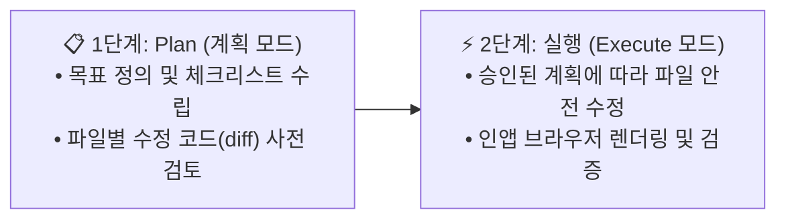

# [시니어 직장인의 AI 탐구기 #14] "말 한마디로 앱이 진화한다!" 오픈코드 Plan 모드로 만드는 로컬스토리지 칸반 보드 실전 가이드

> **핵심 요약**: AI가 코드를 마음대로 바꾸지 못하도록 변경 라인(diff)을 먼저 검토하는 Plan 모드와 인앱 브라우저 검증을 통해 무설치·무서버 로컬스토리지 칸반 보드 웹앱을 완성하는 전 과정을 다룹니다.
> **준비물**: OpenCode Desktop, 웹 브라우저 · **소요 시간**: 약 10분

AI에게 무작정 "만들어줘"라고 지시하기 전에, 변경될 코드 라인을 먼저 확인하는 **'Plan(계획) 모드'**와 실제 브라우저 화면을 눈으로 확인하는 **'인앱 브라우저 검증'**을 결합하면 비전공자도 완벽하게 제어 가능한 나만의 웹앱을 구축할 수 있습니다.

---

## 1. 일반 요청 vs Plan 모드 비교

| 구분 | 일반 요청 ("만들어줘") | Plan 모드 요청 ("계획 먼저 보여줘") |
| :--- | :--- | :--- |
| **작업 방식** | 생각하자마자 즉시 파일 생성/수정 | 바꿀 내용과 코드 라인(diff)을 선제시 |
| **오류 위험** | 기존 데이터 유실이나 엉뚱한 방향 전환 위험 | 사용자가 변경 내역을 읽고 승인해야 착수 |
| **데이터 보존** | 기존 로컬스토리지 데이터가 깨질 수 있음 | 하위 호환 마이그레이션 로직을 미리 계획해 보존 |
| **추천 대상** | 아주 단순한 오탈자 수정 | 구조가 바뀌는 기능 추가 및 리팩터링 작업 |

---

## 2. 7단계 실전 칸반 보드 진화 과정

1. **기본 골격 생성 (Todo 앱)**: `index.html`, `style.css`, `app.js` 3개 파일로 브라우저 `localStorage` 기반 등록·수정·삭제 및 실시간 탭 동기화 구현.
2. **화면 2분할 동시 표시**: 진행 중(Active)과 완료(Done) 항목을 한 화면에 2개 그룹으로 동시 렌더링하도록 레이아웃 리팩터링.
3. **3열 칸반 보드 전환 (`Working` | `Idea` | `Done`)**: CSS Grid 3열 배치 및 기존 boolean 데이터를 문자열 상태로 자동 마이그레이션.
4. **HTML5 드래그 앤 드롭(Drag & Drop)**: 외부 라이브러리 없이 표준 Drag API로 카드를 다른 열로 직관적으로 이동.
5. **열 순서 재배치**: 업무 흐름에 맞춰 `Idea` ➡️ `Working` ➡️ `Done` 순으로 마크업 및 배열 상태 재정렬.
6. **실수 방지 삭제 모달**: 카드를 삭제할 때 브라우저 `confirm()` 대화상자를 띄워 실수로 데이터가 날아가는 사고 예방.
7. **AI 인수인계 문서 `AGENTS.md` 작성**: 프로젝트 규격, 무설치 웹 표준 원칙, XSS 방지 출력 규칙, 문법 검증 명령어(`node --check app.js`) 문서화.

---

## 3. 실무자를 위한 오픈코드 협업 노하우 3가지

1. **변경 라인 선검토 프롬프트 공식**:  
   > 💬 *"OO 기능을 추가해줘. 단, plan 모드로 변경될 파일과 줄 번호(diff)를 먼저 보여주고, 내가 승인하면 실행해줘."*
2. **시각적 피드백(Screenshot) 요청**:  
   작업이 끝나면 *"브라우저로 열어서 실제 화면 스크린샷을 보여줘"*라고 지시해 텍스트 로그 대신 실제 UI 렌더링을 직접 확인합니다.
3. **`AGENTS.md`로 규칙 고정**:  
   프로젝트 루트에 `AGENTS.md`를 두면 AI가 대화를 시작할 때 프로젝트의 기술 스택, 코딩 스타일, 금지 규칙을 스스로 숙지해 엉뚱한 코드를 짜지 않습니다.

---

## 4. 완성된 프로젝트 아키텍처 요약

| 구분 | 주요 파일 | 핵심 구현 기술 | 실무적 이점 |
| :--- | :--- | :--- | :--- |
| **마크업** | `index.html` | 시맨틱 태그, 접근성 라벨 (`aria-labelledby`) | 스크린 리더 지원 및 깔끔한 문서 구조 |
| **스타일** | `style.css` | CSS Grid 3열 배치, 반응형 가로 스크롤, 다크모드 | PC/태블릿/모바일 최적 반응형 화면 |
| **스크립트** | `app.js` | HTML Drag & Drop API, `localStorage` I/O | 별도 DB·서버 없이 평생 무료 영구 보관 |
| **규칙 문서** | `AGENTS.md` | 프로젝트 규격, 데이터 모델, 검증 가이드 | 협업자 및 차기 AI 세션에 완벽한 인수인계 |

---

[← 이전 글: [#13편] 내 컴퓨터에 전용 AI 작업대 만들기! 오픈코드 새 프로젝트 생성 및 폴더 연결 완벽 가이드](오픈코드13.md) · [다음 글: [#15편] 유튜브 자막 추출 및 AI 요약 스킬 'baoyu-youtube-transcript' 설치·활용](오픈코드15.md) · [전체 연재 목차](README.md)
