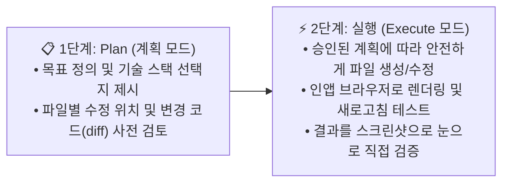

# [시니어 직장인의 AI 탐구기 #14] "말 한마디로 앱이 진화한다!" 오픈코드 Plan 모드로 만드는 로컬스토리지 칸반 보드 실전 가이드

> **"코딩을 한 줄도 몰라도 웹앱을 만들 수 있다던데, AI가 멋대로 코드를 바꿔서 망쳐놓으면 어쩌죠?"**  
> AI에게 무작정 "만들어줘"라고 지시하기 전에, 변경될 코드 라인을 먼저 확인하는 **'Plan(계획) 모드'**와 실제 브라우저 화면을 띄워 눈으로 확인하는 **'인앱 브라우저 검증'**을 결합하면 초보자도 완벽하게 제어할 수 있는 나만의 웹앱을 뚝딱 만들 수 있습니다.

안녕하세요. 시니어 회사원의 시선에서 AI 실무 도구를 가장 쉽고 실용적으로 해설하는 블로그의 열네 번째 글입니다.

지난 글(#13)에서는 내 컴퓨터에 안전한 AI 전용 작업대(프로젝트 폴더)를 만들고 오픈코드와 연결하는 법을 배웠습니다. 

작업대가 준비되었으니 이제 진짜 결과물을 만들어볼 차례입니다. 이번 글에서는 **외부 설치(npm)나 서버 구축 없이 브라우저 하나만으로 돌아가는 '오늘의 할일 칸반 보드'**를 만들어보고, 사용자의 요구에 맞춰 끊임없이 진화시키는 전 과정을 생생하게 공개합니다.

단순한 Todo 리스트로 시작해 ➡️ 한 화면 동시 표시 ➡️ 3열 칸반 보드 ➡️ 드래그 앤 드롭 ➡️ 실수 방지 삭제 모달 ➡️ AI 인수인계 문서(`AGENTS.md`) 작성까지, 실무에서 AI와 페어 프로그래밍을 할 때 필수적인 핵심 팁을 모두 담았습니다.

---

## 1. 실패 없는 AI 개발의 핵심: Plan(계획) 모드와 실행 모드

초보 직장인이 AI 코딩 도구를 사용할 때 가장 두려운 순간은 **"AI가 묻지도 않고 코드를 뒤엎어 버렸을 때"**입니다. 이를 완벽하게 통제하는 비밀 무기가 바로 **Plan 모드**입니다.



### [표] 일반 요청 vs Plan 모드 요청 차이점

| 구분 | 일반 요청 ("만들어줘") | Plan 모드 요청 ("계획 먼저 보여줘") |
| :--- | :--- | :--- |
| **작업 방식** | AI가 생각하자마자 즉시 파일 생성/수정 | 무엇을 왜 바꿀지 단계별 체크리스트와 코드 라인 선제시 |
| **오류 위험** | 기존 데이터 유실이나 엉뚱한 방향 전환 위험 | 사용자가 변경 내역을 읽어보고 승인(`"계속해"`)해야 착수 |
| **데이터 보존** | 기존 로컬스토리지 데이터가 날아갈 수 있음 | 하위 호환 마이그레이션 로직을 미리 계획하여 **데이터 100% 보존** |
| **추천 대상** | 아주 단순한 오탈자 수정 | 구조가 바뀌는 기능 추가 및 리팩터링 작업 |

---

## 2. 실전 제작기: 7단계로 완성하는 '오늘의 할일 보드'

이번 실습에서는 복잡한 빌드 도구나 무거운 npm 패키지를 일절 배제하고, **순수 웹 표준(HTML5 + CSS3 + 바닐라 JS)**만으로 구현했습니다. 더블클릭만 하면 어떤 PC에서든 즉시 실행되는 가장 가볍고 영구적인 구조입니다.

---

### [1단계] 로컬스토리지 Todo 웹앱 기본 골격 생성
- **사용자 요청**: *"로컬 스토리지를 사용하는 간단한 Todo 웹앱을 만들어줘, 진행 상황을 알게 plan 모드로 해줘."*
- **작업 내용**:
  1. `index.html`: 시맨틱 태그 기반 레이아웃(입력창, 카운터, 목록 영역).
  2. `style.css`: 라이트/다크 테마 자동 감지(`prefers-color-scheme`), 커스텀 원형 체크박스.
  3. `app.js`: 브라우저 `localStorage` 연동, 할 일 추가/수정/삭제/토글, 다른 브라우저 탭과 실시간 동기화(`storage` 이벤트).
- **결과 확인**: 오픈코드 내장 브라우저로 렌더링하여 콘솔 에러 0건 및 새로고침 후 데이터 유지 검증.

---

### [2단계] 진행 중인 작업과 완료된 작업을 한눈에! (화면 분할)
기존의 탭(전체/진행 중/완료) 방식은 탭을 번갈아 클릭해야 해서 불편했습니다.
- **사용자 요청**: *"진행 중인 작업과 완료된 작업을 한 페이지에 모두 표시해줘. plan 모드에서 변경될 코드라인을 확인하게 해줘."*
- **Plan 검토**:
  - `index.html`: 상단 필터 탭 제거 ➡️ `진행 중(Active)`과 `완료(Done)` 2개 그룹 섹션 추가.
  - `app.js`: 탭 필터링 변수 제거 ➡️ 그룹별 카운트 배지 및 동시 렌더링 로직으로 교체.
  - 깜빡임 방지: 목록 갱신 시 기존 항목까지 다시 페이드인되는 현상을 막기 위해 신규 추가 항목에만 `item--enter` 클래스를 부여하는 디테일 적용.

---

### [3단계] 3열 칸반 보드로 전면 리팩터링 (`Working` | `Idea` | `Done`)
단순 체크리스트에서 업무 흐름을 관리할 수 있는 칸반(Kanban) 보드 형태로 확장했습니다.
- **사용자 요청**: *"기존 Todo 앱을 Working, Idea, Done 3개 열을 가진 칸반 보드로 리팩터링"*
- **핵심 기술 적용**:
  - CSS Grid(`grid-template-columns: repeat(3, minmax(14rem, 1fr))`)를 활용하여 데스크탑에서는 3열 병렬 배치, 좁은 화면에서는 가로 스크롤을 지원하도록 반응형 구축.
  - **하위 호환 마이그레이션**: 기존 사용자가 쓰던 `{ completed: boolean }` 데이터를 자동으로 읽어 `completed: false`는 `working` 열로, `completed: true`는 `done` 열로 안전하게 자동 변환!

---

### [4단계] 자연스러운 드래그 앤 드롭(Drag & Drop) 도입
마우스로 카드를 쥐고 다른 열에 툭 떨어뜨리는 직관적인 UX를 추가했습니다.
- **사용자 요청**: *"전환 시 드래그 앤 드롭이 지원되도록 바꾸어줘. 곧바로 실행모드로 해줘."*
- **구현 방식**:
  - 외부 무거운 라이브러리 대신 브라우저 표준 **HTML Drag and Drop API** 사용.
  - 카드에 `draggable="true"`를 부여하고 드래그 중인 카드(`opacity: 0.45`)와 마우스가 올라간 대상 열(`is-drop-target`)에 시각적 하이라이트 효과 부여.
  - 모바일 터치 및 키보드 사용자를 배려하여 카드 내 드롭다운(`select`) 조작 방식도 함께 유지.

---

### [5단계] 업무 흐름에 맞춘 열 순서 재배치 (`Idea` ➡️ `Working` ➡️ `Done`)
아이디어가 먼저 떠오르고, 그중 작업에 착수하고, 마지막에 완료되는 자연스러운 사람의 사고 흐름에 맞췄습니다.
- **사용자 요청**: *"idea 가 Working 보다 왼쪽에 위치하도록 수정해줘"*
- **변경 사항**: HTML 열 마크업 순서 및 `app.js` 상태 배열 순서를 `["idea", "working", "done"]`으로 즉시 변경.

---

### [6단계] 실수 방지용 브라우저 삭제 확인창 (`confirm`)
카드를 정리하다가 실수로 삭제 버튼(`✕`)을 눌러 소중한 메모를 날리는 참사를 예방합니다.
- **사용자 요청**: *"항목 삭제시 실수 방지를 위한 브라우저 confirm 대화상자를 추가해줘."*
- **구현 내용**:
  ```javascript
  function removeTodo(id) {
    const todo = todos.find((item) => item.id === id);
    if (!todo) return;
    // 실수 방지를 위한 브라우저 확인창
    if (!confirm(`"${todo.text}" 항목을 삭제할까요?`)) return;
    todos = todos.filter((item) => item.id !== id);
    if (editingId === id) editingId = null;
    save();
    render();
  }
  ```

---

### [7단계] AI와 개발자를 위한 인수인계 문서 `AGENTS.md` 작성
새로운 AI 세션이 열리거나 다른 개발자가 코드를 수정할 때 기존 규칙을 깨뜨리지 않도록 프로젝트 가이드라인을 문서화했습니다.
- **문서 포함 내용**:
  - 무설치·무빌드 바닐라 웹 표준 유지 원칙
  - `localStorage` 데이터 키 및 객체 인터페이스 규격
  - XSS(보안 취약점) 방지를 위한 DOM 안전 출력 규칙
  - 문법 검증 명령어 (`node --check app.js`)

---

## 3. 완성된 오늘의 할일 보드 아키텍처

| 💡 Idea (0) | ⚙️ Working (2) | ✅ Done (1) |
| :---: | :---: | :---: |
| *(카드가 없습니다)* | **오픈코드 설명서**<br>`[Working ▼]` `[✕]` | **오픈코드 설치**<br>`[Done ▼]` `[✕]` |
| | **오후 산책 가기**<br>`[Working ▼]` `[✕]` | |

> 📌 **상태 요약**: `2개 남음` · `[Done 항목 삭제]`  
> *※ 카드를 다른 열로 드래그하거나 상태를 선택하세요 · 더블클릭 수정 · 브라우저 로컬 저장소 자동 저장*

---

## 4. 실무자를 위한 오픈코드 협업 노하우 3가지

### 팁 1: 변경 라인을 먼저 확인하는 프롬프트 공식
기존 코드가 있는 프로젝트에서 기능을 수정할 때는 반드시 아래 문장을 붙여보세요:
> 💬 *"OO 기능을 추가해줘. 단, plan 모드로 변경될 파일과 줄 번호(diff)를 먼저 보여주고, 내가 승인하면 실행해줘."*

### 팁 2: 시각적 피드백(Screenshot) 적극 활용하기
오픈코드는 웹 서버를 띄워 화면을 직접 브라우저 탭으로 열고 캡처할 수 있는 도구를 내장하고 있습니다. 작업이 끝나면 이렇게 요청하세요:
> 💬 *"브라우저로 열어서 실제 화면 스크린샷을 보여줘."*  
텍스트 로그만 보는 것보다 훨씬 직관적으로 UI 완성도를 검증할 수 있습니다.

### 팁 3: `AGENTS.md`로 AI에게 사내 개발 규칙 학습시키기
프로젝트 루트에 `AGENTS.md`를 만들어두면 오픈코드가 세션을 시작할 때 이 문서를 가장 먼저 읽습니다.
- "우리 팀은 외부 라이브러리를 쓰지 않는다."
- "모든 색상은 CSS 변수(`--accent`)를 사용한다."
- "삭제 기능에는 반드시 확인창을 띄운다."  
이러한 규칙을 적어두면 AI가 엉뚱한 코드를 짜는 일이 원천 차단됩니다.

---

## 5. 핵심 개발 내역 및 명령어 요약표

| 구분 | 주요 파일 | 핵심 구현 기술 | 실무적 이점 |
| :--- | :--- | :--- | :--- |
| **마크업** | `index.html` | 시맨틱 태그, 접근성 라벨 (`aria-labelledby`) | 스크린 리더 지원 및 깔끔한 문서 구조 |
| **디자인** | `style.css` | CSS Grid 3열 배치, 반응형 가로 스크롤, 다크모드 | PC/태블릿/모바일 어디서든 최적 화면 제공 |
| **기능** | `app.js` | HTML Drag & Drop API, `localStorage` I/O | 별도 데이터베이스 없이 평생 무료 저장 |
| **규칙 문서**| `AGENTS.md` | 프로젝트 규격, 마이그레이션 규칙, 검증 명령어 | 다른 AI 에이전트나 협업자에게 완벽한 인수인계 |
| **문법 검사**| 터미널 | `node --check app.js` | 브라우저를 켜기 전에 JS 문법 오류 사전 차단 |

---

## 6. 에필로그

프로그래밍 언어의 문법을 일일이 외우지 않아도, **"무엇을 만들고 싶은지"**와 **"어떻게 검증할 것인지"**를 명확히 제시할 수 있다면 누구나 소프트웨어의 기획자이자 제작자가 될 수 있습니다.

오늘 만든 '오늘의 할일 보드'는 서버 비용도 들지 않고, 인터넷이 끊겨도 내 컴퓨터 안에서 완벽하게 작동하는 나만의 업무 도구입니다. 여러분도 여러분의 부서나 개인 일과에 맞춘 맞춤형 칸반 보드를 오픈코드와 함께 만들어 보세요!

다음 글에서는 **"사내 인트라넷이나 엑셀 수첩 대신 쓸 수 있는 로컬 웹앱에 '엑셀 데이터 내보내기/가져오기(백업)' 기능을 추가하여 완벽한 실무 비즈니스 도구로 업그레이드하는 비법"**을 함께 알아보겠습니다.

---
*작성일: 2026년 11월 1일*  
*태그: #오픈코드 #OpenCode #웹앱만들기 #칸반보드 #Plan모드 #드래그앤드롭 #로컬스토리지 #AGENTS #바닐라JS #직장인생산성 #시니어AI*
