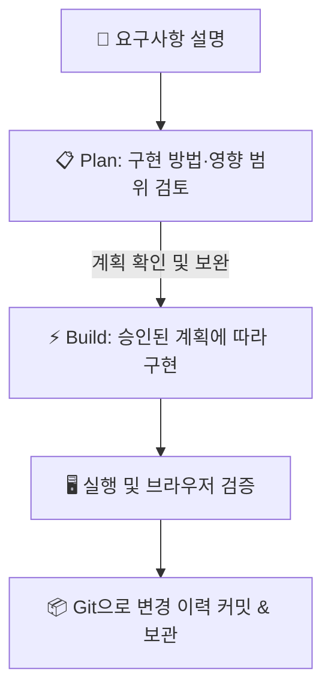

# [시니어 직장인의 AI 탐구기 #17] Plan·Build 모드와 Git으로 안전하게 앱 만들기

> **핵심 요약**: AI에게 무작정 코딩을 맡기지 않고 Plan 모드로 사전 계획을 검토한 뒤 Build 모드로 구현하며, Git으로 변경 이력을 안전하게 관리하는 작업 원칙을 정리합니다.
> **준비물**: OpenCode Desktop, Git · **소요 시간**: 약 10분

새로운 기능이나 웹앱을 제작할 때는 **계획을 먼저 검토(Plan)하고, 승인 후 구현(Build)하며, Git으로 이력을 보관**하는 3단계 안전 습관이 필수적입니다.

---

## 1. 실전 예제: 회의록을 정리해 PDF로 내보내는 앱

### Step 1. Plan 모드에서 계획 검토

대화창에 아래 프롬프트를 입력해 계획서를 먼저 요청합니다:

> 💬 **Plan 모드 프롬프트:**  
> *"회의록 텍스트나 파일을 입력하면 제목, 일시, 참석자, 안건, 결정 사항으로 구조화하고 PDF로 내려받는 앱을 만들고 싶어. 구현 방법, 파일 목록, 데이터 보안(외부 전송 여부), 테스트 계획을 먼저 제안해줘."*

- **점검 포인트**: 앱 형태(웹/데스크톱), PDF 생성 방식, 개인정보 외부 전송 여부를 확인합니다.

### Step 2. Build 모드로 안전한 구현

계획이 만족스럽다면 Build 모드로 전환하여 작업을 지시합니다:

> 💬 **Build 모드 프롬프트:**  
> *"방금 검토한 계획대로 이 실습 폴더 안에만 최소 기능으로 구현해줘. 실행 방법과 테스트 결과를 알려줘."*

- **검증**: 가짜 샘플 회의록 데이터로 앱을 실행하고 한글 PDF 출력과 레이아웃을 확인합니다.

---

## 2. Git을 활용한 프로젝트 변경 이력 관리

Git은 문제가 발생했을 때 이전 상태로 안전하게 되돌릴 수 있는 타임머신입니다.

- **저장소 초기화**:
  > *"현재 프로젝트 폴더가 Git 저장소인지 확인하고, 아니라면 기존 파일을 유지한 채 저장소로 초기화해줘."*
- **변경 사항(Diff) 검토**: 대량 변경이 발생했을 때는 *"이번 작업에서 바뀐 파일별 변경 내역(diff)을 요약해줘"*라고 지시해 원치 않는 파일 수정이 없는지 검토합니다.

---

## 3. 초보자가 피해야 할 5대 실수

| 흔한 실수 | 안전한 실무 원칙 |
| :--- | :--- |
| 계획을 읽지 않고 곧바로 구현 요청 | Plan 결과와 수정 대상 파일을 먼저 확인 |
| 실제 민감 회의록으로 첫 테스트 | 가짜·비식별 샘플로 기능과 데이터 흐름 검증 |
| 작업 폴더를 확인하지 않고 명령 실행 | 오픈코드 프로젝트와 터미널 위치를 먼저 확인 |
| Git 설치 시 모든 것이 자동 백업된다고 맹신 | 커밋 상태를 직접 확인하고 별도 외장 백업도 유지 |
| AI가 만든 산출물을 검토 없이 배포 | 원문 대조, 한글 깨짐, 페이지 잘림 직접 확인 |

---

[← 이전 글: [#16편] OpenCode 데스크톱 첫걸음: 설치부터 모델 연결, 프로젝트 만들기까지](오픈코드16.md) · [다음 글: [#18편] Skills와 MCP, 슬래시 명령어부터 AGENTS.md·GitHub까지](오픈코드18.md) · [전체 연재 목차](README.md)
