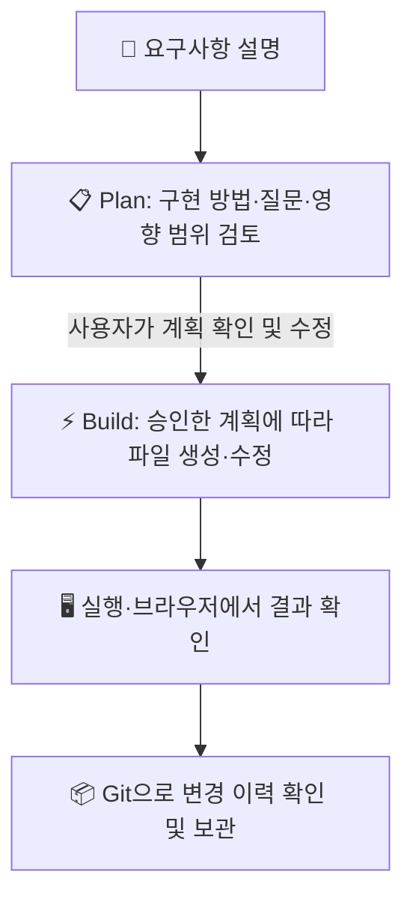

# [시니어 직장인의 AI 탐구기 #17] AI에게 바로 코딩시키지 마세요! 오픈코드 Plan·Build 모드와 Git으로 안전하게 앱 만들기

> **“AI가 앱을 만들어 준다는데, 엉뚱한 코드를 만들거나 기존 파일을 망가뜨리면 어쩌죠?”**  
> 요구사항을 먼저 계획으로 검토하고, 실습용 폴더에서 구현한 뒤, Git으로 변경 이력을 남기면 초보자도 AI의 작업을 훨씬 안전하게 따라갈 수 있습니다.

안녕하세요. 시니어 회사원의 시선에서 AI 실무 도구를 가장 쉽고 실용적으로 해설하는 블로그의 열일곱 번째 글입니다.

지난 #16편에서는 오픈코드 데스크톱 설치, 모델 제공자 연결, 프로젝트 폴더 선택을 살펴보았습니다. 이번에는 영상 튜토리얼의 핵심 실습인 **Plan 모드로 앱을 설계하고 Build 모드로 구현한 다음, Git으로 변경을 관리하는 과정**을 초보자 눈높이에서 정리합니다.

영상 속 예제는 회의록을 정리해 PDF로 내보내는 앱입니다. 세부 화면과 모델 선택은 영상의 당시 환경이므로, 여기서는 특정 모델이 꼭 필요하다고 가정하지 않고 작업 원칙에 초점을 맞춥니다.

---

## 1. Plan과 Build: 계획부터 확인하고 구현하기

오픈코드에는 작업 계획을 세우는 모드와 실제 파일을 수정하는 모드가 있습니다. 화면에 표시되는 명칭은 버전에 따라 다를 수 있지만, 초보자가 기억할 핵심은 단순합니다.



단순한 오탈자 수정이 아니라 새 기능이나 앱을 만드는 일이라면, **계획을 먼저 받고 읽어본 다음 구현을 요청하는 습관**을 들이세요. 계획에 빠진 조건이 있으면 Build를 시작하기 전에 보완하면 됩니다.

이 접근은 지난 #14편의 Plan 모드 실습과도 연결됩니다. 기존 프로젝트가 있다면 첫 실행 전에 백업하거나 Git 상태를 확인하세요.

---

## 2. 실전 예제: 회의록을 정리해 PDF로 만드는 앱

영상에서는 로컬 AI 모델을 활용해 회의록을 구조화된 PDF로 바꾸는 앱을 예제로 사용합니다. 다음 프롬프트는 같은 아이디어를 초보자가 검토하기 쉽게 구체화한 예시입니다.

> 💬 **Plan 모드에 입력할 프롬프트 예시**  
> *“현재 실습 프로젝트 폴더를 먼저 확인해줘. 회의록 텍스트를 입력하거나 파일로 올리면 제목, 날짜, 참석자, 안건, 결정 사항, 후속 조치로 정리하고 PDF로 내려받는 간단한 앱을 만들고 싶어. 가능한 구현 방법과 필요한 파일, 개인정보 처리 방식, 테스트 방법을 먼저 계획해줘. 외부 서버로 회의록을 전송하지 않는 구성이 가능한지도 설명하고, 구현 전에 내가 결정할 사항을 질문해줘.”*

### 계획에서 확인할 질문

AI가 계획을 제안하면 아래를 확인합니다.

1. **앱 형태:** 데스크톱 앱인지, 브라우저에서 실행하는 웹앱인지
2. **AI 처리 위치:** 실제로 로컬 모델을 쓸 수 있는지, 별도 모델 서버가 필요한지
3. **입력 형식:** 텍스트 붙여넣기, 파일 업로드 중 무엇을 지원하는지
4. **PDF 생성:** 어떤 라이브러리나 기능으로 PDF를 만드는지
5. **개인정보:** 회의록 내용이 외부 제공자에게 전송되는지
6. **실행 방법:** 앱을 실행하고 결과를 확인하는 방법

“로컬 모델을 사용한다”고 프롬프트에 쓴다고 해서 자동으로 로컬에서 처리되는 것은 아닙니다. 실제로 어떤 모델과 서버에 연결되는지, 데이터가 외부로 나가는지를 계획과 설정에서 확인하세요. 민감한 회의록은 검증 전 실습에 사용하지 않는 것이 안전합니다.

---

## 3. 계획에 동의한 뒤 Build로 구현하기

계획을 검토해 괜찮다면 Build 모드로 전환하고 구현을 요청합니다.

> 💬 **Build 모드 요청 예시**  
> *“방금 검토한 계획대로 이 실습 프로젝트 폴더 안에만 구현해줘. 먼저 최소 기능을 완성하고, 실행 방법과 테스트 결과를 알려줘. 회의록 내용을 외부 서비스로 보내는 설정이 필요하다면 임의로 진행하지 말고 먼저 설명해줘.”*

구현이 끝나면 파일 목록을 확인하고, AI가 안내한 실행 방법으로 앱을 엽니다. 영상에서는 입력창에 샘플 회의록을 넣고 처리 상태를 확인한 뒤 결과 PDF를 내려받아 화면을 살펴봅니다.

### 테스트는 가짜 데이터로 시작

처음에는 실제 회의록 대신 공개된 예문이나 민감 정보가 없는 테스트 문장을 사용합니다.

```text
회의명: 주간 서비스 점검
일시: 2026년 11월 3일
참석자: 김 담당, 박 담당
안건: 오류 알림 개선
결정 사항: 알림 문구를 다음 주까지 수정한다.
후속 조치: 박 담당이 수정안을 공유한다.
```

확인할 항목은 다음과 같습니다.

- 제목·날짜·참석자·결정 사항이 원문과 일치하는가?
- PDF가 정상적으로 열리고 한글이 깨지지 않는가?
- 입력 파일이 임의로 다른 위치에 전송되거나 저장되지 않는가?
- 앱을 다시 실행해도 안내한 방식대로 동작하는가?

AI가 앱을 만들었다는 사실과 앱이 정확하고 안전하다는 것은 별개입니다. 결과 PDF의 내용과 실제 데이터 흐름을 반드시 직접 확인하세요.

---

## 4. Git은 프로젝트의 체크포인트

영상에서는 Git을 프로젝트의 변경 이력을 기록하는 도구로 소개합니다. 문제가 생겼을 때 이전 상태와 비교하거나 복구할 수 있도록, 작업 초기에 Git 저장소를 준비하는 것이 좋습니다.

### 설치 및 저장소 초기화

Git이 설치되어 있지 않다면 운영체제에 맞게 설치합니다. 설치가 끝나면 오픈코드에 프로젝트 폴더에서 Git 저장소를 초기화해 달라고 요청할 수 있습니다.

> 💬 **초보자 프롬프트 예시**  
> *“현재 프로젝트 폴더에서 Git이 설치되어 있는지 확인하고, 아직 저장소가 아니라면 Git 저장소로 초기화해줘. 기존 파일을 삭제하거나 덮어쓰지 말고, 현재 상태를 먼저 설명해줘.”*

터미널 사용에 익숙한 경우 프로젝트 폴더에서 `git status`로 상태를 확인하고, `git init`으로 초기화할 수 있습니다. Git 명령을 실행하기 전에는 터미널이 **올바른 프로젝트 폴더에 있는지** 확인하세요.

### 변경 사항 살펴보기

오픈코드의 파일 목록이나 Git 변경 사항 화면에서 AI가 수정한 파일과 변경 내용을 살펴봅니다. 이해하지 못하는 대량 변경이 있으면 바로 승인하지 말고 다음처럼 질문하세요.

> *“이번 작업에서 바뀐 파일별로 무엇이 달라졌는지 설명하고, 회의록 원문이나 비밀 키가 포함되어 있지 않은지도 확인해줘.”*

Git은 백업과 같지만 완전한 백업 그 자체는 아닙니다. 저장소 밖의 데이터나 커밋하지 않은 변경까지 자동으로 보호해 주지 않으므로 중요한 프로젝트는 별도 백업도 유지하세요.

---

## 5. 초보자가 피해야 할 실수

| 흔한 실수 | 더 안전한 방법 |
| :--- | :--- |
| 계획을 읽지 않고 곧바로 구현 요청 | Plan 결과와 수정 대상 파일을 먼저 확인 |
| 실제 민감 회의록으로 첫 테스트 | 가짜·비식별 샘플로 기능과 데이터 흐름 검증 |
| 작업 폴더를 확인하지 않고 명령 실행 | 오픈코드 프로젝트와 터미널 위치를 먼저 확인 |
| Git을 설치하면 모든 것이 자동 백업된다고 생각 | 변경 상태를 직접 확인하고 별도 백업도 유지 |
| AI가 만든 PDF를 검토 없이 배포 | 원문 대조, 한글 표시, 페이지 잘림을 확인 |

---

## 6. 다음 편 예고: 스킬·MCP·프로젝트 규칙·GitHub

이번 편에서는 Plan과 Build의 차이를 이해하고, 간단한 앱을 테스트하며, Git으로 변경 이력을 관리하는 흐름을 정리했습니다. 다음 **#18편**에서는 스킬과 MCP 서버의 차이, `AGENTS.md` 프로젝트 규칙 작성, GitHub 원격 저장소 연결을 다룹니다.

관련 글: **#13편 프로젝트 작업대**, **#14편 Plan 모드와 칸반 보드**, **#15편 유튜브 자막 추출 스킬**, **#16편 오픈코드 설치와 첫 프로젝트**.

---
*작성일: 2026년 11월 05일*  
*태그: #오픈코드 #OpenCode #Plan모드 #Build모드 #Git #AI코딩 #초보자가이드 #시니어AI*
