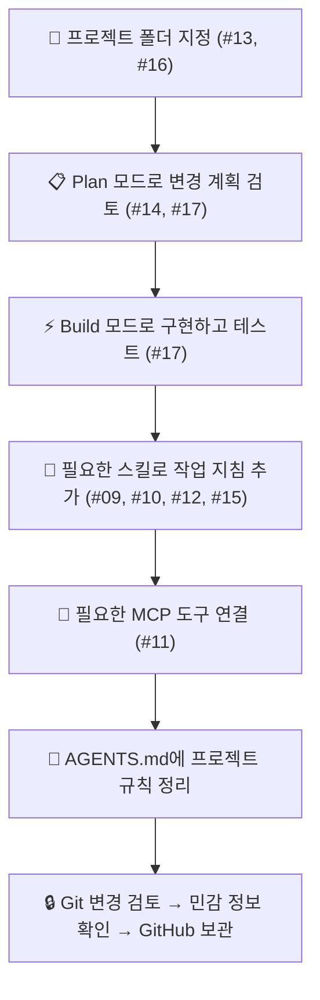

# [시니어 직장인의 AI 탐구기 #18] 스킬과 MCP는 뭐가 다를까? 오픈코드 확장 기능부터 AGENTS.md·GitHub까지

> **“스킬도 있고 MCP도 있다는데, 둘 다 AI 기능을 늘리는 것 아닌가요?”**  
> 스킬은 일을 수행하는 방법을 알려주는 설명서에 가깝고, MCP는 AI가 실제 작업에 사용할 수 있는 도구를 연결합니다. 둘의 차이를 익히고 프로젝트 규칙과 GitHub 저장소까지 준비하면, 오픈코드 초보자도 더 체계적인 작업 환경을 만들 수 있습니다.

안녕하세요. 시니어 회사원의 시선에서 AI 실무 도구를 가장 쉽고 실용적으로 해설하는 블로그의 열여덟 번째 글입니다.

지난 #16편에서는 오픈코드 설치와 프로젝트 연결을, #17편에서는 Plan 모드로 앱을 설계하고 Git으로 변경을 관리하는 방법을 다루었습니다. 이번에는 참고 영상의 나머지 내용인 **슬래시 명령어, 스킬, MCP 서버, `AGENTS.md`, GitHub 연결**을 정리합니다.

---

## 1. 슬래시 명령어로 기본 기능 살펴보기

오픈코드 대화창에 `/`를 입력하면 현재 사용 가능한 슬래시 명령어 목록을 볼 수 있습니다. 영상에서는 긴 대화의 컨텍스트를 줄이는 **`/compact`**를 직접 소개합니다. 대화가 길어지면 현재 세션을 요약·압축해 이후 작업에 필요한 내용을 간결하게 유지하는 기능입니다.

### 영상에서 소개한 `/compact` 따라 하기

1. 프로젝트 작업 중 대화가 길어졌다면 입력창에 `/`를 입력합니다.
2. 명령 목록에서 **`/compact`**를 선택하거나 명령어를 입력합니다. 현재 공식 TUI 문서에는 같은 기능의 별칭으로 **`/summarize`**도 안내되어 있습니다.
3. 압축이 끝난 뒤 목표, 결정된 사항, 남은 작업이 대화에 유지되었는지 확인합니다.
4. 중요한 결정이나 명령이 빠졌다면 다음 요청 전에 다시 알려주거나 프로젝트의 `AGENTS.md`에 지속적으로 필요한 규칙을 기록합니다.

영상에서는 모델 정보와 컨텍스트 사용량을 확인한 뒤 압축 전후의 사용량을 비교하는 장면도 나옵니다. 사용량 표시 위치는 버전에 따라 다를 수 있고, 압축 후 수치가 얼마나 줄어드는지도 대화와 모델에 따라 달라집니다.

### 함께 알아두면 유용한 기본 명령

| 명령 | 용도 | 초보자 참고 |
| :--- | :--- | :--- |
| `/help` | 도움말 표시 | 명령을 잊었을 때 확인 |
| `/models` | 사용 가능한 모델 목록 | 모델 선택 및 변경 |
| `/connect` | 모델 제공자 연결 | 인증 정보 입력 전 제공자와 비용 확인 |
| `/init` | 프로젝트 안내 파일 초기화/작성 지원 | 생성 결과를 검토하고 `AGENTS.md`에 반영 |
| `/undo` | 직전 대화 응답과 그에 따른 파일 변경 되돌리기 | 되돌릴 내용부터 확인. 현재 공식 문서상 Git 저장소가 필요 |
| `/redo` | `/undo`로 되돌린 작업 다시 적용 | 현재 공식 문서상 Git 저장소가 필요 |
| `/new` | 새 세션 시작 | 현재 프로젝트 폴더 자체를 바꾸는 명령은 아님 |

명령은 OpenCode 버전이나 Desktop/TUI 사용 환경에 따라 차이가 있을 수 있습니다. **가장 확실한 방법은 현재 앱에서 `/`를 눌러 목록을 확인하는 것**입니다. `/undo`와 `/redo`는 프로젝트 파일을 바꿀 수 있으므로, 중요한 작업 전에는 Git 상태와 변경 사항을 확인하세요.

> 💬 **초보자 프롬프트 예시**  
> *“현재 대화에서 프로젝트 목표, 결정된 기술 사항, 수정한 파일, 아직 남은 작업을 먼저 요약해줘. 중요한 내용이 빠지지 않았는지 확인한 다음 /compact를 실행해도 되는지 알려줘.”*

---

## 2. 스킬이란? AI에게 ‘일하는 방법’을 알려주는 가이드

스킬(Skill)은 특정 목표를 수행할 때 따라야 할 **단계별 지침과 작업 기준**입니다. 예를 들어 웹 화면을 설계하는 스킬은 디자인 원칙과 점검 절차를 알려줍니다.

영상에서는 `skills.sh`에서 UI 디자인 관련 스킬을 찾고, 설치한 다음 에이전트에게 기존 UI를 개선하도록 요청합니다. 설치 방식은 스킬과 오픈코드 버전에 따라 달라질 수 있으므로, 레지스트리의 실제 설치 명령과 프로젝트/전역 설치 범위를 확인하세요.

스킬 검색 및 설치의 자세한 흐름은 이미 작성한 블로그와 연결됩니다.

- **#09편:** `research-first`로 작업 전 기존 도구와 라이브러리 조사
- **#10편:** 인터랙티브 다이어그램 스킬 `archify`
- **#12편:** 스킬을 찾고 관리하는 `find-skills`
- **#15편:** 유튜브 자막 추출 스킬 `baoyu-youtube-transcript`

### 스킬을 적용하는 프롬프트 예시

> *“설치된 UI 디자인 스킬을 읽고, 현재 화면에서 개선할 점을 먼저 간단히 설명해줘. 기존 기능과 데이터는 유지하면서 시각적 스타일만 개선할 수 있도록 계획을 제안해줘.”*

스킬 파일은 AI가 따를 지침이므로 설치 전에 출처와 내용을 확인합니다. 특히 파일에 포함된 명령이나 외부 스크립트 실행 지시는 무조건 신뢰하지 말고, 무엇을 하는지 먼저 살펴보세요.

---

## 3. MCP 서버란? AI가 사용할 수 있는 외부 도구 연결

MCP(Model Context Protocol)는 AI 에이전트가 외부 도구나 서비스와 상호작용할 수 있도록 연결하는 방식입니다. 영상에서는 문서 생성 기능을 제공하는 MCP 서버를 예로 들어, 프로젝트 문서를 Word와 PDF로 만드는 흐름을 보여줍니다.

영상의 설명에 따르면 설정은 `opencode.json` 파일에 추가할 수 있지만, **설정 키와 파일 위치·형식은 현재 오픈코드 버전 및 MCP 서버마다 다를 수 있습니다.** 따라서 영상의 예시를 그대로 복사하기보다 해당 서버의 공식 문서와 현재 오픈코드 문서를 기준으로 설정하세요.

### MCP를 연결할 때 확인할 사항

1. 서버 제작자와 저장소가 신뢰할 만한지
2. 서버가 접근하는 파일·네트워크·계정 권한이 무엇인지
3. API 키나 인증 정보가 어디에 저장되는지
4. 설정 파일을 수정한 뒤 재시작 또는 새로고침이 필요한지
5. 서버가 실제로 연결되었는지 상태 화면이나 로그에서 확인했는지

> 💬 **안전한 설정 요청 예시**  
> *“이 MCP 서버의 공식 설정 문서를 먼저 읽고, 필요한 권한과 데이터 접근 범위를 요약해줘. 비밀 키를 파일에 직접 적지 말고, 현재 프로젝트의 설정을 덮어쓰기 전에 변경 계획을 보여줘.”*

이 폴더의 **#11편 `kordoc` MCP 설치 가이드**가 MCP를 실제로 활용하는 관련 사례입니다. 도구의 기능, 실행 조건, 입력 문서의 민감도를 확인한 후 연결하세요.

### 스킬과 MCP의 차이

| 구분 | 스킬(Skill) | MCP 서버 |
| :--- | :--- | :--- |
| **비유** | 일을 잘하는 방법이 적힌 설명서 | 일을 수행하는 데 쓰는 도구·연결 통로 |
| **주요 역할** | 목표와 절차, 지침 제공 | 파일·서비스·기능 등 외부 도구 접근 제공 |
| **예시** | 자막을 추출하고 요약하는 절차 안내 | 문서 생성, 데이터 조회 등 실제 기능 호출 |
| **주의점** | 지침과 스크립트의 출처 및 내용을 확인 | 권한, 인증 정보, 네트워크 접근 범위 확인 |

간단히 말해 **스킬은 ‘어떻게 할지’를 알려주고, MCP는 ‘무엇을 사용할 수 있는지’를 늘려줍니다.** 한 작업에서 둘이 함께 사용될 수도 있습니다.

---

## 4. `AGENTS.md`: 프로젝트의 인수인계 메모

프로젝트 루트의 `AGENTS.md`는 AI 에이전트에게 프로젝트 구조와 작업 규칙을 알려주는 안내 문서로 활용할 수 있습니다. 영상에서는 초기화 명령을 이용해 기본 파일을 만든 뒤, 프로젝트 실행 방법이나 MCP 설정 같은 규칙을 기록합니다.

영상 자막에는 파일명이 `AGENDS.md`, `agent.md`처럼 다르게 인식된 부분이 있습니다. 실제 파일명과 적용 규칙은 현재 오픈코드 공식 문서를 확인하세요. 이 블로그에서는 프로젝트 안내 파일을 **`AGENTS.md`**라고 표기합니다.

### 초보자용 `AGENTS.md`에 넣을 내용

```markdown
# 프로젝트 안내

## 프로젝트 목적
- 이 프로젝트가 해결하려는 문제를 한두 문장으로 설명

## 실행 및 테스트
- 앱 실행 방법
- 테스트 또는 문법 검사 명령

## 작업 규칙
- 기존 기능과 사용자 데이터를 임의로 삭제하지 않기
- 의존성을 추가하기 전에 이유를 설명하기
- 개인정보나 비밀 키를 코드·로그에 기록하지 않기
- 큰 구조 변경은 먼저 계획을 제시하기
```

규칙을 너무 많이 넣으면 중요한 내용이 묻힐 수 있으므로, 실제 작업에 필요한 핵심 사항만 적고 오래된 지침은 주기적으로 정리합니다. 생성된 파일은 AI가 만든 초안을 그대로 신뢰하지 말고 직접 읽어보세요.

---

## 5. GitHub에 프로젝트를 연결하기

Git은 로컬 프로젝트의 변경 이력을 관리하고, GitHub는 저장소를 원격에 보관하고 공유하는 서비스입니다. 영상에서는 GitHub CLI를 준비하고 계정 인증을 거친 뒤 프로젝트를 원격 저장소에 게시합니다.

### 연결 전 준비

- Git이 설치되어 있고 프로젝트가 Git 저장소인지 확인
- GitHub 계정 준비
- GitHub CLI(`gh`)가 필요한 흐름이라면 공식 설치 안내에 따라 설치
- 저장소에 올리면 안 되는 파일(비밀 키, 개인 문서, 큰 임시 파일)이 없는지 검토

### 오픈코드에 요청할 수 있는 예시

> 💬 *“현재 프로젝트의 Git 상태와 공개될 파일 목록을 먼저 확인해줘. API 키, 개인정보, 로컬 설정 파일이 포함되어 있지 않은지 점검한 뒤, GitHub 연결과 새 저장소 생성 절차를 제안해줘. 외부 공개 여부를 확인하기 전에는 업로드하지 마.”*

인증 과정에서 브라우저 로그인이나 코드 입력이 나타날 수 있습니다. 화면의 주소가 공식 GitHub 도메인인지 확인하고, 인증 코드를 다른 사람과 공유하지 마세요. 원격 저장소가 **Public(공개)**인지 **Private(비공개)**인지도 게시 전에 확인합니다.

GitHub는 강력한 원격 보관 수단이지만 민감 정보를 올려도 된다는 뜻은 아닙니다. 이미 비밀 키를 커밋했다면 단순히 파일을 지우는 것만으로 충분하지 않을 수 있으므로 키를 폐기·교체하고 저장소 이력을 점검해야 합니다.

---

## 6. 이 영상에서 배운 오픈코드 초보자 작업 흐름



오픈코드를 잘 쓰는 비결은 기능을 한꺼번에 모두 켜는 것이 아닙니다. **작업 범위를 정하고, 계획을 확인하고, 필요한 확장만 추가하고, 결과와 변경 사항을 검증하는 것**이 초보자에게 가장 중요한 습관입니다.

---

## 7. 참고 자료 및 연재 목차

- **원본 영상:** [Learn 80% of OpenCode Desktop in 20 Minutes! | Full Beginner Tutorial](https://youtu.be/npjJyQnLM6U)
- **영상 채널:** Thanh-y David Nguyen
- **자막:** 한국어 자동 생성 자막을 참고해 재구성했습니다. 자동 자막의 제품명·명령 이름은 오인식될 수 있으므로 실제 설정 전 공식 문서로 확인하세요.
- **이 연재:** #16 설치·모델·프로젝트 → #17 Plan·Build·Git → #18 스킬·MCP·규칙·GitHub

---
*작성일: 2026년 11월 05일*  
*태그: #오픈코드 #OpenCode #Skills #MCP #AGENTSmd #GitHub #초보자가이드 #AI코딩 #시니어AI*
