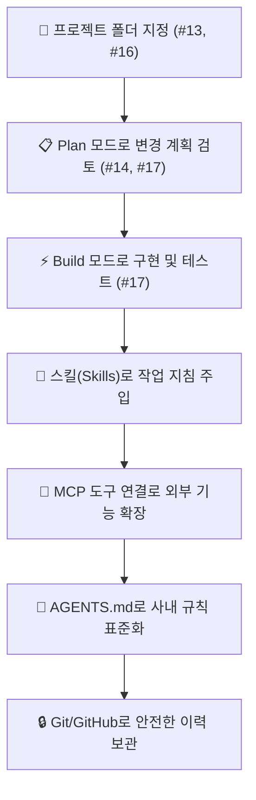

# [시니어 직장인의 AI 탐구기 #18] Skills와 MCP, 슬래시 명령어부터 AGENTS.md·GitHub까지

> **핵심 요약**: 오픈코드의 핵심 확장 기능인 스킬(Skills)과 외부 도구 연동 프로토콜(MCP)의 명확한 차이점을 익히고, 슬래시 명령어(`/compact`), 프로젝트 규칙(`AGENTS.md`), GitHub 연동까지 실무 작업 환경을 완성합니다.
> **준비물**: OpenCode Desktop, Git/GitHub · **소요 시간**: 약 10분

스킬(Skill)은 일을 수행하는 방법을 알려주는 설명서이고, MCP는 실제 작업에 사용하는 외부 도구를 연결하는 통로입니다. 둘의 차이를 이해하고 프로젝트 규칙을 세워보겠습니다.

---

## 1. 슬래시 명령어와 컨텍스트 압축 (`/compact`)

대화창에 `/`를 입력하면 유용한 슬래시 명령어 목록을 확인할 수 있습니다:

- **`/compact` (또는 `/summarize`)**: 대화가 길어져 토큰 소비가 커질 때 현재 세션을 요약·압축해 작업에 꼭 필요한 내용만 남깁니다.
- **주요 기본 명령**:
  - `/help`: 도움말 표시
  - `/models`: 사용 가능한 모델 목록 및 즉시 전환
  - `/connect`: AI 제공자 간편 인증 호출
  - `/undo` / `/redo`: 직전 코드 변경 되돌리기 및 재적용 (Git 필요)

---

## 2. 스킬(Skill) vs MCP 서버 차이점

| 구분 | 스킬 (Skill) | MCP 서버 (Model Context Protocol) |
| :--- | :--- | :--- |
| **비유** | 일하는 방법과 절차가 적힌 **업무 매뉴얼** | 실제 작업을 수행하는 **전문 공구·도구함** |
| **역할** | 작업 지침, 디자인 원칙, 점검 절차 제공 | 파일 변환, DB 조회, 외부 API 등 도구 호출 제공 |
| **대표 예시** | `research-first`([#09편](오픈코드09.md)), `archify`([#10편](오픈코드10.md)) | `kordoc`([#11편](오픈코드11.md)), MarkItDown([#19편](오픈코드19.md)) |
| **주의점** | 지침과 프롬프트 스크립트 출처 확인 | 접근 권한, 토큰 소비, 데이터 외부 유출 여부 점검 |

> 💡 **한 줄 정리**: **스킬은 '어떻게 할지(How)'**를 가르쳐주고, **MCP는 '무엇을 쓸 수 있는지(What)'**를 확장해 줍니다.

---

## 3. `AGENTS.md`: 프로젝트 인수인계 규칙서

프로젝트 루트 폴더에 `AGENTS.md`를 작성해 두면 AI가 세션을 시작할 때 이 문서를 가장 먼저 읽고 프로젝트 규칙을 스스로 준수합니다:

```markdown
# 프로젝트 개발 지침

## 프로젝트 개요
- 해결하려는 문제와 목표를 1~2문장으로 기술

## 실행 및 검증
- 개발 서버 실행 방법 및 문법 검사 명령

## AI 작업 원칙
- 기존 기능과 사용자 데이터를 임의로 삭제하지 않는다.
- 큰 구조 변경은 반드시 Plan 모드에서 diff를 먼저 제시한다.
- 개인정보나 API 비밀 키를 코드·로그에 남기지 않는다.
```

---

## 4. GitHub 저장소 연동 시 안전 수칙

1. **사전 검토**: 커밋 전 `.env`, 비밀 키, 개인 정보, 대용량 임시 파일이 포함되어 있지 않은지 확인합니다.
2. **저장소 공개 범위 확인**: 원격 저장소를 생성할 때 **Public(공개)**과 **Private(비공개)** 여부를 철저히 확인합니다.
3. **오픈코드 요청 예시**:
   > *"현재 Git 상태와 커밋 대상 파일 목록을 점검해줘. 비밀 키나 불필요한 설정 파일이 없는지 확인한 뒤 GitHub 원격 저장소 연결 절차를 안내해줘."*

---

## 5. 오픈코드 초보자 표준 작업 흐름도



---

[← 이전 글: [#17편] Plan·Build 모드와 Git으로 안전하게 앱 만들기](오픈코드17.md) · [다음 글: [#19편] uv로 완성하는 PDF·오피스 문서 처리! Microsoft MarkItDown 설치부터 OpenCode MCP 연동 & 토큰 절약 노하우](오픈코드19.md) · [전체 연재 목차](README.md)
