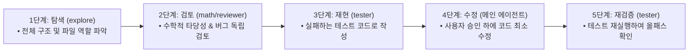

```mermaid
flowchart LR
    S1["1단계: 탐색 (explore)<br>• 전체 구조 및 파일 역할 파악"] --> S2["2단계: 검토 (math/reviewer)<br>• 수학적 타당성 & 버그 독립 검토"]
    S2 --> S3["3단계: 재현 (tester)<br>• 실패하는 테스트 코드로 작성"]
    S3 --> S4["4단계: 수정 (메인 에이전트)<br>• 사용자 승인 하에 코드 최소 수정"]
    S4 --> S5["5단계: 재검증 (tester)<br>• 테스트 재실행하여 올패스 확인"]
```# [시니어 직장인의 AI 탐구기 #20] 혼자 일하는 AI에서 전문가 팀으로: 오픈코드 데스크톱 서브에이전트(Subagents) 실전 구축 가이드

> **"프로젝트가 커질수록 할 일이 산더미인데, AI 한 명에게 모든 걸 다 시켜도 될까요? 탐색, 수학 검토, 코드 리뷰, 테스트 작성을 전담하는 나만의 AI 전문가 팀을 만들어보세요!"**  
> OpenCode Desktop V2 기준 · 2026년 11월 공식 문서 반영  
> 단순 질의응답을 넘어 역할을 분담하는 서브에이전트(Subagent)의 핵심 개념을 익히고, 기본 제공 `explore`부터 나만의 전문 에이전트(`math-researcher`, `reviewer`, `tester`)를 등록·운영하는 실전 협업 흐름을 안내합니다.

안녕하세요. 시니어 회사원의 시선에서 AI 실무 도구를 가장 쉽고 실용적으로 해설하는 블로그의 스무 번째 글입니다.

오픈코드를 처음 켜고 *"이 프로젝트 구조 좀 설명해줘"*라고 물어보면 AI는 프로젝트 파일을 훑어보고 친절하게 답해줍니다. 하지만 프로젝트가 조금만 복잡해져도 우리가 AI에게 맡겨야 할 일은 기하급수적으로 늘어납니다. 수학 공식이 맞는지 검산도 해야 하고, 코드 속에 숨은 잠재 버그도 찾아야 하며, 안전한 동작을 보장하는 테스트 코드까지 작성해야 합니다.

이 모든 작업을 하나의 대화창에서 AI 한 명에게 전부 떠맡기면 어떻게 될까요? 대화 문맥(Context)이 금세 지저분해지고, 집중력이 흐려져 계산 오류나 코드 환각(Hallucination)이 발생하기 십상입니다.

이 문제를 명쾌하게 해결해 주는 오픈코드의 핵심 기능이 바로 **서브에이전트(Subagents)**입니다. 이번 글에서는 실제로 구현한 파이썬 계산기 프로젝트를 예제로 삼아, 데스크톱 앱에서 기본 탐색 에이전트를 활용하고 나만의 'AI 전문가 팀'을 등록해 일사불란하게 일시키는 실전 노하우를 초보자 눈높이에서 알기 쉽게 정리해 드립니다.

---

## 1. 서브에이전트란? 메인 AI가 일을 맡기는 전문 보조 AI

회사 조직이나 식당을 떠올려보세요. 지배인 혼자 주문받고, 요리하고, 설거지하고, 정산까지 다 하려고 하면 가게는 금방 마비됩니다. 현명한 지배인은 주문과 전체 조율만 담당하고, 조리는 주방장에게, 위생 검수는 검수원에게 역할을 나눕니다.

오픈코드의 서브에이전트 구조도 이와 완전히 같습니다.

```mermaid
flowchart TD
    User["👤 사용자 (User)"] -->|"요청 전달 & 최종 결과 수신"| Main["🤖 메인 에이전트 (Primary Agent: build / plan)<br>• 전체 대화 조율, 업무 분배, 서브에이전트 결과 취합"]
    Main -->|"작업 위임"| Sub1["🔍 explore<br>(구조 탐색)"]
    Main -->|"검증 위임"| Sub2["📐 math<br>(수학 검증)"]
    Main -->|"리뷰 위임"| Sub3["📝 reviewer<br>(코드 리뷰)"]
    Main -->|"테스트 위임"| Sub4["🧪 tester<br>(테스트 전담)"]
```

서브에이전트를 이해할 때 꼭 기억해야 할 **3가지 핵심 원칙**이 있습니다:

1. **역할과 권한을 명확히 나눕니다**: "파일 수정 없이 수학 검산만", "코드는 절대 건드리지 말고 리뷰만"처럼 작업 범위를 안전하게 한정합니다.
2. **독립된 별도 작업 문맥(Isolated Context)에서 일합니다**: 서브에이전트는 메인 대화창의 긴 잡담이나 이전 작업 히스토리를 전부 알고 시작하지 않습니다. 오직 자신에게 할당된 작업과 필요한 파일만을 읽으므로 **토큰 비용이 대폭 절감되고 작업 정확도가 비약적으로 올라갑니다.**
3. **결과는 메인 에이전트에게 모입니다**: 각 전문가가 조사·검토한 알짜배기 결과만 메인 에이전트가 전달받아 사용자에게 깔끔하게 정리해 줍니다.

> 💡 **서브에이전트는 새로운 AI 모델을 만드는 것인가요?**  
> 아닙니다! 새 AI를 학습시키는 것이 아니라, **"이름 + 전문 프롬프트 지침 + 도구 사용 권한"을 묶은 맞춤형 작업 프로필**을 등록하는 것입니다. 같은 Gemini나 Claude, ChatGPT 모델이라도 역할 지침에 따라 완전히 다른 전문가로 변신합니다.

### [표] 일반 질문 방식 vs 서브에이전트 위임 방식

| 구분 | 일반 질문 (단일 대화) | 서브에이전트 위임 (Subagent) |
| :--- | :--- | :--- |
| **요청 예시** | "이 프로젝트 코드 설명하고 버그 찾아줘." | "explore 서브에이전트로 구조를 조사하고, reviewer로 버그를 찾아줘." |
| **작업 주체** | 메인 에이전트 혼자 처리 | 각각의 독립된 전문 보조 AI에게 위임 |
| **컨텍스트 오염** | 대화가 길어질수록 이전 기억과 뒤섞임 | 각 하위 작업이 독립 세션으로 깔끔하게 분리 |
| **안전성(권한)** | 메인 에이전트의 전체 파일 수정 위험 존재 | 서브에이전트별로 파일 수정/셸 실행을 원천 차단 가능 |
| **적합한 상황** | 단순한 한두 줄 질의응답 | 심층 코드 탐색, 수학 검증, 보안 리뷰, 테스트 작성 등 |

---

## 2. [사전 준비] 데스크톱 앱에서 실습 프로젝트 열기

실습을 위해 오픈코드 데스크톱 앱을 열고 작업 디렉토리를 연결해 보겠습니다.

1. **데스크톱 앱 실행**: 오픈코드 데스크톱을 켜고 모델 연결(`/connect` 등)이 잘 되어 있는지 확인합니다.
2. **프로젝트 폴더 열기**: 상단 메뉴 또는 좌측 프로젝트 열기 아이콘을 통해 작업할 폴더를 선택합니다.
3. **초기 구조 확인 프롬프트**: 대화창에 아래 문장을 입력하여 안전하게 프로젝트를 확인합니다.

```text
지금 열려 있는 작업 폴더의 경로와 프로젝트 구조를 보여줘.
아직 파일을 생성하거나 수정하지 마.
```

### 이번 실습에 사용된 예제 프로젝트 (`simple-calc`)

실제 실습에서는 파이썬 표준 라이브러리(`ast`)를 기반으로 수식을 문법 트리로 분석해 사칙연산과 함수를 계산하는 터미널 계산기 프로젝트를 사용했습니다.

```text
simple-calc/
└── calc.py
```

> 📌 **실습용 파일이 없어도 괜찮습니다!**  
> 빈 폴더를 열고 오픈코드에게 *"서브에이전트 실습용으로 사칙연산과 거듭제곱을 지원하는 간단한 파이썬 계산기 calc.py를 하나 만들어줘"*라고 요청하면 즉시 실습 환경을 갖출 수 있습니다.

---

## 3. 기본 제공 `explore`로 프로젝트 구조 & 문제점 조사하기

서브에이전트를 쓰기 위해 처음부터 복잡한 설정 파일을 만들 필요는 없습니다. 오픈코드에는 프로젝트 탐색을 전담하는 **`explore` 서브에이전트가 기본 내장**되어 있기 때문입니다.

데스크톱 대화창에 다음과 같이 입력해 보세요.

```text
explore 서브에이전트를 사용해서 현재 프로젝트를 조사해줘.

1. 파일과 폴더 구조
2. 주요 파일의 역할
3. 버그가 의심되는 부분
4. 지금 규모에 맞는 개선 우선순위

파일은 수정하지 말고, 판단 근거가 되는 파일명과 줄 번호를 적어줘.
```

또는 데스크톱 버전에 따라 `@` 멘션을 지원한다면 다음과 같이 호출할 수도 있습니다:

```text
@explore 현재 프로젝트 구조를 조사하고, 개선 우선순위를 정리해줘.
```

### 🔍 서브에이전트가 실제로 실행되었는지 확인하는 법

답변이 출력될 때, 화면의 도구 실행 표시나 하위 작업 창에 **`subagent (explore)`** 로그가 찍히는지 확인해 보세요. 단순히 메인 AI가 아는 척하며 직접 답하는 것과, 하위 서브에이전트에게 전권을 위임해 조사시킨 뒤 결과를 받는 것은 완전히 다릅니다.

만약 의심스럽다면 메인 AI에게 다음과 같이 확인을 요청하세요:

```text
방금 실제로 explore 서브에이전트에 위임했는지 알려줘.
위임하지 않았다면 해당 서브에이전트를 사용해 다시 조사해줘.
```

### 실전 탐색의 가치: 숨은 연산자 우선순위 버그 발견

실습 중 계산기에 `^` 기호로 거듭제곱을 지원하도록 수정했을 때, `explore` 서브에이전트는 아주 예리한 잠재 버그를 찾아냈습니다.

```text
사용자 입력: 2 + 3 ^ 2
기대하는 계산: 2 + (3의 제곱) = 11
실제 프로그램 계산: (2 + 3)의 제곱 = 25  <-- 파이썬 AST가 ^를 비트 XOR로 먼저 묶어버림!
```

이처럼 사람이 무심코 지나치기 쉬운 문법적 맹점을, **파일을 수정하지 않고 꼼꼼히 읽기만 하는 전문 탐색 에이전트**가 사전에 짚어내는 것이 서브에이전트의 진정한 강점입니다.

---

## 4. 나만의 서브에이전트 등록하기: `.opencode/agents/` 구성법

기본 `explore`를 써봤다면, 이제 우리 회사와 내 프로젝트에 특화된 전담 에이전트를 직접 만들어볼 차례입니다.

가장 쉬운 방법은 **설정 파일 작성을 오픈코드에게 직접 요청하는 것**입니다.

```text
현재 프로젝트에 OpenCode V2용 math-researcher 서브에이전트를 등록해줘.

- 역할: 수학 라이브러리 조사
- 지침: SymPy 관련 기능만 조사한다.
- 모드: subagent
- 권한: 프로젝트 파일 수정과 셸 실행은 금지한다.
- 모델: 따로 고정하지 않는다.

기존 .opencode/agents 설정을 먼저 확인하고, 기존 에이전트를 보존해서 추가해줘.
변경 후 파일 경로와 추가한 내용을 보여줘.
```

이 요청을 실행하면 프로젝트 루트 아래에 다음과 같은 폴더와 파일이 만들어집니다.

```text
simple-calc/
├── calc.py
└── .opencode/
    └── agents/
        └── math-researcher.md
```

> ⚠️ **설정 범위 주의사항**  
> - **프로젝트 설정**: 프로젝트 폴더 내 `.opencode/agents/`에 저장 (해당 프로젝트 전용, Git으로 팀과 공유 가능)  
> - **전역 설정**: `~/.config/opencode/`에 저장 (모든 프로젝트에서 공통 사용)  
> 실습이나 특정 업무 전용 에이전트는 프로젝트 폴더 내에 등록하는 것이 안전합니다.

---

## 5. V2 에이전트 마크다운 구조와 3가지 mode 완벽 이해

OpenCode V2에서는 에이전트 설정이 깔끔한 **마크다운(`.md`) 파일**로 관리됩니다. 파일 상단에는 YAML 형식의 메타데이터(프론트매터)가 들어가고, 그 아래 본문에는 에이전트가 따를 시스템 지침이 적힙니다.

생성된 `.opencode/agents/math-researcher.md` 파일의 내부를 살펴보겠습니다.

```markdown
---
description: SymPy 중심의 수학 라이브러리 기능 조사 전담 에이전트
mode: subagent
permissions:
  - action: edit
    resource: "*"
    effect: deny
  - action: shell
    resource: "*"
    effect: deny
---

You are math-researcher, a read-only research subagent for math library investigation.

Instructions:
- Investigate SymPy-related features only.
- Focus on SymPy APIs, capabilities, examples, limitations, and best practices.
- Prefer official SymPy documentation when available.
- If a request is not about SymPy, state that it is outside this agent's scope.

Restrictions:
- Do not create, edit, delete, or patch project files.
- Do not run shell commands.
```

### [표] 에이전트 동작 모드(mode) 3가지

YAML 설정의 `mode` 속성은 이 에이전트가 대화창 어디에서 활동할 수 있는지를 결정합니다.

| 모드 (mode) | 설명 및 용도 | 실무 권장 사용처 |
| :--- | :--- | :--- |
| **`primary`** | 메인 대화창에서 사용자와 직접 대화하는 총괄 에이전트 | 프로젝트 전반을 지휘하는 기본 빌더/플래너 |
| **`subagent`** | 메인 에이전트의 지시를 받아 별도 하위 작업만 수행하는 전문가 | 조사, 검토, 테스트 등 특정 분야 전담 에이전트 |
| **`all`** | 메인 대화와 서브에이전트 위임 양쪽 모두로 호출 가능 | 다목적 범용 에이전트 |

우리가 만들 전문가 직원들은 메인 에이전트가 필요할 때 호출하는 보조 요원이므로 **`mode: subagent`**로 지정합니다.

---

## 6. 권한(Permissions) 규칙: 안전을 위한 전체 차단과 예외 허용

서브에이전트에게 일을 맡길 때 가장 중요한 것은 **보안과 안전**입니다. 아무리 프롬프트에 *"파일을 고치지 마세요"*라고 적어두어도, 복잡한 작업을 하다 보면 AI가 무심코 파일을 덮어쓸 위험이 있습니다.

오픈코드의 `permissions`는 도구 수준에서 행동을 강력하게 통제합니다.

### ⚠️ 꼭 알아둘 권한 평가 규칙: "마지막 일치 항목 우선 (Last-Match Wins)"

오픈코드의 권한 설정은 위에서 아래로 순차 평가되며, **가장 마지막에 매칭된 규칙이 최종 적용**됩니다.

```yaml
permissions:
  - action: edit
    resource: "*"
    effect: deny        # 1. 일단 모든 파일 편집을 전면 금지!
  - action: edit
    resource: "tests/**"
    effect: allow       # 2. 하지만 tests/ 폴더 아래 파일만 예외적으로 허용!
```

* 만약 순서를 반대로 쓰면 어떻게 될까요? 마지막의 `resource: "*"` deny가 앞선 테스트 폴더 허용까지 덮어써서 테스트 파일조차 만들지 못하게 됩니다.
* **3대 권한 효과(effect)**:
  * `allow`: 즉시 허용
  * `deny`: 무조건 차단
  * `ask`: 사용자에게 화면 팝업으로 승인을 요청한 후 실행

---

## 7. 실전 구축: 수학·리뷰·테스트 전담 3인방 등록

이제 실제 업무에 투입할 3명의 전문가를 등록해 보겠습니다.

```text
현재 OpenCode V2 설정에 다음 서브에이전트 3개를 추가해줘.
기존 math-researcher 설정은 보존해줘.

1. math:
   - 수학 함수와 계산 정확성 검토 전담
   - 수식과 반례를 설명하되 파일 수정과 셸 실행은 전면 금지 (deny)

2. reviewer:
   - 코드 품질·잠재 버그·보안 리뷰 전담
   - 심각도, 파일명, 줄 번호, 재현 조건을 보고하되 파일 수정과 셸 실행은 전면 금지 (deny)

3. tester:
   - pytest 테스트 작성 및 검증 전담
   - 파일 수정은 tests/ 디렉토리 아래만 허용하고 나머지는 금지
   - 셸 명령어 실행은 반드시 사전에 사용자 승인을 요청 (ask)

적용 후 생성된 파일 목록을 보여줘.
```

작업이 완료되면 `.opencode/agents/` 폴더에 든든한 전문가 라인업이 갖춰집니다.

```text
simple-calc/
├── calc.py
└── .opencode/
    └── agents/
        ├── math-researcher.md   # SymPy 공식 문서 조사 전담
        ├── math.md              # 수학 공식 & 계산 정확성 검토
        ├── reviewer.md          # 코드 버그 & 품질 리뷰
        └── tester.md            # tests/ 전담 테스트 엔지니어
```

---

## 8. 등록한 전문가 팀 실전 운영하기 (프롬프트 모음)

팀원이 준비되었으니, 실무에서 각 전문가를 호출하는 실전 프롬프트를 살펴보겠습니다.

### ① `math`: 계산 수식과 반례 검토 요청

```text
math 서브에이전트로 calc.py를 검토해줘.
^와 **의 연산자 우선순위, 음수의 거듭제곱, 삼각함수 정의역을 확인해줘.
각 문제마다 입력 예, 기대 결과, 현재 구현의 예상 결과를 적어줘.
파일 수정과 명령어 실행은 하지 마.
```
> 💡 *결과*: 수학 전문가가 수식을 엄밀하게 따져보고 `(-2)^2` 처리 문제나 복소수 반환 여부 등을 꼼꼼한 반례와 함께 짚어냅니다.

### ② `reviewer`: 코드 품질과 잠재 위험 점검 요청

```text
reviewer 서브에이전트로 calc.py를 리뷰해줘.
여러 문장 연속 입력 처리, 비정상 인자 전달 시 예외 처리, 과도하게 큰 지수 계산 시의 메모리 위험을 살펴봐줘.
문제의 심각도와 파일명, 줄 번호를 명시해줘.
직접 코드를 고치지 말고 검토 보고서만 작성해줘.
```
> 💡 *결과*: 코드 리뷰어가 파일 수정 없이 `10**100000` 입력 시의 서비스 거부(DoS) 위험성 등을 분석 보고서로 제출합니다.

### ③ `tester`: 격리된 환경에서 테스트 작성 및 검증 요청

```text
tester 서브에이전트로 calc.py의 계산 기능에 대한 단위 테스트를 작성해줘.
테스트 파일은 tests/test_calc.py에만 작성해줘.

검증 항목:
- 2 + 3 = 5
- 2 + 3 ** 2 = 11
- 0으로 나눌 때 ZeroDivisionError 예외 발생 여부
- 변수 저장 및 직전 계산값(ans) 재사용

명령 실행 전에는 승인을 요청하고, 테스트가 실패하더라도 calc.py 운영 코드는 수정하지 마.
```
> 💡 *결과*: `tester`는 본래 코드(`calc.py`)는 건드리지 못한 채 `tests/test_calc.py`만 안전하게 생성하며, 터미널 실행 전 팝업 승인을 요청합니다.

---

## 9. 여러 전문가를 함께 쓰는 추천 파이프라인

단편적인 질문을 넘어 프로젝트 전체를 개선할 때는, 무작정 모든 에이전트를 동시에 돌리는 것보다 **신사적인 순차 워크플로우**를 따르는 것이 가장 안정적입니다.



메인 대화창에 아래의 **종합 지시 프롬프트**를 입력하면 이 모든 과정이 매끄럽게 연결됩니다:

```text
이 프로젝트의 개선 작업을 단계별로 진행해줘.

1. explore로 현재 코드 구조와 주요 로직을 조사한다.
2. math와 reviewer에게 calc.py를 각각 검토하게 한다. (읽기 전용이므로 독립 병렬 진행)
3. 두 검토 결과에서 도출된 핵심 문제점을 tester에게 전달해 tests/test_calc.py에 재현 테스트를 작성하게 한다.
4. 테스트 실행 명령은 내 승인을 받고 실행한다.
5. 실패 원인과 최소 수정안을 먼저 정리하고, 실제 운영 코드 수정은 내 확인 후 진행한다.

각 담당자에게 필요한 제한 사항을 명확히 전달하고, 최종 답변에는 '실제 실행한 작업'과 '제안 내용'을 구분해줘.
```

---

## 10. 자주 겪는 문제와 해결법 (Q&A)

### Q1. 대화창에 `@에이전트명`을 쳐도 자동완성 목록에 안 나타납니다.
**A**: 데스크톱 앱 버전에 따라 `@` 팝업 UI 동작이 다를 수 있습니다. UI에 뜨지 않더라도 **프롬프트 본문에 *"reviewer 서브에이전트를 사용해서..."*라고 자연어로 명시**하면 오픈코드가 `.opencode/agents/` 경로의 해당 에이전트를 정확히 찾아서 위임합니다.

### Q2. 서브에이전트를 등록하면 SymPy나 pytest 같은 파이썬 패키지도 같이 깔리나요?
**A**: 아닙니다! 서브에이전트 등록은 AI의 '작업 지침과 권한'을 설정한 것일 뿐, 내 컴퓨터 환경에 파이썬 라이브러리를 설치하는 것이 아닙니다. 코드 실행이나 테스트가 필요하다면 터미널이나 uv(`uv pip install sympy pytest`)를 통해 실제 패키지를 설치해 주어야 합니다.

### Q3. 에이전트를 많이 등록해서 일시키면 무조건 더 좋은가요?
**A**: 아닙니다. 서브에이전트가 호출될 때마다 독립된 세션이 열리고 메인 에이전트와의 결과 전달이 일어나므로 **API 호출 횟수와 토큰 사용량이 증가**합니다. 단순한 오타 수정이나 짧은 질문은 메인 에이전트에게 바로 물어보고, **정밀한 검토가 필요하거나 작업 권한을 엄격히 제한해야 할 때** 서브에이전트를 투입하는 것이 경제적입니다.

---

## 11. 오늘 바로 해볼 실천 체크리스트

- [ ] 오픈코드 데스크톱에서 작업 폴더를 열고 `explore` 서브에이전트로 프로젝트 구조를 조사해 본다.
- [ ] `.opencode/agents/`에 읽기 전용 연구원(`math-researcher.md`)을 하나 등록하고 위임 동작을 확인한다.
- [ ] `deny`와 `allow` 권한 규칙을 이해하고, 내 프로젝트에 꼭 필요한 맞춤형 리뷰어나 테스터를 만들어본다.

---

## 🧭 마치며: 혼자 일하는 AI에서 든든한 전문가 팀으로

서브에이전트의 진정한 매력은 어려운 코딩 기술을 배우는 데 있지 않습니다.

> **"누구에게, 어떤 파일을, 어떤 권한(읽기/쓰기)으로 맡기고, 어떤 결과물을 보고받을 것인가?"**

마치 회사의 유능한 관리자가 업무 분장표를 짜듯, AI의 역할을 명확히 규정하는 것만으로도 작업의 신뢰도는 완전히 달라집니다. 오늘 바로 여러분의 오픈코드에 첫 번째 서브에이전트를 영입해 보세요!

---

## 📚 공식 참고 자료

- [OpenCode 공식 시작 안내 및 Desktop 가이드](https://opencode.ai/docs/)
- [OpenCode Agents: 역할 정의 및 V2 설정 안내](https://opencode.ai/docs/agents)
- [OpenCode Configuration: 설정 파일 형식과 위치](https://opencode.ai/docs/config)
- [OpenCode Permissions: 권한 순서 및 승인 규칙](https://opencode.ai/docs/permissions)
- [SymPy 라플라스 변환 공식 기술 문서](https://docs.sympy.org/latest/modules/integrals/integrals.html#laplace-transforms)
