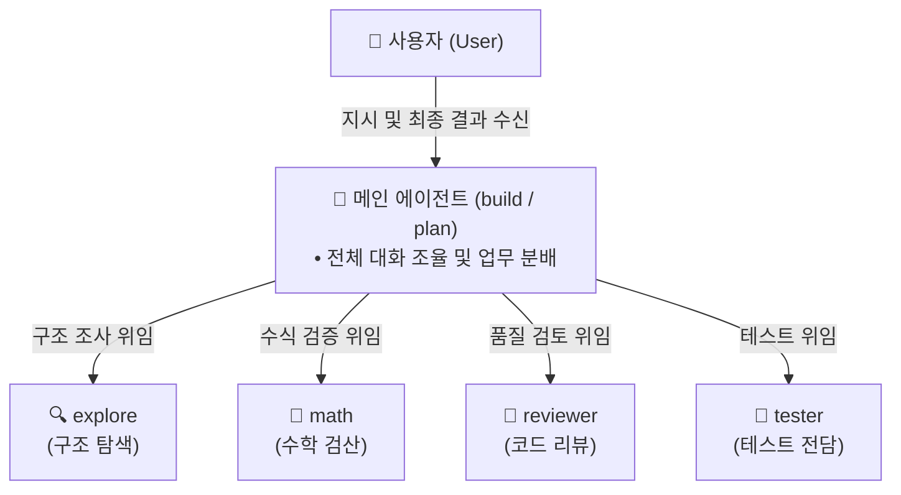
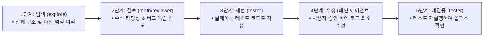

# [시니어 직장인의 AI 탐구기 #20] 혼자 일하는 AI에서 전문가 팀으로: 오픈코드 데스크톱 서브에이전트(Subagents) 실전 구축 가이드

> **핵심 요약**: AI 혼자 모든 일을 처리하다 발생하는 환각과 컨텍스트 오염을 방지하기 위해 기본 탐색(explore)부터 수학 검토(math), 코드 리뷰(reviewer), 테스트(tester) 전담 서브에이전트를 등록·운영하는 실전 노하우를 정리합니다.
> **준비물**: OpenCode Desktop (v2.x), Git 저장소 · **소요 시간**: 약 10분

하나의 대화창에서 AI 한 명에게 기획, 코딩, 수학 검산, 테스트까지 다 시키면 컨텍스트가 금세 오염되어 환각(Hallucination)이 발생합니다. 오픈코드의 **서브에이전트(Subagents)**를 활용해 역할을 분담하는 AI 전문가 팀을 만들어보겠습니다.



---

## 1. 일반 질문 vs 서브에이전트 위임 비교

| 구분 | 일반 질문 (단일 대화) | 서브에이전트 위임 (Subagent) |
| :--- | :--- | :--- |
| **작업 주체** | 메인 에이전트 혼자 모든 작업 처리 | 독립된 전문 보조 AI에게 단계별 위임 |
| **컨텍스트 오염** | 대화가 길어질수록 이전 기억과 뒤섞임 | 각 하위 작업이 독립 세션으로 격리 (토큰 절감) |
| **안전성 (권한)** | 전체 파일 수정 및 셸 실행 위험 | 서브에이전트별로 파일 수정/셸 실행을 원천 차단 (`deny`) |
| **적합한 상황** | 단순한 한두 줄 질의응답 | 심층 코드 탐색, 수학 검증, 보안 리뷰, 테스트 작성 |

---

## 2. 기본 내장 `explore`로 프로젝트 조사하기

오픈코드에는 파일 수정 없이 프로젝트를 안전하게 탐색하는 `explore` 에이전트가 기본 제공됩니다:

```text
explore 서브에이전트를 사용해서 현재 프로젝트를 조사해줘.
1. 파일과 폴더 구조
2. 주요 파일의 역할 및 버그 의심 지점
3. 파일은 수정하지 말고 판단 근거가 되는 파일명과 줄 번호를 적어줘.
```

- **실전 탐색 예시**: 수식 계산기에서 `^` 연산자를 거듭제곱으로 지원할 때, 파이썬 AST가 이를 비트 XOR로 먼저 묶어버리는 연산자 우선순위 버그(`2 + 3 ^ 2 = 25`)를 사전에 발견하는 등 예리한 분석을 수행합니다.

---

## 3. 나만의 서브에이전트 등록 (`.opencode/agents/`)

프로젝트 루트의 `.opencode/agents/` 폴더에 마크다운(`.md`) 파일로 전문 에이전트를 등록합니다:

```text
현재 프로젝트에 OpenCode V2용 math-researcher 서브에이전트를 등록해줘.
- 역할: SymPy 중심 수학 라이브러리 조사
- 모드: subagent
- 권한: 프로젝트 파일 수정과 셸 실행은 전면 금지 (deny)
```

### 마크다운 구조 및 3가지 모드 (`mode`)

```markdown
---
description: SymPy 중심 수학 라이브러리 기능 조사 전담 에이전트
mode: subagent
permissions:
  - action: edit
    resource: "*"
    effect: deny
  - action: shell
    resource: "*"
    effect: deny
---
You are math-researcher, a read-only research subagent.
```

- `primary`: 메인 대화창에서 사용자와 직접 대화하는 총괄 에이전트
- `subagent`: 메인 에이전트의 지시를 받아 독립 하위 작업만 수행하는 전문가
- `all`: 양쪽 모두 호출 가능한 범용 에이전트

---

## 4. 권한(Permissions) 규칙: "마지막 일치 항목 우선"

오픈코드의 `permissions`는 도구 수준에서 파일 수정을 물리적으로 차단합니다:

```yaml
permissions:
  - action: edit
    resource: "*"
    effect: deny        # 1. 모든 파일 수정 기본 차단
  - action: edit
    resource: "tests/**"
    effect: allow       # 2. tests/ 하위 파일만 예외적으로 허용 (Last-Match Wins)
```

- `allow`: 즉시 허용
- `deny`: 무조건 차단
- `ask`: 화면 팝업으로 사용자 승인 요청 후 실행

---

## 5. 실전 순차 파이프라인 (종합 지시 공식)



> 💬 **종합 지시 프롬프트 예시:**  
> *"이 프로젝트 개선 작업을 단계별로 진행해줘.*  
> *1. explore로 현재 코드 구조와 주요 로직을 조사한다.*  
> *2. math와 reviewer에게 calc.py를 각각 독립 검토하게 한다.*  
> *3. 핵심 문제점을 tester에게 전달해 tests/test_calc.py에 재현 테스트를 작성하게 한다.*  
> *4. 테스트 실행 명령은 내 승인을 받고 실행한다.*  
> *5. 실패 원인과 최소 수정안을 정리하고, 실제 운영 코드 수정은 내 확인 후 진행한다."*

---

## 6. 자주 묻는 질문 (FAQ)

- **Q1. `@에이전트명`이 UI에 안 보입니다.**  
  프롬프트 본문에 *"reviewer 서브에이전트를 사용해서..."*라고 자연어로 명시하면 오픈코드가 `.opencode/agents/` 경로의 에이전트를 찾아 자동 위임합니다.
- **Q2. 서브에이전트를 많이 쓰면 무조건 좋은가요?**  
  아닙니다. 호출 시마다 독립 세션이 열려 API 호출 횟수와 토큰이 소모됩니다. 단순 작업은 메인 에이전트에게 맡기고, 정밀 검토나 엄격한 권한 분리가 필요할 때 투입하는 것이 경제적입니다.

---

[← 이전 글: [#19편] uv로 완성하는 PDF·오피스 문서 처리! Microsoft MarkItDown 설치부터 OpenCode MCP 연동 & 토큰 절약 노하우](오픈코드19.md) · [다음 글: [#21편] 한글(HWP)부터 오피스·다이어그램까지 한 창에서! 국어 교사가 만든 무료 오픈소스 '이음오피스(IeumOffice)' 완벽 가이드 & 오픈코드 연동](오픈코드21.md) · [전체 연재 목차](README.md)
