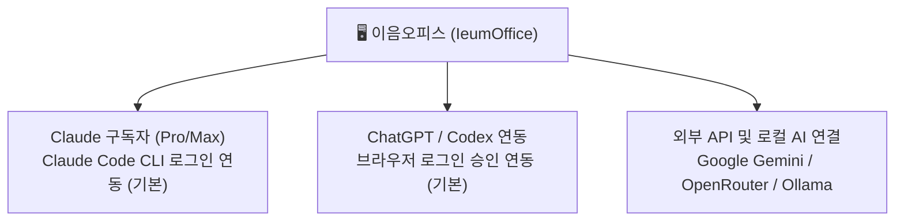

# [시니어 직장인의 AI 탐구기 #21] 한글(HWP)부터 오피스·다이어그램까지 한 창에서! 국어 교사가 만든 무료 오픈소스 '이음오피스(IeumOffice)' 완벽 가이드 & 오픈코드 연동

> **핵심 요약**: 한컴오피스나 MS 오피스 없이 Mac·Windows에서 HWP·HWPX·Docx·Xlsx·PDF·다이어그램을 한 창의 탭으로 편집하고, AI가 원본 문서를 직접 수정하는 100% 무료 오픈소스 '이음오피스'의 기능과 OpenCode MCP 연동법을 정리합니다.
> **준비물**: 이음오피스 데스크톱, OpenCode Desktop · **소요 시간**: 약 10분

부처나 공공기관에서 온 아래한글(`.hwp`, `.hwpx`) 공문, 재무팀의 엑셀(`.xlsx`), 워드(`.docx`), 다이어그램까지 번갈아 띄우고 AI 창에 복사-붙여넣기 하느라 지치셨다면, 현직 고등학교 국어 교사가 공익을 위해 공개한 무료 오픈소스 **'이음오피스(IeumOffice)'**를 만나보세요.

---

## 1. 이음오피스(IeumOffice)란?

충남 온양여고 국어 교사(박준일, 깃허브 `pblsketch`)가 읽고 쓰는 교육 실무를 위해 개발한 **통합 문서 오픈소스(Apache 2.0)** 데스크톱 오피스입니다.

- **한 창(Tab) 통합 편집**: HWP, HWPX, Word, Excel, PPT, PDF, 마인드맵(XMind), 다이어그램(draw.io)을 단 하나의 탭에서 작업합니다.
- **원본 형식 그대로 보존**: 클라우드 변환 없이 내 PC에서 직접 열고 수정한 부분만 원래 포맷(`.hwp`, `.xlsx` 등)으로 안전하게 저장합니다.
- **문서 내장형 AI 편집**: AI에게 *"표에 누락된 합계 행을 추가하고 SUM 수식을 넣어줘"*라고 말하면 화면에 열린 문서를 직접 수정하며, Diff 및 원클릭 되돌리기를 지원합니다.
- **100% 로컬 보안**: 회원가입이 없고 개발자 서버로 전송되는 데이터가 제로(0%)이며, 덮어쓰기 시 자동 백업(`.bak`)을 생성합니다.

---

## 2. 인터넷에서 쏟아진 사용자 호평 BEST 5 단일 비교표

| 호평 테마 | 인터넷 사용자 반응 및 공감 포인트 | 실무적 의의 |
| :--- | :--- | :--- |
| **1. Mac/Linux HWP 완벽 편집** | *"한컴오피스 없이 맥북에서 HWP를 열고 수정해 HWP로 저장할 수 있다니 기적"* | 패러럴즈 가상머신 탈피, 비Windows 환경 실무 자유 |
| **2. 복붙 지옥 탈출** | *"문서 열어두고 말만 하면 표와 수식을 직접 고치고 Diff와 되돌리기까지 지원"* | 마크다운 표 복사 깨짐 해결, 원본 직접 수정 |
| **3. 국어 교사의 무료 철학** | *"가입 유도나 유료 구독 없이 Apache 2.0으로 배포된 진정한 공익 소프트웨어"* | 라이선스 비용 0원, 기업·공공기관 안심 사용 |
| **4. 100% 로컬 보안 & 백업** | *"개발자 서버 0%, 내 PC에만 저장되고 덮어쓸 때 `.bak` 원본 자동 보관"* | 사내 기밀 유출 차단, 파일 무결성 보장 |
| **5. 터미널 CLI & MCP 지원** | *"`ieumoffice` 명령어와 MCP 내장으로 OpenCode와 결합 시 환상적인 시너지"* | AI 코딩 에이전트 연동 문서 자동화 파이프라인 |

---

## 3. OS별 다운로드 및 설치 가이드

- **공식 사이트**: [ieumoffice.com](https://ieumoffice.com)
- **공식 저장소**: [github.com/pblsketch/ieumoffice](https://github.com/pblsketch/ieumoffice)

### Windows (10 / 11 64비트)

1. 공식 사이트에서 `IeumOffice-Setup-<버전>.exe`를 받습니다.
2. 스마트스크린 경고 시 **[추가 정보] → [실행]**을 누르고 마법사에 따라 설치합니다.

### Mac (macOS 12 Monterey 이상)

1. CPU 종류(Apple Silicon vs Intel)에 맞는 `.dmg` 파일을 받아 **Applications** 폴더로 드래그합니다.
2. 실행 시 보안 경고가 뜨면 `시스템 설정` > `개인정보 보호 및 보안`에서 **[확인 없이 열기]**를 클릭합니다.

<details>
<summary>🐧 Linux(우분투/데비안) 설치 방법 보기 (선택)</summary>

`.deb` 또는 `.AppImage` 파일을 받아 실행합니다:

```bash
sudo dpkg -i IeumOffice-<버전>-amd64.deb
```

</details>

---

## 4. AI 연동 구조 (Claude Code / Codex 중심)

이음오피스는 공식 저장소(`pblsketch/ieumoffice`) 기준, 내 컴퓨터에 로그인된 **Claude Code / Codex**를 기반으로 작동하여 복잡한 API 키 발급 없이도 구독 한도 안에서 AI 비서 기능을 활용할 수 있습니다.



> 💡 **추가 API 설정**: Google Gemini 무료 API 키, OpenRouter, 사내 Ollama 로컬 서버 연동 옵션은 이음오피스 앱 상단의 **`설정(⚙️) → AI`** 화면에서 언제든지 추가·변경할 수 있습니다.

---

## 5. [오픈코드 파워 유저를 위한] OpenCode MCP & CLI 연동

이음오피스를 설치하면 터미널 명령어 `ieumoffice`와 **MCP 서버(`ieumoffice mcp`)**가 함께 내장됩니다.

### ① 오픈코드에 전역 MCP 도구 등록

내장 터미널에서 아래 한 줄 명령어를 실행합니다:

```bash
opencode mcp add ieumoffice --global -- ieumoffice mcp
```

- **설정 파일 (`~/.config/opencode/opencode.json`)**:

  ```jsonc
  {
    "$schema": "https://opencode.ai/config.json",
    "mcp": {
      "servers": {
        "ieumoffice": {
          "type": "local",
          "command": ["ieumoffice", "mcp"]
        }
      }
    }
  }
  ```

### ② 실전 활용 프롬프트
>
> *"ieumoffice 도구를 사용해서 현재 폴더의 '2026_예산안.xlsx' 시트 구조를 읽고, 합계 수식이 빈 셀을 찾아 SUM 함수를 적용해줘."*  
> *"기획안.md 파일 내용을 바탕으로 ieumoffice 명령을 실행해 깔끔한 '신규사업_제안서.docx' 워드 문서를 생성해줘."*

---

[← 이전 글: [#20편] 혼자 일하는 AI에서 전문가 팀으로: 오픈코드 데스크톱 서브에이전트(Subagents) 실전 구축 가이드](오픈코드20.md) · [다음 글: [#22편] AI 대화가 술술 풀리는 마법의 사전: 시니어 직장인을 위한 생성형 AI 핵심 필수 용어 30선](오픈코드22.md) · [전체 연재 목차](README.md)
