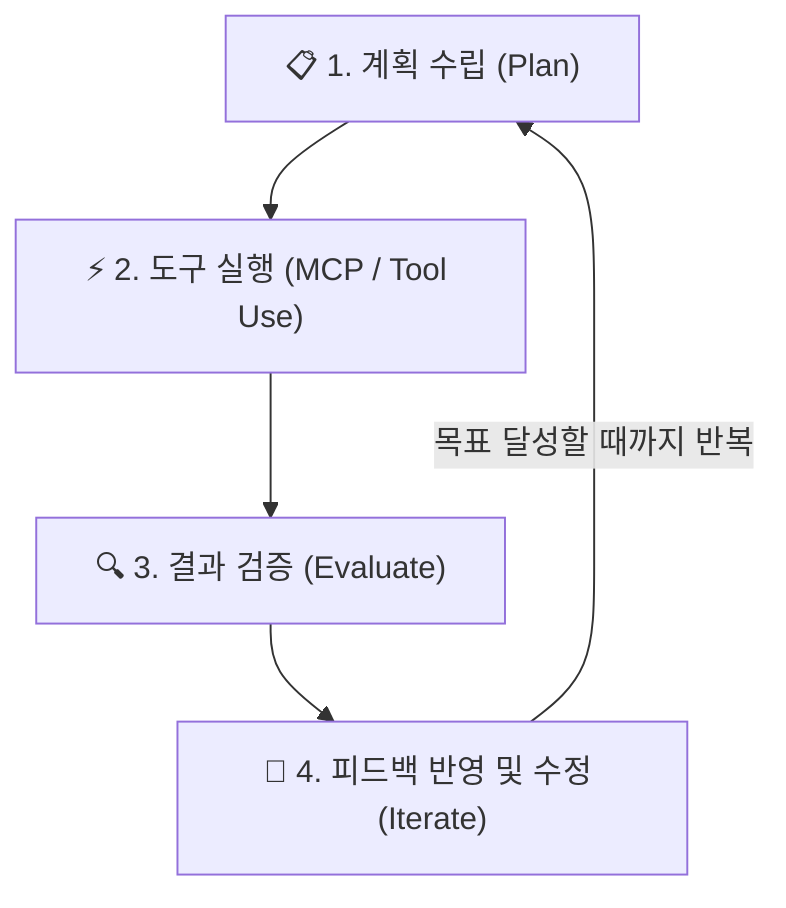
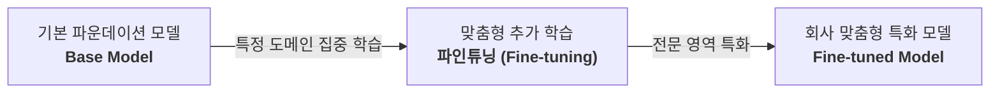

```mermaid
flowchart TD
    Plan["📋 1. 계획 수립 (Plan)"] --> Tool["⚡ 2. 도구 실행 (MCP / Tool Use)"]
    Tool --> Eval["🔍 3. 결과 검증 (Evaluate)"]
    Eval --> Iter["🔄 4. 피드백 반영 및 수정 (Iterate)"]
    Iter -->|"목표 달성할 때까지 반복"| Plan
```# [시니어 직장인의 AI 탐구기 #22] AI 대화가 술술 풀리는 마법의 사전: 시니어 직장인을 위한 생성형 AI 핵심 필수 용어 30선

> **"RAG? 토큰? MCP? 프롬프트 엔지니어링? AI 뉴스나 회의 때마다 쏟아지는 외계어에 기죽으셨나요? 딱 30개 핵심 용어만 알면, AI와의 대화도 사내 AI 프로젝트도 손바닥 보듯 훤히 보입니다!"**  
> 생성형 AI & 오픈코드(OpenCode) 실무 기준 · 2026년 11월 총정리  
> 최신 생성형 AI, 거대 언어 모델(LLM), 에이전트 및 딥러닝 분야에서 가장 빈번하게 쓰이는 필수 용어 30가지를 시니어 직장인의 눈높이에 맞춘 일상 비유와 오픈코드 실전 연계 팁으로 친절하게 해설합니다.

안녕하세요. 시니어 회사원의 시선에서 AI 실무 도구를 가장 쉽고 실용적으로 해설하는 블로그의 스물두 번째 글입니다.

최근 회사나 뉴스, 유튜브 강좌를 보면 너도나도 AI 이야기를 합니다. 그런데 정작 회의실에 들어가거나 AI 관련 문서를 읽다 보면 머리가 지끈거리기 시작합니다.

*"이번 프로젝트는 사내 규정을 RAG로 연결하고, 프롬프트에 CoT 기법을 써서 할루시네이션을 줄여봅시다."*  
*"토큰 소모량이 너무 많으니 컨텍스트 윈도우를 최적화하고, 외부 연동은 MCP 프로토콜로 에이전틱 워크플로우를 구성하죠."*

분명 한국말인데 마치 외계어를 듣는 것 같은 느낌을 받으신 적이 있으실 겁니다. AI가 똑똑하다는 건 알겠는데, 전문 용어의 벽에 막혀 AI에게 제대로 질문조차 하기 어려웠던 분들도 많습니다.

하지만 겁먹으실 필요가 전혀 없습니다! 이 용어들은 컴퓨터 공학 박사들만을 위한 난해한 암호가 아닙니다. **내 컴퓨터 옆자리에 앉은 똑똑한 'AI 신입사원'과 제대로 소통하고 일을 잘 시키기 위한 '업무용 공용어'**일 뿐입니다.

이번 글에서는 최신 AI 기술과 오픈코드(OpenCode) 실무에서 매일 마주치는 **가장 중요한 필수 용어 30선**을 엄선하여, 시니어 직장인의 상식과 실무 감각에 딱 맞춘 비유와 함께 일목요연하게 정리해 드리겠습니다.

---

## 🧭 한눈에 보는 AI 필수 용어 지도 (5대 테마)

30개의 용어를 무작정 외우려 하면 금세 잊어버립니다. 직장에서 일이 돌아가는 원리처럼 **5가지 실무 테마**로 묶어서 이해하면 머릿속에 체계적인 지도가 그려집니다.

| 테마 분류 | 핵심 주제 | 세부 주요 개념 |
| :---: | :--- | :--- |
| **1** | **AI 기본 원리와 언어 단위** | LLM, 프롬프트, 토큰, 컨텍스트 윈도우, 환각 현상, 사전 학습, 파라미터 |
| **2** | **두뇌 구조와 작동 방식** | 생성형 AI, 트랜스포머, 어텐션 메커니즘, 추론, MoE(전문가 혼합), 잠재 공간 |
| **3** | **외부 지식 연결 & 사실 검증** | RAG(검색 증강 생성), 임베딩, 벡터 DB, 그라운딩, 지식 그래프 |
| **4** | **자율 행동과 도구 활용** | AI 에이전트, 함수 호출(Tool Use), MCP 프로토콜, 에이전틱 워크플로우 |
| **5** | **맞춤 학습 & 안전 경량화** | 파인튜닝, RLHF, CoT(사고의 사슬), 멀티모달, 제로샷/퓨샷, 양자화, 가드레일, 지식 증류 |

---

## [테마 1] AI 기본 원리와 언어의 단위 (기초 체력 기르기)

우리가 AI와 글(텍스트)로 대화할 때 가장 먼저 맞닥뜨리는 기본 개념들입니다.

```mermaid
flowchart LR
    P["인간의 지시문<br><b>프롬프트 (Prompt)</b>"] -->|"글자를 쪼개는 단위"| T["최소 의미 단위<br><b>토큰 (Token)</b>"]
    T -->|"한 번에 기억하는 한계"| C["작업 기억 공간<br><b>컨텍스트 윈도우 (Context Window)</b>"]
```

### 01. LLM (Large Language Model, 거대 언어 모델)

- **한 줄 정의**: 방대한 텍스트 데이터를 학습하여 인간처럼 언어를 이해하고 자연스럽게 생성하는 인공신경망 모델입니다.
- **직장인 눈높이 비유**: 세상의 온갖 백과사전, 도서관 책, 인터넷 문서를 통째로 읽고 달달 외운 **'만능 수석 연구원'**입니다.
- **오픈코드 실무 연결**: 우리가 오픈코드에서 선택하는 Gemini 3.8 Flash, DeepSeek V4.1, Claude 3.7 Sonnet 등이 모두 LLM에 해당합니다.

### 02. 프롬프트 (Prompt)

- **한 줄 정의**: AI 모델로부터 원하는 답변이나 결과물을 유도하기 위해 입력하는 질문, 지시문, 또는 문맥 정보입니다.
- **직장인 눈높이 비유**: 일을 시키기 위해 부하 직원에게 건네는 **'구체적인 업무 지시서(Work Order)'**입니다.
- **오픈코드 실무 연결**: 대화창에 *"이 파이썬 코드의 버그를 찾고 테스트 코드를 짜줘"*라고 입력하는 지시 문장 전체가 프롬프트입니다. 지시가 구체적일수록 결과물의 완성도가 높아집니다.

### 03. 토큰 (Token)

- **한 줄 정의**: AI 모델이 글자를 읽고 처리할 때 쪼개어 인식하는 최소 의미 단위(단어 조각, 글자 등)입니다.
- **직장인 눈높이 비유**: 지하철을 탈 때 내는 **'교통 요금'**이자 원고를 쓸 때 계산하는 **'글자 수(원고지 칸 수)'**입니다.
- **오픈코드 실무 연결**: 보통 영단어 1단어는 1토큰 안팎, 한글은 1글자당 1~3토큰이 소모됩니다. AI 모델의 이용 요금은 언제나 '처리한 토큰 수'에 비례하여 부과되므로 토큰 다이어트가 곧 비용 절약입니다.

### 04. 콘텍스트 윈도우 (Context Window)

- **한 줄 정의**: AI가 대화나 작업을 진행할 때 한 번에 기억하고 참고할 수 있는 최대 텍스트(토큰) 허용 범위입니다.
- **직장인 눈높이 비유**: AI가 책상 위에 한 번에 펼쳐놓고 볼 수 있는 **'책상(작업대)의 넓이'**입니다.
- **오픈코드 실무 연결**: 콘텍스트 윈도우가 128K~1M 토큰으로 넓을수록 두꺼운 책 수십 권 분량의 소스 코드나 PDF 보고서 전체를 한 번에 올려두고 대화할 수 있습니다.

### 05. 환각 현상 (Hallucination)

- **한 줄 정의**: AI가 잘못된 정보나 사실이 아닌 내용을 마치 진짜 사실인 것처럼 그럴듯하게 지어내어 답변하는 오류입니다.
- **직장인 눈높이 비유**: 잘 모르는 질문을 받았을 때 당황해서 **'아주 그럴듯하게 거짓말을 지어내는 신입사원의 헛소리'**입니다.
- **오픈코드 실무 연결**: AI에게 존재하지 않는 함수나 규정을 물어보면 그럴듯한 거짓 코드를 짜줄 때가 있습니다. 이를 방지하기 위해 검색(RAG)이나 신뢰할 수 있는 소스 문서를 제공해야 합니다.

### 10. 사전 학습 (Pre-training)

- **한 줄 정의**: 특정 작업 목적 없이 인터넷의 방대한 비라벨링 데이터를 모델 스스로 읽으며 언어와 지식의 일반 패턴을 익히는 초기 학습 단계입니다.
- **직장인 눈높이 비유**: 회사에 입사하기 전, 초·중·고·대학교를 다니며 세상의 일반 상식과 기본 어휘를 배우는 **'기본 소양 교육 과정'**입니다.
- **오픈코드 실무 연결**: 수천억 개의 웹 페이지를 읽고 기본 언어 능력을 갖춘 원초적 모델을 파운데이션 모델(Foundation Model)이라고 부릅니다.

### 27. 파라미터 / 매개변수 (Parameters)

- **한 줄 정의**: AI 모델이 학습 데이터를 통해 조정한 가중치들의 총합으로, 모델의 지적 용량과 규모를 가늠하는 대표적인 척도입니다.
- **직장인 눈높이 비유**: 인간 뇌 속에 있는 **'시냅스(신경망 연결)의 총개수'**입니다.
- **오픈코드 실무 연결**: 흔히 "7B(70억 개)", "70B(700억 개)", "671B"라고 부르는 숫자가 바로 파라미터 수입니다. 숫자가 클수록 똑똑하고 복잡한 추론을 잘하지만, 구동하는 데 많은 컴퓨터 자원(GPU)이 필요합니다.

---

## [테마 2] AI의 두뇌 구조와 작동 방식 (AI 속 들여다보기)

AI가 어떻게 인간처럼 생각하고 글을 써 내려가는지 그 속사정을 이해하는 용어들입니다.


### 29. 생성형 AI (Generative AI)

- **한 줄 정의**: 기존 데이터를 단순히 분류하거나 판별하는 데 그치지 않고, 학습한 패턴을 바탕으로 새로운 글, 그림, 음악, 코드를 창작해 내는 AI입니다.
- **직장인 눈높이 비유**: 스팸 메일인지 아닌지 골라내는 '감별사'를 넘어, 직접 매력적인 영업 기획서 초안을 써 내려가는 **'창작자'**입니다.

### 14. 트랜스포머 (Transformer)

- **한 줄 정의**: 문장 속 단어들 간의 관계를 동시에 병렬로 계산하는 '어텐션(Attention)' 구조를 기반으로 현대 생성형 AI의 기반이 된 딥러닝 아키텍처입니다.
- **직장인 눈높이 비유**: 문장을 한 글자씩 느리게 읽지 않고, 페이지 전체 단어들의 관계를 한눈에 스캔하여 순식간에 맥락을 꿰뚫어 보는 **'초고속 정보 고속도로'**입니다.
- **오픈코드 실무 연결**: 2017년 구글이 발표한 논문 *"Attention Is All You Need"*에서 탄생했으며, 오늘날 GPT, Gemini, Claude 등 모든 최신 LLM의 뿌리가 되었습니다.

### 15. 어텐션 메커니즘 (Attention Mechanism)

- **한 줄 정의**: 문장을 처리할 때 특정 단어가 문맥상 다른 어떤 단어들과 가장 밀접하게 연결되어 있는지 가중치를 두어 집중(주의)하는 기술입니다.
- **직장인 눈높이 비유**: *"철수가 영희에게 사과를 주었다. **그것은** 매우 달콤했다"*에서 '**그것은**'이 철수가 아니라 '사과'를 가리킨다는 사실을 형광펜으로 칠하듯 알아채는 **'집중력'**입니다.

### 20. 추론 (Inference)

- **한 줄 정의**: 이미 학습을 마친 AI 모델에 새로운 입력 데이터를 넣었을 때 예측이나 결과물을 계산하여 출력하는 과정입니다.
- **직장인 눈높이 비유**: 시험공부(학습)를 다 끝마친 학생이 시험지를 받아 들고 **'실제 문제를 푸는 실전 행동'**입니다.
- **오픈코드 실무 연결**: 우리가 오픈코드에서 질문을 던지고 AI가 토큰을 하나씩 생성하며 화면에 타이핑해 주는 그 실시간 과정이 바로 '추론'입니다.

### 22. MoE (Mixture of Experts, 전문가 혼합)

- **한 줄 정의**: 거대한 전체 모델을 한 번에 다 돌리지 않고, 입력 질문에 가장 적합한 특정 전문 서브 네트워크들만 활성화하여 효율을 극대화하는 모델 구조입니다.
- **직장인 눈높이 비유**: 회사 전 직원을 한 회의실에 다 부르지 않고, 코딩 질문이 들어오면 '개발팀 에이스 2명'만 불러서 답변하게 하는 **'전문가 선별 호출 시스템'**입니다.
- **오픈코드 실무 연결**: 딥시크(DeepSeek V3/R1)나 GPT-4 등이 MoE 아키텍처를 채택하여, 거대한 두뇌 성능을 유지하면서도 연산 비용과 응답 속도를 획기적으로 낮췄습니다.

### 28. 잠재 공간 (Latent Space)

- **한 줄 정의**: 데이터의 고차원 특징들이 압축되어 의미적 거리와 관계에 따라 수학적으로 정렬되어 있는 모델 내부의 추상적 공간입니다.
- **직장인 눈높이 비유**: 도서관에서 '마케팅' 서가 옆에 '광고', '소비자 심리' 책이 모여 있듯, **의미가 비슷한 개념들이 오밀조밀 모여 있는 'AI 마음속의 생각 지도'**입니다.

---

## [테마 3] 외부 지식 연결 & 사실 검증 (똑똑하고 정확하게 만들기)

AI의 최대 약점인 환각 현상(거짓말)을 잡고 최신 사내 지식을 주입하는 핵심 기술들입니다.


### 06. RAG (Retrieval-Augmented Generation, 검색 증강 생성)

- **한 줄 정의**: 모델의 학습 데이터에 없는 최신 정보나 사내 문서를 외부 DB에서 검색한 뒤, 이를 바탕으로 정확한 답변을 생성하는 기법입니다.
- **직장인 눈높이 비유**: 기억력에만 의존해 답변하지 않고, 서랍에서 **'최신 사내 규정철을 직접 꺼내서 펼쳐보며 답변하는 오픈북(Open-book) 시험'**입니다.
- **오픈코드 실무 연결**: 회사의 취업규칙 PDF나 프로젝트 소스 코드를 읽혀두고 질문하면, AI가 해당 문서를 검색해 근거와 함께 정확히 답해주는 것이 RAG의 대표 사례입니다.

### 07. 임베딩 (Embedding)

- **한 줄 정의**: 단어, 문장, 이미지 등의 비정형 데이터를 컴퓨터가 의미적 유사도를 계산할 수 있도록 고차원 숫자 벡터로 변환하는 기술입니다.
- **직장인 눈높이 비유**: 글자의 겉모습이 달라도 '강아지'와 '개', '댕댕이'가 서로 가까운 친척이라는 사실을 컴퓨터가 알 수 있도록 **'의미별 고유 좌표(위도·경도)'**를 부여하는 작업입니다.

### 08. 벡터 데이터베이스 (Vector DB)

- **한 줄 정의**: 데이터의 의미적 유사성(임베딩 벡터)을 기준으로 빠른 유사도 검색(ANN)을 수행하기 위해 특화된 데이터베이스입니다.
- **직장인 눈높이 비유**: 정확한 키워드가 일치하지 않아도 "비슷한 뉘앙스를 가진 문서"를 번개처럼 찾아주는 **'의미 기반 전용 초고속 서고'**입니다.
- **오픈코드 실무 연결**: Pinecone, Chroma, Qdrant, Milvus 등이 대표적인 벡터 DB로, RAG 시스템 구축 시 핵심 엔진으로 쓰입니다.

### 23. 그라운딩 (Grounding)

- **한 줄 정의**: AI의 답변을 검증 가능한 실제 사실, 신뢰할 수 있는 출처 문서 또는 실시간 현실 데이터에 단단히 결속시키는 기술입니다.
- **직장인 눈높이 비유**: 공중에서 붕 떠서 지어내는 뜬구름 잡는 소리가 되지 않도록, 답변마다 **'출처 각주와 팩트의 닻을 단단히 내리는 작업'**입니다.

### 30. 지식 그래프 (Knowledge Graph)

- **한 줄 정의**: 개체(Entity)와 개체 간의 실제 관계를 노드(점)와 엣지(선) 형태의 네트워크로 구조화하여 AI가 논리적 연결 고리를 정확히 파악하도록 돕는 지식 체계입니다.
- **직장인 눈높이 비유**: "누가 누구의 부하 직원이고, 어느 부서 소속이며, 어떤 프로젝트를 담당하는지" 한눈에 보여주는 **'기업 인맥 및 조직 계통도'**입니다.

---

## [테마 4] 자율 행동과 도구 활용: AI 에이전트 (직접 일하는 AI)

단순히 말만 번지르르하게 하는 챗봇을 넘어, 컴퓨터를 조작하고 도구를 쓰며 실무를 처리하는 에이전트의 핵심입니다.



### 11. AI 에이전트 (AI Agent)

- **한 줄 정의**: 단순 답변을 넘어 주어진 목표를 달성하기 위해 스스로 계획을 세우고, 웹 검색이나 코드 실행 등 도구를 사용하며 자율적으로 행동하는 AI입니다.
- **직장인 눈높이 비유**: 시키는 질문에 한 줄 대답만 하는 수동적인 알바생이 아니라, "매출 보고서 완성해 둬"라고 하면 알아서 파일 찾고 계산기 두드려 보고서까지 올려놓는 **'능동적인 정규직 대리'**입니다.
- **오픈코드 실무 연결**: 오픈코드(OpenCode) 그 자체가 대표적인 AI 에이전트 도구입니다.

### 12. 함수 호출 / 도구 사용 (Function Calling / Tool Use)

- **한 줄 정의**: LLM이 직접 계산하거나 수행하기 어려운 작업(계산기, DB 조회, API 호출, 파일 쓰기 등)을 외부 도구에 위임하여 처리하는 기능입니다.
- **직장인 눈높이 비유**: 아무리 머리가 좋아도 복잡한 암산은 **'탁상용 계산기'**를 두드리고, 날씨는 **'스마트폰 날씨 앱'**을 열어보고 확인하는 지혜로운 행동입니다.
- **오픈코드 실무 연결**: 오픈코드가 터미널 명령을 실행하거나, 파일을 읽고 쓰는 모든 행위가 바로 도구 사용(Tool Use)입니다.

### 13. MCP (Model Context Protocol)

- **한 줄 정의**: AI 모델이 다양한 로컬 도구, 데이터베이스, 외부 서비스와 표준화된 규격으로 안전하게 통신할 수 있도록 만든 개방형 프로토콜입니다.
- **직장인 눈높이 비유**: 전 세계 어디서나 규격만 맞으면 꽂아서 쓰는 **'컴퓨터의 USB 포트'**처럼, AI에게 어떤 외부 프로그램이든 손쉽게 꽂아 쓸 수 있게 해주는 **'AI 전용 만능 단자'**입니다.
- **오픈코드 실무 연결**: 앤트로픽이 제정하고 오픈코드가 적극 지원하는 표준입니다. 지난 #11편의 한글 문서 파서(`kordoc`), #19편의 오피스 파서(`markitdown`), #21편의 `ieumoffice`가 모두 MCP로 연결되었습니다.

### 26. 에이전틱 워크플로우 (Agentic Workflow)

- **한 줄 정의**: 계획 수립, 실행, 결과 검증, 피드백 반영(Plan-Act-Evaluate-Iterate)의 순환 루프를 거치며 복잡한 목표를 완수하는 작업 흐름입니다.
- **직장인 눈높이 비유**: "일단 해보고 끝"이 아니라, **기획안 작성 → 실행 → 자체 검수 → 미비점 수정**의 과정을 스스로 반복하며 완성도를 높이는 **'책임감 있는 업무 프로세스'**입니다.
- **오픈코드 실무 연결**: 오픈코드의 `Plan 모드`와 `Build 모드`를 번갈아 활용하거나, #20편에서 배운 `explore → math → reviewer` 서브에이전트 협업이 대표적인 에이전틱 워크플로우입니다.

---

## [테마 5] 맞춤 학습 & 안전 경량화 (회사에 맞게 다듬기)

기본 모델을 사내 맞춤형으로 훈련시키고, 비용을 낮추며 안전하게 통제하는 고급 기술들입니다.



### 09. 파인튜닝 (Fine-tuning, 미세 조정)

- **한 줄 정의**: 이미 방대하게 학습된 기본 모델(Foundation Model)에 특정 분야의 데이터를 추가 학습시켜 도메인 맞춤형 모델로 개조하는 과정입니다.
- **직장인 눈높이 비유**: 일반 대졸 신입사원을 뽑아 우리 회사만의 전문 회계 용어나 법률 양식을 집중 교육시켜 **'우리 회사 맞춤형 스페셜리스트'**로 키워내는 심화 직무 연수입니다.

### 16. RLHF (Reinforcement Learning from Human Feedback)

- **한 줄 정의**: 인간 평가자의 피드백을 기반으로 모델의 답변이 더 안전하고, 유용하며, 인간의 선호에 맞도록 정렬(Alignment)하는 강화학습 기법입니다.
- **직장인 눈높이 비유**: 신입사원이 작성한 보고서에 대해 선배 사수들이 "이 문장은 친절하고 좋아(+칭찬)", "이 표현은 너무 거칠어(-지적)"라고 피드백을 주며 **'눈치와 사회성을 길러주는 과정'**입니다.

### 17. CoT (Chain-of-Thought, 생각의 사슬)

- **한 줄 정의**: 복잡한 추론 문제에서 AI가 바로 답을 내지 않고 단계별 논리적 사고 과정을 거쳐 설명하도록 유도하여 정답률을 높이는 기법입니다.
- **직장인 눈높이 비유**: 수학 문제를 풀 때 답만 덜컥 적지 않고, **'풀이 과정을 단계별로 차근차근 적어 내려가며 검산하는 모범생의 연습장'**입니다.
- **오픈코드 실무 연결**: 프롬프트 끝에 *"단계별로 차근차근 생각해줘(Let's think step by step)"*라고 한 줄만 덧붙여도 AI의 코딩 및 논리 추론 성공률이 비약적으로 향상됩니다.

### 18. 멀티모달 (Multimodal)

- **한 줄 정의**: 텍스트뿐만 아니라 이미지, 오디오, 비디오, 코드 등 여러 종류의 입출력 형태를 동시에 이해하고 처리하는 능력입니다.
- **직장인 눈높이 비유**: 귀로만 듣는 라디오를 넘어, **눈으로 표와 설계도를 보고 귀로 목소리를 들으며 손으로 문서를 타이핑하는 오감 만족 인재**입니다.
- **오픈코드 실무 연결**: 웹 브라우저 UI 스크린샷 이미지를 오픈코드 대화창에 던져주고 *"이 화면과 똑같이 웹페이지를 구현해줘"*라고 지시할 수 있는 비결이 바로 멀티모달 덕분입니다.

### 19. 제로샷 / 퓨샷 러닝 (Zero-shot / Few-shot Learning)

- **한 줄 정의**: 예시를 전혀 주지 않거나(제로샷), 몇 가지 예시만 보여주고도(퓨샷) 새로운 작업을 즉시 수행하도록 하는 프롬프팅 방식입니다.
- **직장인 눈높이 비유**:
  - **제로샷**: "보고서 써봐" 하고 설명서 없이 바로 시키는 방식
  - **퓨샷**: "지난달 A 대리 보고서 양식 2개 참고해서 비슷하게 써봐" 하고 **샘플 몇 개를 쥐여주며 시키는 방식**

### 21. 양자화 (Quantization)

- **한 줄 정의**: 모델 가중치의 정밀도(예: 16비트 부동소수점 → 4/8비트 정수)를 낮춰 연산 속도를 높이고 메모리 사용량을 크게 줄이는 경량화 기술입니다.
- **직장인 눈높이 비유**: 4K 초고화질 영화를 스마트폰에서 가볍게 보기 위해 **'화질 손실을 최소화하면서 파일 용량을 1/4로 압축하는 기술'**입니다.
- **오픈코드 실무 연결**: 내 노트북(MacBook Air 등)에서 무거운 AI 모델을 로컬로 부드럽게 돌릴 수 있는 비결이 바로 4비트(GGUF 등) 양자화 모델 덕분입니다.

### 24. 가드레일 (Guardrails)

- **한 줄 정의**: AI가 부적절한 언어, 유해 콘텐츠, 개인정보 노출, 위험한 명령 수행 등을 하지 못하도록 입출력을 검사하고 통제하는 안전 보호 장치입니다.
- **직장인 눈높이 비유**: 도로 가장자리에 설치된 **'고속도로 안전 난간(가드레일)'**처럼, AI가 탈선하거나 위험한 절벽으로 떨어지지 않도록 막아주는 안전망입니다.

### 25. 지식 증류 (Knowledge Distillation)

- **한 줄 정의**: 거대하고 무거운 고성능 모델(교사)의 지식과 판단 방식을 작고 가벼운 모델(학생)에게 가르쳐 모델을 작게 복제하는 기법입니다.
- **직장인 눈높이 비유**: 수십 년 경력의 베테랑 부장님(교사)의 핵심 업무 노하우와 판단 기준을 엑기스만 쏙 뽑아 담은 **'핵심 업무 매뉴얼(요약본)'을 신입(학생)에게 전수하는 과정**입니다.

---

## 📊 AI 핵심 필수 용어 30선 총정리 대조표

출력해 두고 책상 옆에 붙여두거나 필요할 때마다 검색(`Ctrl + F` / `Cmd + F`)해서 찾아볼 수 있는 30개 용어 종합 정리표입니다.

| 번호 | 용어 (영문 / 약어) | 한 줄 핵심 정의 | 실무 직장인 비유 & 팁 |
| :---: | :--- | :--- | :--- |
| **01** | **LLM (거대 언어 모델)** | 방대한 텍스트 데이터를 학습하여 인간처럼 언어를 이해하고 생성하는 모델 | 도서관을 통째로 외운 만능 수석 연구원 |
| **02** | **프롬프트 (Prompt)** | AI에게 원하는 답변을 유도하기 위해 입력하는 질문, 지시문, 문맥 | 부하 직원에게 건네는 구체적인 업무 지시서 |
| **03** | **토큰 (Token)** | AI가 글자를 읽고 처리할 때 쪼개어 인식하는 최소 의미 단위 | 원고지 글자 수이자 요금 청구의 기본 단위 |
| **04** | **콘텍스트 윈도우 (Context Window)** | AI가 대화나 작업 시 한 번에 기억하고 참고할 수 있는 최대 토큰 범위 | 책상 위에 한 번에 펼쳐놓을 수 있는 작업대 넓이 |
| **05** | **환각 현상 (Hallucination)** | 잘못된 정보를 마치 진짜인 것처럼 그럴듯하게 지어내어 답변하는 오류 | 잘 모르는 질문에 그럴듯하게 헛소리하는 신입사원 |
| **06** | **RAG (검색 증강 생성)** | 모델 외부 DB에서 관련 문서를 검색하여 정확한 답변을 생성하는 기법 | 서랍 속 사내 최신 규정집을 펴놓고 치르는 오픈북 시험 |
| **07** | **임베딩 (Embedding)** | 텍스트나 비정형 데이터를 의미적 유사도 계산이 가능한 숫자 벡터로 변환 | 의미가 비슷한 개념끼리 가깝게 배치하는 고유 좌표 부여 |
| **08** | **벡터 데이터베이스 (Vector DB)** | 데이터의 의미적 유사성을 기준으로 빠른 근사 검색을 수행하는 데이터베이스 | 키워드가 달라도 뉘앙스가 통하는 문서를 찾는 지능형 서고 |
| **09** | **파인튜닝 (Fine-tuning)** | 기본 모델에 특정 분야 데이터를 추가 학습시켜 도메인 맞춤형으로 개조 | 신입사원에게 우리 회사만의 회계/법률을 가르치는 심화 직무 교육 |
| **10** | **사전 학습 (Pre-training)** | 목적 없이 인터넷의 방대한 데이터를 모델 스스로 읽으며 패턴을 익히는 단계 | 입사 전 학교에서 쌓는 기본 교양과 어휘 습득 과정 |
| **11** | **AI 에이전트 (AI Agent)** | 목표 달성을 위해 계획 수립, 도구 사용, 검증을 자율적으로 수행하는 AI | 시키지 않아도 알아서 계획 짜고 도구 써서 일 끝내는 책임 대리 |
| **12** | **함수 호출 / 도구 사용 (Tool Use)** | LLM이 직접 하기 힘든 계산, 파일 수정, API 호출 등을 외부 도구에 위임 | 머리로만 암산하지 않고 전자계산기나 전산망을 쓰는 행동 |
| **13** | **MCP (Model Context Protocol)** | AI와 다양한 로컬 도구·데이터를 표준화된 규격으로 연결하는 개방형 프로토콜 | 전 세계 어디서나 호환되는 컴퓨터의 'AI 전용 만능 USB 단자' |
| **14** | **트랜스포머 (Transformer)** | 문장 속 단어 간 관계를 병렬로 계산하는 어텐션 기반 현대 딥러닝 아키텍처 | 페이지 전체 문맥을 한 번에 스캔하는 초고속 정보 고속도로 |
| **15** | **어텐션 메커니즘 (Attention)** | 특정 단어가 문맥상 어떤 단어들과 가장 밀접한지 가중치를 두어 집중하는 기술 | '그것'이 가리키는 대상을 정확히 찾아내는 형광펜 집중력 |
| **16** | **RLHF (인간 피드백 강화학습)** | 인간 평가자의 선호도 피드백을 기반으로 모델 답변을 안전하고 유용하게 정렬 | 사수들의 칭찬과 지적 피드백을 통해 눈치와 사회성을 기르는 과정 |
| **17** | **CoT (Chain-of-Thought)** | 답을 바로 내지 않고 단계별 논리적 사고 과정을 거쳐 설명하게 하는 추론 기법 | 풀이 과정을 차근차근 적어가며 검산하는 모범생의 연습장 |
| **18** | **멀티모달 (Multimodal)** | 텍스트, 이미지, 음성, 코드 등 다양한 형태의 입출력을 동시에 처리하는 능력 | 글자뿐만 아니라 도표, 사진, 음성까지 이해하는 오감 만족 인재 |
| **19** | **제로샷 / 퓨샷 러닝** | 예시 없이(제로샷) 또는 소수의 예시를 보고(퓨샷) 새로운 작업을 즉시 수행 | 설명서 없이 바로 시키기 vs 2~3개 예시 샘플 보여주며 시키기 |
| **20** | **추론 (Inference)** | 학습을 마친 모델에 새로운 입력을 넣어 예측이나 결과물을 출력하는 과정 | 공부를 마친 학생이 실제 시험지를 받아 들고 문제를 푸는 실전 |
| **21** | **양자화 (Quantization)** | 모델 가중치의 정밀도를 낮춰 메모리와 연산 속도를 대폭 최적화하는 기술 | 4K 고화질 영상을 모바일용으로 압축해 가볍게 돌리는 최적화 |
| **22** | **MoE (전문가 혼합)** | 전체 네트워크 대신 질문에 적합한 특정 전문 서브 네트워크들만 활성화 | 전 직원을 소집하지 않고 필요한 전문 부서 에이스만 부르는 회의 |
| **23** | **그라운딩 (Grounding)** | AI 답변을 검증 가능한 실제 사실, 출처 문서 또는 실시간 현실 데이터에 결속 | 뜬구름 잡는 소리가 되지 않도록 출처 각주와 팩트의 닻을 내리는 일 |
| **24** | **가드레일 (Guardrails)** | 비윤리적 표현, 유해 콘텐츠, 기밀 유출을 막기 위한 AI 입출력 안전 보호 장치 | 차량이 도로 밖 절벽으로 떨어지지 않게 막아주는 고속도로 가드레일 |
| **25** | **지식 증류 (Distillation)** | 무거운 거대 모델(교사)의 핵심 판단 능력을 가벼운 모델(학생)에게 전수 | 베테랑 부장님의 수십 년 노하우 엑기스만 담은 핵심 업무 매뉴얼 전수 |
| **26** | **에이전틱 워크플로우** | 계획-실행-평가-반복의 순환 루프를 통해 복잡한 과업을 완수하는 작업 흐름 | 기획 → 실행 → 검수 → 수정 과정을 거치는 완결형 업무 프로세스 |
| **27** | **파라미터 (Parameters)** | 학습을 통해 조율된 모델 가중치의 총합으로 모델의 지적 체급을 나타냄 | 인간 두뇌 신경망을 연결하는 시냅스(Synapse)의 총개수 |
| **28** | **잠재 공간 (Latent Space)** | 데이터의 의미적 관계와 특성이 다차원 공간에 수학적으로 정렬된 내부 공간 | 의미가 비슷한 서적들이 한 서가에 모여 있는 AI 머릿속 지식 도서관 |
| **29** | **생성형 AI (Generative AI)** | 단순 분류나 예측을 넘어 글, 그림, 코드 등 새로운 창작물을 만들어내는 AI | 정답만 맞히는 판별사를 넘어 직접 기획서 초안을 작성하는 창작자 |
| **30** | **지식 그래프 (Knowledge Graph)** | 개체와 개체 간의 실제 관계를 네트워크 망 형태로 구조화한 지식 체계 | 누가 어떤 부서에서 어떤 프로젝트를 맡고 있는지 엮은 전사 인맥도 |

---

## 💡 용어를 알면 프롬프트가 달라진다! 오픈코드 실전 활용 3선

이 용어들을 단순히 지식으로만 알고 있으면 반쪽짜리입니다. 오픈코드 프롬프트에 직접 적용하여 작업 품질을 극적으로 끌어올리는 실전 꿀팁을 소개합니다.

### 팁 1: CoT(생각의 사슬)를 활용한 논리적 코드 작성

복잡한 작업을 시킬 때 바로 코드를 짜라고 하면 논리적 허점이 생기기 쉽습니다. 다음과 같이 CoT를 지시해 보세요:

```text
현재 폴더의 엑셀 자동화 스크립트를 작성해줘.
단, 바로 코드를 출력하지 말고
1단계: 데이터 전처리 요구사항 분석
2단계: 예외 처리(빈 셀, 형식 오류) 고려사항
3단계: 단계별 논리 흐름을 먼저 차근차근(Chain-of-Thought) 설명한 뒤 최종 코드를 작성해줘.
```

### 팁 2: 그라운딩(Grounding)과 퓨샷(Few-shot)으로 환각(Hallucination) 없애기

새로운 양식으로 문서를 작성할 때 거짓 정보를 지어내지 않도록 출처 문서와 예시 샘플을 명시합니다:

```text
첨부한 '2026_인사규정.pdf' 문서의 내용에만 철저히 기반하여(Grounding) 요약해줘.
문서에 명시되지 않은 내용은 추측하지 말고 '확인 불가'라고 표기해줘.
답변 스타일은 아래의 예시 형식(Few-shot)을 그대로 준수해줘:
[규정 항목] - [개정 내용] - [실무 적용 시점]
```

### 팁 3: MCP 도구를 명시한 에이전틱 워크플로우 위임

오픈코드에게 어떤 도구를 쓰고 어떤 순서로 검증할지 구체적으로 역할을 부여합니다:

```text
kordoc MCP 도구를 사용해서 공문서.hwpx 파일을 읽고 핵심 안건을 추출해줘.
추출한 내용을 바탕으로 ieumoffice MCP를 사용해 깔끔한 기획서.docx 파일로 새로 생성해줘.
작업이 끝나면 결과 파일을 검증하고 수정된 내용을 요약해줘.
```

---

## ❓ 시니어 직장인이 자주 묻는 질문 (FAQ)

### Q1. 이 30개 용어를 시험 보듯 전부 외워야 AI를 쓸 수 있나요?

**A**: 절대 아닙니다! 운전면허를 딸 때 자동차 엔진의 모든 피스톤 부품 명칭을 외울 필요가 없는 것과 같습니다. 다만 "브레이크", "내비게이션", "주유구"의 위치를 알아야 운전이 편해지듯, AI와 대화할 때 필수적인 **'프롬프트, 토큰, RAG, 에이전트, MCP'** 정도만 자연스럽게 입에 익혀두셔도 충분합니다. 나머지는 필요할 때 본 글의 표를 열어 찾아보세요.

### Q2. 사내 문서를 연결할 때 파인튜닝(Fine-tuning)과 RAG 중 무엇을 써야 하나요?

**A**: **90% 이상의 기업 실무에서는 RAG(검색 증강 생성)가 정답**입니다.

- **파인튜닝**은 모델 자체의 말투나 특수한 문법을 개조하는 것이라 비용과 시간이 많이 들고, 규정이 바뀔 때마다 다시 비싼 재학습을 해야 합니다.
- **RAG**는 원본 문서를 폴더나 DB에 넣어두고 AI가 필요할 때마다 검색해서 읽는 방식이므로, 문서가 수정되면 파일만 바꿔치기하면 끝납니다. 훨씬 저렴하고 정확합니다.

### Q3. 컨텍스트 윈도우가 크면 무조건 좋은 것 아닌가요?

**A**: 꼭 그렇지는 않습니다. 작업대(책상)가 축구장만큼 넓어지면 많은 서류를 올려둘 수 있지만, 그만큼 서류를 찾는 데 시간이 오래 걸리고 집중력이 흐려져 중간 내용을 건너뛰는 '중간 상실(Lost in the Middle)' 현상이 발생할 수 있습니다. 필요한 핵심 문서만 골라서 전달하는 것이 토큰 비용도 아끼고 답변 품질도 높이는 지름길입니다.

---

## 8. 오늘 바로 해볼 실천 체크리스트

- [ ] 본 게시글을 웹 브라우저 즐겨찾기에 등록하거나 PDF/마크다운으로 저장해 둔다.
- [ ] 오늘부터 AI에게 복잡한 질문을 할 때 프롬프트 끝에 *"단계별로 차근차근 생각해줘(CoT)"*를 붙여본다.
- [ ] 회사 회의나 AI 뉴스에서 모르는 약어가 나왔을 때 당황하지 않고 대조표(`Ctrl + F`)에서 검색해 본다.
- [ ] 오픈코드에서 내가 사용하는 모델의 콘텍스트 윈도우 크기와 토큰 사용량을 확인해 본다.

---

## 🧭 마치며: 용어의 장벽을 넘어 AI와 자유롭게 소통하는 날까지

새로운 기술이 등장할 때마다 우리를 가장 주눅 들게 만드는 것은 기술 그 자체보다 **'낯선 용어가 주는 위압감'**입니다.

하지만 스마트폰이 처음 나왔을 때 '앱', '와이파이', '블루투스', '스트리밍'이라는 단어가 낯설었지만 지금은 온 국민의 일상어가 되었듯, AI의 핵심 용어들도 머지않아 모든 직장인의 기본 상식이 될 것입니다.

오늘 정리해 드린 30개의 나침반을 든든하게 챙겨두세요. 이제 회의실에서도, 오픈코드 데스크톱 앞에서도 당당하게 여러분의 전문성과 노하우를 AI에게 발휘하실 수 있을 것입니다!

---

## 📚 추천 참고 자료 및 출처

- [Google DeepMind AI Glossary (공식 AI 용어집)](https://deepmind.google/technologies/)
- [OpenAI 공식 프롬프트 엔지니어링 가이드](https://platform.openai.com/docs/guides/prompt-engineering)
- [Anthropic Model Context Protocol (MCP) 공식 문서](https://modelcontextprotocol.io/)
- [OpenCode 공식 문서 및 에이전트 아키텍처 안내](https://opencode.ai/docs)
- [Hugging Face NLP Course (트랜스포머 & 딥러닝 개념)](https://huggingface.co/learn/nlp-course)
