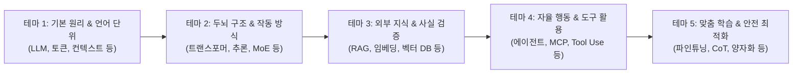

# [시니어 직장인의 AI 탐구기 #22] AI 대화가 술술 풀리는 마법의 사전: 시니어 직장인을 위한 생성형 AI 핵심 필수 용어 30선

> **핵심 요약**: 사내 회의, 뉴스, 프롬프트 작성 시 매일 마주치는 LLM·RAG·토큰·MCP 등 핵심 생성형 AI 필수 용어 30가지를 5대 실무 테마별 직관적 비유와 오픈코드 활용 팁으로 총정리합니다.
> **준비물**: 호기심과 실무 상식 · **소요 시간**: 약 10분

AI 관련 회의에 들어가거나 매뉴얼을 읽다 보면 *"사내 문서를 RAG로 연결하고, CoT 기법을 써서 할루시네이션을 줄이고, MCP로 에이전틱 워크플로우를 구성하자"*는 식의 외계어에 당황하기 쉽습니다. 하지만 이 용어들은 내 PC 옆자리의 똑똑한 AI 신입사원과 소통하기 위한 **업무용 공용어**일 뿐입니다. 30대 핵심 용어를 5대 테마별 표로 깔끔하게 정리해 드립니다.

---

## 🧭 한눈에 보는 5대 테마 용어 지도

---

## [테마 1] AI 기본 원리와 언어의 단위 (01~07)

| 번호 | 용어 (영문) | 핵심 정의 | 직장인 눈높이 비유 | 오픈코드 실무 연결 |
| :---: | :--- | :--- | :--- | :--- |
| **01** | **LLM** (Large Language Model) | 방대한 텍스트를 학습해 인간의 언어를 이해·생성하는 거대 인공신경망 | 세상의 온갖 백과사전을 통째로 외운 **'만능 수석 연구원'** | Gemini, Claude, DeepSeek, GPT 등 작업에 투입하는 AI 두뇌 |
| **02** | **프롬프트** (Prompt) | AI로부터 원하는 결과를 이끌어내기 위해 입력하는 질문과 지시문 | 부하 직원에게 건네는 **'구체적인 업무 지시서'** | 지시가 구체적일수록 완성도 높은 코드와 문서가 출력됨 |
| **03** | **토큰** (Token) | AI가 글자를 읽고 쓸 때 쪼개어 인식하는 최소 의미 조각 | 지하철 **'교통 요금'**이자 원고지의 **'글자 수 칸'** | 1단어당 약 1토큰(한글은 1~3토큰), 토큰 절약이 곧 비용 절감 |
| **04** | **컨텍스트 윈도우** (Context Window) | AI가 한 번에 기억하고 참고할 수 있는 최대 텍스트(토큰) 한도 | AI가 펼쳐놓고 작업할 수 있는 **'책상(작업대)의 넓이'** | 128K~1M 이상 넓을수록 대형 PDF나 전체 프로젝트 코드를 한 번에 분석 |
| **05** | **환각 현상** (Hallucination) | AI가 모르는 내용을 사실인 것처럼 그럴듯하게 거짓말하는 현상 | 곤란한 질문에 당황해 **'지어내는 신입사원의 헛소리'** | RAG([#26편](오픈코드26.md))나 원본 문서를 제공해 허위 답변 원천 차단 |
| **06** | **사전 학습** (Pre-training) | 특정 목적 없이 인터넷의 방대한 데이터를 읽어 언어의 기초를 익히는 단계 | 입사 전 학교에서 쌓는 **'기본 소양 및 기초 교양 교육'** | 수천억 페이지를 읽고 기본 언어 능력을 갖춘 원초적 파운데이션 모델 |
| **07** | **파라미터** (Parameters) | 학습을 통해 조율된 인공신경망 가중치들의 총합 (모델의 지적 규모) | 인간 뇌 속의 **'시냅스(신경망 연결) 총개수'** | 7B(70억 개), 70B, 671B 등 숫자가 클수록 고난도 복잡 추론에 능함 |

---

## [테마 2] 두뇌 구조와 작동 방식 (08~13)

| 번호 | 용어 (영문) | 핵심 정의 | 직장인 눈높이 비유 | 오픈코드 실무 연결 |
| :---: | :--- | :--- | :--- | :--- |
| **08** | **생성형 AI** (Generative AI) | 단순 판별을 넘어 새로운 글, 그림, 음악, 코드를 창작하는 인공지능 | 스팸을 골라내는 감별사를 넘어 직접 기획서를 쓰는 **'창작자'** | 질문에 맞는 코드, 문서, 다이어그램을 즉석에서 새로 작성 |
| **09** | **트랜스포머** (Transformer) | 단어 간 관계를 병렬로 동시 계산하는 현대 생성형 AI의 기반 아키텍처 | 페이지 전체를 한눈에 훑어 맥락을 파악하는 **'초고속 정보 고속도로'** | GPT, Gemini, Claude 등 모든 최신 LLM의 공통 척추 엔진 |
| **10** | **어텐션 메커니즘** (Attention) | 문장 속에서 어떤 단어가 다른 단어와 밀접한지 집중 가중치를 두는 기술 | 대명사 '그것'이 가리키는 대상에 **'형광펜을 칠하는 집중력'** | 수만 줄의 코드에서 함수 호출과 변수 간의 연관성을 꿰뚫어 봄 |
| **11** | **추론** (Inference) | 학습을 마친 모델이 새로운 입력을 받아 답을 계산해 내는 실전 행동 | 공부를 끝마친 학생이 시험지를 받아 들고 **'문제를 푸는 과정'** | 질문 후 AI가 실시간으로 토큰을 한 글자씩 써 내려가는 동작 |
| **12** | **MoE** (Mixture of Experts) | 전체 신경망 대신 질문 영역에 맞는 전문 소규모 서브넷만 켜는 구조 | 종합병원에서 환자 증상에 따라 **'전문의를 골라 호출하는 진료'** | DeepSeek V4.1 등이 채택, 적은 계산 리소스로 초고속 고품질 추론 달성 |
| **13** | **잠재 공간** (Latent Space) | 텍스트나 이미지의 의미와 맥락이 고차원 좌표로 압축 표현된 수학적 공간 | 비슷한 성격의 책들을 같은 서가에 꽂아둔 **'도서관 분류실'** | 단어 간의 의미적 거리와 유사성을 계산하는 추론의 무대 |

---

## [테마 3] 외부 지식 연결 & 사실 검증 (14~18)

| 번호 | 용어 (영문) | 핵심 정의 | 직장인 눈높이 비유 | 오픈코드 실무 연결 |
| :---: | :--- | :--- | :--- | :--- |
| **14** | **RAG** (Retrieval-Augmented Gen) | 모델 외부에 있는 최신 문서나 사내 문서를 검색해 근거로 답변하는 기술 | 머릿속 지식만으로 답하지 않고 **'사내 규정집을 펼쳐놓고 보는 오픈북 시험'** | 사내 규정 PDF를 읽혀 환각 없이 팩트에 기반한 답변 생성 ([#26편](오픈코드26.md)) |
| **15** | **임베딩** (Embedding) | 텍스트의 의미를 컴퓨터가 계산할 수 있는 숫자의 나열(벡터)로 변환하는 기술 | 사람의 신상 정보를 키·몸무게·적성 수치로 정량화한 **'디지털 지문'** | 의미가 비슷한 단어나 문장이 벡터 공간에서 가깝게 배치됨 |
| **16** | **벡터 DB** (Vector Database) | 임베딩된 벡터 데이터 간의 의미적 유사도를 초고속으로 검색하는 저장소 | 책 제목 대신 '줄거리와 분위기'로 책을 찾아주는 **'의미 기반 검색대'** | Qdrant, Chroma 등을 MCP로 연결해 대용량 사내 문서 검색 |
| **17** | **그라운딩** (Grounding) | AI의 답변을 검증된 외부 데이터나 실제 사실 출처에 단단히 결속시키는 과정 | 허공에 뜬 추측 대신 **'영수증과 근거 조항을 제시하는 감사 절차'** | 답변에 참고한 파일명과 페이지 번호를 각주로 명시하도록 강제 |
| **18** | **지식 그래프** (Knowledge Graph) | 정보 간의 복잡한 연결 관계를 노드(점)와 엣지(선)의 그물망으로 시각화한 구조 | 사내 조직도와 업무 결재 라인을 한눈에 그린 **'입체 인맥 지도'** | Graphify([#25편](오픈코드25.md))를 활용해 수백 개 파일 간 호출 경로 시각화 |

---

## [테마 4] 자율 행동과 도구 활용 (19~22)

| 번호 | 용어 (영문) | 핵심 정의 | 직장인 눈높이 비유 | 오픈코드 실무 연결 |
| :---: | :--- | :--- | :--- | :--- |
| **19** | **AI 에이전트** (AI Agent) | 단순 답변을 넘어 목표 달성을 위해 스스로 계획하고 도구를 써서 실행하는 AI | 말만 하는 조언자를 넘어 파일도 열고 프로그램도 돌리는 **'디지털 비서'** | OpenCode의 기본 정체성으로, 계획 수립·코드 작성·터미널 실행을 자율 수행 |
| **20** | **도구 사용** (Tool Use / Function Calling) | AI가 필요할 때 파일 읽기, 계산기, 웹 브라우저 등 외부 함수를 호출하는 능력 | 전문가가 필요에 따라 **'계산기를 두드리거나 사전을 펼쳐보는 행위'** | `read`, `edit`, `browser`, `bash` 도구를 활용해 내 컴퓨터 제어 |
| **21** | **MCP** (Model Context Protocol) | AI 에이전트와 외부 도구/데이터 간의 연결을 일원화한 세계 표준 규격 | USB 단자처럼 어떤 주변기기든 꽂으면 바로 쓰는 **'만능 연결 젠더'** | `kordoc`([#11편](오픈코드11.md)), `MarkItDown`([#19편](오픈코드19.md))을 한 줄로 연결 |
| **22** | **에이전틱 워크플로우** (Agentic Workflow) | 계획(Plan) ➡️ 도구 실행(Tool) ➡️ 검증(Eval) ➡️ 피드백 반영(Iterate)의 자율 루프 | 기획안 작성 후 결재받고 수정 보완해 납품하는 **'직장인의 업무 루틴'** | Plan 모드로 계획을 검토하고 Build 모드로 실행하는 유기적 협업 흐름 |

---

## [테마 5] 맞춤 학습 & 안전 경량화 (23~30)

| 번호 | 용어 (영문) | 핵심 정의 | 직장인 눈높이 비유 | 오픈코드 실무 연결 |
| :---: | :--- | :--- | :--- | :--- |
| **23** | **파인튜닝** (Fine-Tuning) | 사전 학습된 범용 모델에 특정 기업이나 분야의 데이터를 추가 학습시키는 기법 | 기본 소양을 갖춘 신입사원에게 **'사내 맞춤 직무 심화 교육'**을 시키는 것 | 법률·의료·금융 전용 특화 모델 구축에 활용 |
| **24** | **RLHF** (인간 피드백 강화학습) | 인간의 채점과 선호도 피드백을 통해 모델의 답변을 더 예의 바르고 안전하게 조정 | 선임 직원이 신입사원의 보고서를 빨간펜으로 첨삭 지도하는 **'도제 교육'** | 유해하거나 공격적인 답변을 줄이고 사용자 의도에 맞는 답변 유도 |
| **25** | **CoT** (Chain-of-Thought) | "단계별로 차근차근 생각해 보자"며 생각의 중간 추론 과정을 명시하게 하는 기법 | 정답만 툭 던지지 않고 **'수학 문제의 풀이 과정을 꼼꼼히 적는 것'** | 복잡한 코딩이나 수학 검산 시 프롬프트에 명시하면 오류가 극적으로 감소 |
| **26** | **멀티모달** (Multimodal) | 텍스트뿐만 아니라 이미지, 오디오, 비디오 등 다양한 형태의 입출력을 함께 처리 | 귀로 듣고 눈으로 차트를 보며 브리핑하는 **'오감형 인재'** | 에러 화면 스크린샷이나 손그림 와이어프레임을 첨부해 코딩 요청 |
| **27** | **제로샷 & 퓨샷** (Zero-Shot / Few-Shot) | 예시 없이 바로 질문(Zero)하거나, 1~2개 예시를 보여주고 풀게(Few) 하는 기법 | 설명만 듣고 일하기 vs **'작년 선배의 샘플 보고서 2장을 보여주며 시키기'** | 원하는 출력 양식이 엄격할 때 1~2개 샘플을 프롬프트에 넣으면 정확도 200% 상승 |
| **28** | **양자화** (Quantization) | 숫자의 정밀도(32비트 ➡️ 4비트)를 낮춰 모델의 용량을 획기적으로 다이어트 | 무거운 원본 사진을 **'가벼운 웹용 압축 이미지로 줄여 저장'**하는 기술 | 내 노트북의 적은 VRAM에서도 로컬 대형 모델(Ollama 등)을 쾌적하게 구동 |
| **29** | **가드레일** (Guardrails) | AI가 사내 보안 규정을 위반하거나 위험한 행동을 하지 못하도록 설정한 안전장치 | 도로 밖으로 차가 튕겨 나가지 않도록 막아주는 **'안전 난간'** | 권한 차단(`deny`) 규칙으로 프로젝트 외부 파일 수정이나 시스템 삭제 방지 |
| **30** | **지식 증류** (Knowledge Distillation) | 거대한 교사 모델의 핵심 지식을 작고 빠른 학생 모델로 압축 전수하는 기술 | 명의(名醫) 교수의 핵심 노하우만 쏙 뽑아 정리한 **'핵심 요약 족보'** | 작고 가벼운 모델로도 대형 모델 못지않은 정확도를 스마트폰이나 PC에서 발휘 |

---

[← 이전 글: [#21편] 한글(HWP)부터 오피스·다이어그램까지 한 창에서! 국어 교사가 만든 무료 오픈소스 '이음오피스(IeumOffice)' 완벽 가이드 & 오픈코드 연동](오픈코드21.md) · [다음 글: [#23편] AI에게 브라우저를 맡겨보세요: OpenCode @browser 사용법과 따라 하는 실습](오픈코드23.md) · [전체 연재 목차](README.md)
