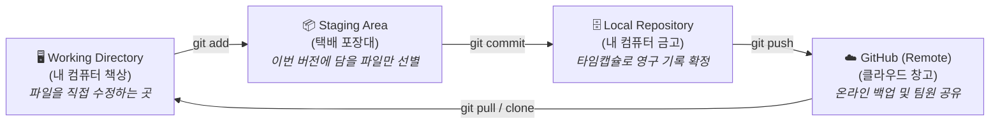

# [시니어 직장인의 AI 탐구기 #27] 유튜브 명강의 3선으로 끝내는 Git & GitHub 완벽 정복 가이드

> **“파일 이름을 `보고서_최종.docx`, `보고서_진짜최종.docx`, `보고서_수정2.docx`로 쌓아가며 지치셨나요?  
> 오픈코드(OpenCode)로 만든 소중한 코드와 문서를 절대 잃어버리지 않고 타임머신처럼 관리하는 `Git`과, 클라우드 금고 `GitHub`의 핵심만 유튜브 최고 평점 명강의 3선에서 쏙쏙 뽑아 시니어 직장인 눈높이로 완벽 정리했습니다!”**
>
> 실무 중심 Git & GitHub 입문 가이드 · 작성 및 자료 확인: 2026년 11월 15일  
> 참고 유튜브 명강의 3선:  
>
> 1. [얄팍한 코딩사전(얄코) — 제대로 파는 Git & GitHub](https://www.youtube.com/watch?v=1I3hMwQU6GU) ([최신 리뉴얼 편](https://youtu.be/0TEPC1UDGM0))  
> 2. [드림코딩 by 엘리 — 깃, 깃허브 제대로 배우기 (기본 마스터편)](https://www.youtube.com/watch?v=FXDjmsivAi4)  
> 3. [코딩알려주는누나 — 깃, 깃허브 한번에 이해시켜드리고 포트폴리오 올리는 법까지 알려드림](https://www.youtube.com/watch?v=cwC8t9dno2s)

안녕하세요! 시니어 직장인의 눈높이에서 AI 실무 도구를 가장 알기 쉽게 전해드리는 스물일곱 번째 시간입니다.

지난 [#26편](오픈코드26.md)에서는 AI가 거짓말하지 않고 사내 문서를 바탕으로 답하게 만드는 `Smart RAG & Vector Search`를 배웠습니다.

이제 오픈코드(OpenCode)와 함께 업무 자동화 스크립트도 짜고, 웹앱도 만들고, 문서도 자동으로 생성하다 보면 반드시 부딪히는 현실적인 고민이 있습니다.

> *"어제까지 잘 되던 코드인데, 오늘 AI한테 기능 하나 추가해 달랬다가 전체가 꼬여버렸어요! 어제로 되돌릴 수 없나요?"*  
> *"집에 있는 노트북에서 작업하던 프로젝트를 내일 회사 컴퓨터에서 이어서 작업하고 싶은데, 매번 USB로 복사해야 하나요?"*  
> *"유튜브에 Git 강의가 너무 많아서 어떤 것부터 봐야 할지 막막합니다."*

이 모든 고민을 단번에 해결해 주는 도구가 바로 **Git(깃)**과 **GitHub(깃허브)**입니다.

오늘은 유튜브에서 비전공자와 입문자들 사이에서 **"이것만 보면 감이 확 잡힌다"**며 가장 높은 평점과 추천을 받는 **대표 명강의 3가지**의 핵심 노하우만 한데 모아, 시니어 직장인의 눈높이에서 가장 쉽게 따라 할 수 있도록 총정리해 드리겠습니다!

---

## 1. 유튜브 평점 최상위 Git & GitHub 명강의 3선 비교

수많은 강의 중에서도 **① 원리 비유**, **② 구조적 체계**, **③ 당장 따라 치는 실전성** 세 박자가 완벽히 어우러진 3대 강의를 먼저 소개합니다.

| 추천 강의 | 채널명 | 핵심 강점 (왜 평점이 높을까?) | 이 글에서 가져온 핵심 비법 |
| :--- | :--- | :--- | :--- |
| **[제대로 파는 Git & GitHub](https://www.youtube.com/watch?v=1I3hMwQU6GU)** | **얄팍한 코딩사전 (얄코)** | • 애니메이션과 **'타임캡슐'·'평행우주'** 비유로 입문 장벽 파괴<br>• 과거로 돌아가는 법(`reset` vs `revert`)과 충돌 해결까지 명쾌하게 설명 | • 타임머신 원리 이해<br>• 안전한 과거 복구법<br>• 브랜치(Branch)와 병합 개념 |
| **[깃, 깃허브 제대로 배우기](https://www.youtube.com/watch?v=FXDjmsivAi4)** | **드림코딩 by 엘리** | • Git의 **3가지 작업 공간** 구조를 군더더기 없이 정석으로 설명<br>• 터미널(CLI)과 시각화 도구(GUI)를 함께 다뤄 흐름이 한눈에 보임 | • 3대 공간 구조(Working → Staging → Repo)<br>• `status`, `log`로 상태 추적<br>• CLI + GUI 병행 전략 |
| **[깃, 깃허브 한번에 이해시켜드리고…](https://www.youtube.com/watch?v=cwC8t9dno2s)** | **코딩알려주는누나** | • 비전공자 눈높이에 맞춘 친절한 톤과 **실전 3스텝 루틴**<br>• 초기 설정부터 내 프로젝트를 GitHub에 올리기까지 최단 코스 | • 1회성 초기 설정(`config`)<br>• 매일 쓰는 3단계 업로드 공식<br>• 팀 프로젝트 받기(`clone`) |

> 💡 **학습 추천 순서**: 개념이 낯설다면 **얄코(비유)**로 큰 그림을 이해하고 → **드림코딩 엘리(3공간 구조)**로 원리를 다진 뒤 → **코딩알려주는누나(3스텝 명령어)**로 내 손에 익히는 조합이 가장 완벽합니다.

---

## 2. Git vs GitHub, 10초 만에 구분하는 핵심 개념

초보자들이 가장 많이 헷갈리는 질문이 *"Git이랑 GitHub가 같은 거 아닌가요?"*입니다. 두 가지는 역할이 완전히 다릅니다.

> **한 줄 비유: `Git`은 내 컴퓨터에 달린 '타임머신(블랙박스)'이고, `GitHub`은 그 기록을 올려두는 '클라우드 금고(SNS)'입니다.**

| 구분 | Git (깃) | GitHub (깃허브) |
| :--- | :--- | :--- |
| **정체** | 내 컴퓨터에 설치하는 **버전 관리 프로그램** | 인터넷 상의 **원격 저장소 호스팅 서비스** (웹사이트) |
| **동작 위치** | 내 컴퓨터 내부 (**로컬, Local**) | 클라우드 서버 (**원격, Remote**) |
| **주요 역할** | 파일의 변경 이력(버전)을 스냅샷으로 기록하고 과거로 되돌림 | Git으로 기록한 프로젝트를 온라인에 백업하고 팀원과 공유·협업 |
| **인터넷 연결** | 인터넷이 없어도 내 컴퓨터에서 혼자 사용 가능 | 인터넷에 연결되어야 업로드(`push`)·다운로드(`pull`) 가능 |
| **비유** | 한글·워드 프로그램의 **'변경 내용 추적 및 저장'** 기능 | 완성된 문서를 팀과 공유하는 **'구글 드라이브 / 사내 공유 폴더'** |

---

## 3. Git의 3가지 작업 공간 (드림코딩 엘리 핵심 구조)

드림코딩 엘리 강의에서 가장 강조하는 핵심은 **Git이 파일을 관리하는 3개의 방(공간)**입니다. 이 그림만 머릿속에 넣으면 *"왜 `add`랑 `commit`을 두 번이나 나눠서 하지?"*라는 의문이 단번에 풀립니다.



1. **Working Directory (작업 디렉토리 — 내 책상):** 현재 내가 코드를 고치고 문서를 작성하는 실제 폴더입니다. 아직 Git에 정식 기록되지 않은 작업 중인 파일들이 있습니다.
2. **Staging Area (스테이징 영역 — 택배 포장대):** 이사를 가거나 택배를 보낼 때, 책상 위의 모든 물건을 다 넣지 않고 **이번에 보낼 물건만 골라 상자에 담는 공간**입니다. (`git add` 명령어로 담습니다.)
3. **Repository (저장소 — 영구 금고):** 상자 포장이 끝나면 뚜껑을 닫고 날짜와 라벨(메모)을 붙여 창고에 보관합니다. 이것이 바로 하나의 버전, 즉 **커밋(Commit)**입니다. (`git commit` 명령어로 확정합니다.)

> 📌 **왜 `add`와 `commit`을 나눌까요?**  
> 책상 위에서 A 기능 파일과 B 기능 파일을 동시에 고쳤더라도, *"일단 A 기능만 깔끔하게 따로 묶어서 기록(커밋)하고 싶다"* 할 때 A 파일만 포장대(`add`)에 올려 확정(`commit`)할 수 있기 때문입니다!

---

## 4. 실전 따라 하기: GitHub 가입·Git 설치부터 첫 업로드까지

이제 **코딩알려주는누나**와 **얄코** 강의의 실전 코스를 따라, GitHub 무료 계정을 만든 뒤 내 컴퓨터에 Git을 설치·설정하고 첫 업로드까지 순서대로 진행해 보겠습니다.

### 1단계: GitHub(깃허브) 무료 회원가입하기

먼저 내 프로젝트를 보관할 클라우드 금고인 **GitHub 계정**부터 만듭니다. 개인·소규모 팀 사용은 **완전 무료(Free)**입니다.

1. 웹 브라우저에서 **[GitHub 공식 사이트(github.com)](https://github.com)**에 접속한 뒤, 오른쪽 상단의 **`Sign up`** 버튼을 클릭합니다.
2. 안내에 따라 아래 3가지를 순서대로 입력합니다.
   * **이메일 주소(Email):** 실제로 인증 메일을 받을 수 있는 본인 이메일 입력 *(다음 3단계 Git 설정에서 똑같이 쓰므로 기억해 두세요!)*
   * **비밀번호(Password):** 영문·숫자·특수문자를 조합해 안전하게 설정
   * **사용자 이름(Username):** GitHub 주소(`https://github.com/내아이디`)에 들어갈 영문 아이디 입력 *(예: `gildong-hong`)*
3. 사람인지 확인하는 간단한 퍼즐을 풀고, 입력한 이메일로 도착한 **인증 코드(Launch code)**를 입력하면 가입이 완료됩니다.

> 💡 **가입 후 2단계 인증(2FA) 안내:** GitHub는 계정 보안을 위해 로그인 후 스마트폰 인증 앱(Google Authenticator, Microsoft Authenticator 등)이나 패스키를 통한 **2단계 인증** 등록을 권장·요청합니다. 화면 안내대로 한 번만 등록해 두면 내 소중한 코드가 안전하게 보호됩니다.

---

### 2단계: 내 컴퓨터에 Git 설치하기 (Windows / Mac)

먼저 내 컴퓨터에 Git이 이미 설치되어 있는지 터미널(Mac: `터미널`, Windows: `PowerShell` 또는 `명령 프롬프트`)에서 확인합니다.

```bash
git --version
```

`git version 2.xx.x`처럼 버전 숫자가 나오면 이미 설치되어 있으므로 **3단계**로 바로 넘어가시면 됩니다. 만약 *"명령을 찾을 수 없습니다"*라고 나온다면 OS에 맞게 설치해 주세요.

#### ① Windows 사용자 설치법

1. **[Git 공식 홈페이지](https://git-scm.com/downloads/win)**에 접속해 **Download for Windows (64-bit)** 설치 파일을 내려받아 실행합니다.
2. 설치 마법사가 나오면 별다른 옵션 변경 없이 **`Next`** 버튼만 계속 눌러 설치를 완료합니다.
3. 설치가 끝나면 시작 메뉴에서 **`Git Bash`**를 검색해 실행할 수 있습니다. (Windows에서도 Mac과 똑같은 리눅스 스타일 명령어를 쓸 수 있는 전용 터미널입니다!)

> 💡 **터미널 한 줄 설치 (Windows 11/10):** PowerShell에서 `winget install --id Git.Git -e --source winget` 명령어로도 바로 설치할 수 있습니다.

#### ② Mac 사용자 설치법

먼저 키보드에서 **`Command(⌘) + Space`**를 눌러 Spotlight 검색창을 열고, **`터미널`**(또는 `Terminal`)을 입력해 터미널 앱을 실행합니다. Mac에서는 아래 두 가지 방법 중 편한 것을 선택해 설치할 수 있습니다.

* **방법 A: 애플 기본 개발자 도구로 가장 쉽게 설치하기 (입문자 추천)**
  1. 터미널에 아래 명령어를 입력하고 `Enter`를 누릅니다.

     ```bash
     xcode-select --install
     ```

     *(또는 `git --version`만 입력해도 미설치 시 자동으로 설치 안내 창이 뜹니다.)*
  2. 화면에 **"명령어 라인 개발자 도구(Xcode Command Line Tools)를 설치하시겠습니까?"**라는 팝업 창이 뜨면 **`설치`** → 사용권 계약 **`동의`**를 차례로 클릭합니다.
  3. 인터넷 속도에 따라 약 3~10분 정도 기다리면 Git 설치가 자동으로 완료됩니다.

* **방법 B: Homebrew(`brew`)로 최신 버전 설치 및 관리하기 (개발·AI 도구 사용자 추천)**
  이미 맥용 패키지 관리자 Homebrew가 설치되어 있다면 항상 최신 버전의 Git을 깔끔하게 관리할 수 있습니다.
  1. 터미널에서 Homebrew 설치 여부를 먼저 확인합니다.

     ```bash
     brew --version
     ```

  2. 버전이 출력되면 아래 명령어로 Git을 설치합니다. (만약 `command not found: brew`가 뜬다면 **방법 A**를 쓰시거나, [Homebrew 공식 사이트](https://brew.sh/ko/)의 설치 명령어를 먼저 실행한 뒤 진행하세요.)

     ```bash
     brew install git
     ```

  3. **Apple Silicon(M1/M2/M3/M4) 맥 확인 팁:** 설치 후 터미널을 완전히 껐다가 다시 켠 뒤 `which git`을 입력했을 때 `/opt/homebrew/bin/git`이 나오면 Homebrew 최신 Git이 정상 적용된 것입니다.

설치가 끝났다면 터미널(또는 Windows `Git Bash`)을 새로 열고 `git --version`을 다시 입력해 `git version 2.xx.x`처럼 버전이 정상 출력되는지 확인합니다.

---

### 3단계: 내 컴퓨터에 이름표 붙이기 & 필수 초기 설정 (최초 1회만 실행)

Git은 누가 언제 파일을 고쳤는지 기록을 남깁니다. 컴퓨터를 바꿀 때까지 딱 한 번만 내 이름과 이메일, 기본 설정을 등록해 두면 됩니다.

```bash
# 1. 내 이름 설정 (영문 또는 한글 가능)
git config --global user.name "홍길동"

# 2. GitHub에 가입한 이메일 주소와 동일하게 입력 (중요! 잔디 심기 연동)
git config --global user.email "gildong@example.com"

# 3. 기본 브랜치 이름을 최신 표준인 'main'으로 통일
git config --global init.defaultBranch main
```

#### (선택) Windows·Mac 협업 시 깨짐 방지 꿀팁 설정

OS가 다른 컴퓨터를 오가며 작업한다면 아래 설정도 함께 해두면 한글 파일명이나 줄바꿈 오류를 예방할 수 있습니다.

```bash
# 한글 파일명이 \355\225\234... 처럼 숫자로 깨져 보이는 현상 방지
git config --global core.quotepath false

# 줄바꿈(엔터) 방식 차이로 인한 불필요한 변경 감지 방지
# Windows 사용자:
git config --global core.autocrlf true
# Mac 사용자:
git config --global core.autocrlf input
```

모든 설정을 마쳤다면 아래 명령어로 내가 입력한 값이 잘 저장되었는지 확인합니다.

```bash
git config --list
```

> 🔐 **GitHub 로그인(인증)은 어떻게 하나요?**  
> 처음 `git push`를 할 때 브라우저 창이 열리면서 **GitHub 로그인 및 권한 승인(Authorize)** 화면이 자동으로 뜹니다. 평소 쓰던 GitHub 아이디/비밀번호로 로그인해 승인 버튼을 누르면, 이후에는 내 컴퓨터가 인증 정보를 기억해 매번 로그인할 필요가 없습니다. (GitHub 공식 CLI인 `gh auth login`을 사용해도 매우 간편합니다.)

---

### 4단계: 내 프로젝트 폴더에 Git 심기 & 첫 업로드 (New Project)

내 컴퓨터의 프로젝트 폴더로 이동한 뒤, 아래 순서대로 진행하면 GitHub에 코드가 안전하게 올라갑니다.

```bash
# 1. 현재 폴더를 Git이 관리하는 저장소로 초기화 (.git 숨김 폴더 생성)
git init

# 2. 현재 상태 확인하기 (수시로 쳐보는 습관이 좋습니다!)
git status

# 3. 현재 폴더의 모든 변경 파일을 포장대(Staging Area)에 담기
# (특정 파일만 담고 싶다면: git add 파일이름)
git add .

# 4. 의미 있는 메시지와 함께 첫 번째 타임캡슐(Commit) 만들기
git commit -m "첫 번째 프로젝트 업로드"
```

이제 내 컴퓨터 금고(`Local Repository`)에는 안전하게 저장되었습니다. 다음으로 GitHub 웹사이트에서 `New repository` 버튼을 눌러 새 빈 창고를 만들고, 그 주소를 내 컴퓨터와 연결해 줍니다.

```bash
# 5. 내 컴퓨터와 GitHub 원격 저장소(origin) 연결하기
git remote add origin https://github.com/내아이디/내저장소이름.git

# (선택) 연결이 잘 되었는지 주소 확인
git remote -v

# 6. GitHub 클라우드로 최종 발사 (Push)!
# 참고: 기본 브랜치 이름이 main인 경우 main, master인 경우 master 사용
git push -u origin main
```

---

### 5단계: 매일 반복하는 실무 업데이트 3스텝 (Daily Work)

한 번 연결(`remote add`)을 끝내면, 다음 날부터 코드를 수정하거나 새 문서를 만들었을 때는 아래 **황금 3스텝**만 계속 반복하면 됩니다.

```bash
git add .
git commit -m "로그인 버튼 디자인 수정 및 오타 교정"
git push origin main
```

---

### 6단계: 회사/집 컴퓨터 동기화 및 팀 프로젝트 내려받기

* **처음 통째로 내려받을 때 (`clone`)**: GitHub에 올라가 있는 프로젝트를 내 다른 컴퓨터나 팀원 컴퓨터로 처음 복사해 올 때 사용합니다.

  ```bash
  git clone https://github.com/내아이디/내저장소이름.git
  ```

* **이미 있는 폴더에서 최신 변경분만 당겨올 때 (`pull`)**: 회사에서 수정하고 `push`한 내용을 집 컴퓨터에서 이어서 작업하기 전에 실행합니다.

  ```bash
  git pull origin main
  ```

---

## 5. 시니어의 안전장치: 과거로 되돌리기 & 평행우주 브랜치 (얄코 핵심)

**얄팍한 코딩사전(얄코)** 강의에서 가장 호평받는 파트는 **"실수했을 때 과거로 돌아가는 법"**과 **"원본을 망가뜨리지 않고 새 기능을 실험하는 법"**입니다.

### ① 과거로 돌아가는 두 가지 방법: `reset` vs `revert`

게임에서 세이브 포인트로 돌아가는 것과 비슷하지만, **기록을 지우느냐 남기느냐**에 큰 차이가 있습니다.

| 명령어 | 동작 방식 (비유) | 언제 사용하나요? |
| :--- | :--- | :--- |
| **`git reset`** | **시간을 아예 되감아** 그 이후의 기억을 지워버림 | **혼자 작업할 때**, 아직 GitHub에 올리기 전 실수를 깨끗이 지우고 싶을 때 |
| **`git revert`** | 과거의 실수를 **반대로 되돌리는 새로운 기록**을 하나 더 쌓음 | **이미 GitHub에 올렸거나 팀원과 협업 중일 때** (기존 역사를 지우지 않아 안전함!) |

---

### ② 평행우주 만들기: 브랜치(Branch)와 병합(Merge)

멀쩡히 잘 돌아가는 회사 홈페이지 코드에 새로운 결제 기능을 추가하고 싶습니다. 원본 코드를 바로 고치다가 고장 나면 큰일 나겠죠? 이때 사용하는 것이 **브랜치(Branch, 나뭇가지)**입니다.

1. **`branch` 생성**: 원본(`main`)을 그대로 둔 채, 나만의 **평행우주(예: `feature/payment`)**를 하나 복제해 빠져나옵니다.
2. **독립 작업**: 평행우주 안에서 마음껏 실험하고 고치고 커밋합니다. 원본 서비스에는 아무 영향이 없습니다.
3. **`merge` (병합)**: 새 기능이 완벽히 완성되면, 평행우주의 결과물을 원본(`main`)에 합칩니다.
4. **충돌(Conflict) 해결**: 만약 같은 파일의 같은 줄을 두 사람이 서로 다르게 고쳐서 합칠 때 Git이 *"어느 쪽을 쓸까요?"*라고 멈추면, 당황하지 말고 두 코드 중 남길 부분만 골라 저장한 뒤 다시 `add` → `commit`하면 해결됩니다.

> 💡 **검은 터미널 화면이 여전히 부담스럽다면?**  
> 얄코와 엘리 모두 강조하듯, 명령어를 억지로 외울 필요는 없습니다! **[GitHub Desktop](https://desktop.github.com/)**, **[SourceTree](https://www.sourcetreeapp.com/)**, 혹은 **VS Code 왼쪽의 소스 제어(Source Control) 탭**을 사용하면 마우스 클릭만으로 커밋 내역과 브랜치 나무 모양을 그림으로 보면서 편하게 관리할 수 있습니다.

---

## 6. 오픈코드(OpenCode)와 함께 쓰는 Git & GitHub 실전 프롬프트

우리 시니어 직장인에게는 강력한 무기 **오픈코드(OpenCode)**가 있습니다! Git 명령어가 헷갈릴 때는 오픈코드 대화창에 직접 부탁하면 안전하게 상태를 확인하고 명령을 실행해 줍니다.

### [예제 1] 현재 프로젝트 안전하게 커밋 & 푸시하기

```text
현재 프로젝트 폴더의 git 상태를 확인(git status)해서 변경된 파일이 무엇인지 알려줘.
민감한 비밀번호나 API 키(.env 등)가 포함되지 않았는지 확인한 뒤,
변경 내용을 요약한 한국어 커밋 메시지로 commit하고 GitHub(origin main)에 push해줘.
```

### [예제 2] 실수 방지용 실험 브랜치(Branch) 만들기

```text
지금부터 새로운 기능을 테스트할 건데 원본 코드가 망가지면 안 돼.
'experiment/new-ui'라는 이름의 새 브랜치를 만들고 그쪽으로 이동해줘.
```

### [예제 3] 어제 작업 상태로 안전하게 되돌리기

```text
최근 커밋 로그(git log -n 5)를 보여줘.
방금 수정한 코드가 엉켜버렸는데, 아직 push는 안 했어.
가장 최근 커밋 상태로 작업 파일을 되돌리는 안전한 방법을 안내해줘.
```

---

## 7. 시니어 직장인을 위한 FAQ & 실수 예방 체크리스트

### Q1. 파일 하나 고칠 때마다 매번 `push` 해야 하나요?

**아닙니다!** 내 컴퓨터에서 작은 기능 하나를 완성할 때마다 `commit`(로컬 저장)을 자주 해두고, 오늘 퇴근 전이나 의미 있는 작업 단락이 끝났을 때 한 번에 `push`(GitHub 클라우드 업로드)하시면 됩니다.

### Q2. `.gitignore` 파일은 왜 꼭 만들어야 하나요?

GitHub는 전 세계 사람들이 볼 수 있는 공개 공간(Public)으로 설정되는 경우가 많습니다. **API 키, 비밀번호(`.env`), 개인정보 파일, 용량이 큰 임시 파일(`node_modules`, `.venv`)** 등이 실수로 올라가지 않도록 **"이 파일들은 Git이 무시하고 절대 올리지 마!"**라고 적어두는 블랙리스트 파일이 `.gitignore`입니다. 프로젝트 시작 시 가장 먼저 챙겨야 할 필수 안전장치입니다.

### Q3. 혼자서 작업할 때도 Git과 GitHub가 필요한가요?

**네, 무조건 추천합니다!** 혼자 일할 때도 3개월 전의 나, 어제의 나는 사실상 다른 사람과 같습니다. 언제든 과거 버전으로 돌아갈 수 있는 보험이자, 내 컴퓨터가 갑자기 고장 나도 코드를 100% 살려내는 무료 클라우드 백업 역할을 톡톡히 해줍니다.

---

## 8. 오늘 바로 기억할 핵심 요약

> ### 📌 오늘의 1분 핵심 요약
>
> 1. **Git vs GitHub**: Git은 내 컴퓨터의 **타임머신(버전 관리)**, GitHub은 인터넷에 올리는 **클라우드 금고(백업·협업)**
> 2. **3가지 공간**: 책상(`Working Directory`) → 택배 포장(`git add`, `Staging Area`) → 금고 보관(`git commit`, `Repository`)
> 3. **매일 쓰는 3스텝**: `git add .` → `git commit -m "메모"` → `git push origin main`
> 4. **안전장치**: 원본을 지키는 평행우주 **브랜치(`branch`)**, 명령어가 낯설면 **GUI 툴**이나 **오픈코드**에게 맡기기!

이제 더 이상 `최종_진짜최종_수정3.docx` 같은 파일 이름 때문에 머리 아파하지 마세요. 오늘 배운 Git과 GitHub라는 든든한 타임머신을 장착하고, 오픈코드와 함께 두려움 없이 마음껏 코드를 실험하고 기록해 보시기 바랍니다!

---

[← 이전 글: [#26편] AI가 거짓말하지 않고 똑똑하게 일하는 법: Smart RAG & Vector Search 완벽 정리](오픈코드26.md) · [다음 글: [#28편] 에뮬레이터 없이 무료 클라우드 직결! Firebase 콘솔과 오픈코드로 만드는 실전 파일 포털 'ClientVault'](오픈코드28.md) · [전체 연재 목차](README.md)
