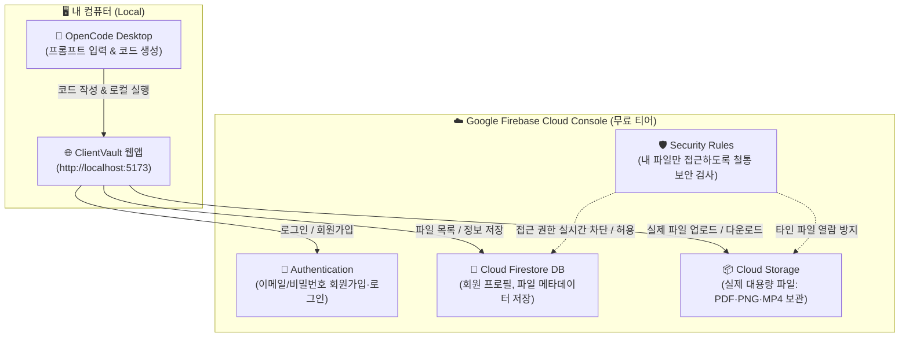
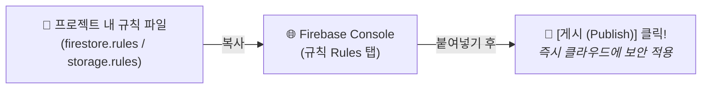
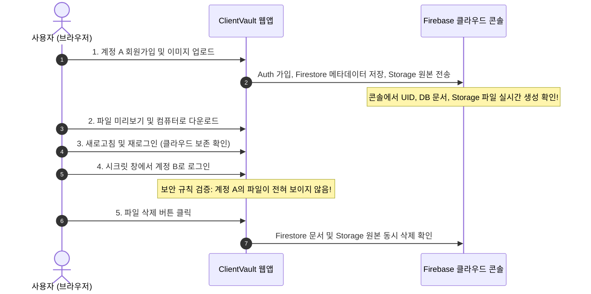

# [시니어의 AI 탐구기 #28] Firebase 클라우드 콘솔로 ClientVault 만들기: 에뮬레이터 없이 무료 클라우드로 구축하는 실전 파일 포털

> **"웹앱에 파일 업로드 기능을 넣고 싶은데, 복잡한 Java 설치나 에뮬레이터 설정 때문에 막히셨나요?  
> 구글 파이어베이스(Firebase)의 넉넉한 평생 무료(Free Tier) 클라우드를 오픈코드(OpenCode)에 직접 연결하면, 내 컴퓨터에 무거운 개발 환경을 깔지 않고도 로그인·DB·파일 보관함까지 완비된 안전한 고객 전용 파일 포털(ClientVault)을 완성할 수 있습니다!"**
>
> 실무 중심 Firebase 클라우드 연동 가이드 · 작성 및 자료 확인: 2026년 11월 20일  
> 실습 준비물: OpenCode Desktop, 웹 브라우저, 구글 계정 (Java나 에뮬레이터 설치 불필요!)

안녕하세요! 시니어 직장인의 눈높이에서 AI 실무 도구를 가장 알기 쉽게 전해드리는 스물여덟 번째 시간입니다.

지난 [#27편](오픈코드27.md)에서는 소중한 코드와 문서를 타임머신처럼 안전하게 백업하고 협업하는 `Git & GitHub 완벽 정복 가이드`를 살펴보았습니다.

앞서 [#14편](오픈코드14.md)에서는 브라우저의 로컬스토리지(`localStorage`)를 활용해 설치 없는 칸반 보드 웹앱을 만들어 보았는데요, 실무에서 실제로 쓰다 보면 곧 이런 한계에 부딪히게 됩니다.

---

## 1. 무엇을 어디서 하는지 한눈에 익히기

본격적인 실습에 들어가기 전, 각 도구가 무슨 일을 맡고 내가 어디를 확인해야 하는지 머릿속에 큰 그림을 먼저 그려두면 개발이 훨씬 쉬워집니다.



### [표] 도구별 역할과 내가 확인할 포인트

| 도구 | 주요 역할 | 실습 중 내가 확인할 것 |
| :--- | :--- | :--- |
| **OpenCode** | 앱 화면·동작 코드 작성 및 빌드 점검 | 단계별 프롬프트 입력, 변경 파일(`diff`)과 터미널 실행 결과 검토 |
| **Firebase Console** | 클라우드 프로젝트 생성 및 데이터·사용자 실시간 확인 | 가입된 계정, Firestore 데이터베이스 문서, Storage 저장 파일 확인 |
| **Firebase Authentication** | 이메일 회원가입·로그인·로그아웃 처리 | 가입한 사용자의 고유 식별자(UID) 생성 여부 |
| **Cloud Firestore** | 이메일·등록 시각·파일 이름과 크기 등의 목록 저장 | `users/{uid}` 및 `files/{fileId}` 데이터 문서 생성 여부 |
| **Cloud Storage for Firebase** | 실제 파일 내용(바이트 데이터) 저장 | 사용자 UID 하위 폴더에 파일이 정상 보관되는지 |
| **Firebase Security Rules** | 계정별 데이터 접근 권한 실시간 검사 | 타인의 파일 접근이 Firebase 서버 차원에서 안전하게 거부되는지 |

> 💡 **ClientVault 실습 범위 안내**:  
> 본 실습의 업로드 범위는 파일당 10 MiB, JPG·PNG·WebP·PDF·MP4 형식입니다. 개발 도구인 OpenCode의 AI 모델은 앱 자체에 포함되지 않으므로, 완성된 ClientVault를 실행하는 데 별도의 Gemini나 OpenAI API 키가 전혀 소모되지 않습니다.

---

## 2. 안심하고 쓰는 무료 개발 시험 범위 (Always Free)

많은 시니어 직장인분들이 클라우드 서비스를 시작할 때 **"나도 모르게 요금 폭탄을 맞으면 어쩌지?"**라는 걱정을 가장 많이 하십니다. Firebase의 무료 제공 정책을 정확히 알고 나면 마음 편히 개발에 집중할 수 있습니다.

* **로컬 에뮬레이터 및 Java 설치 불필요**: 모든 인증·DB·스토리지 동작을 브라우저의 Firebase 클라우드 콘솔과 직접 연결해 시험하므로, 컴퓨터에 무거운 Java(JDK 21)나 에뮬레이터 패키지를 설치할 필요가 전혀 없습니다.
* **넉넉한 무료 사용량 (Always Free 할당량)**:
  * **Authentication**: 이메일/비밀번호 로그인 기준 **월 50,000 MAU(활성 사용자)**까지 완전 무료입니다.
  * **Cloud Firestore**: 데이터 저장 용량 **1 GiB**, 일일 문서 읽기 **50,000회**, 쓰기 **20,000회**, 삭제 **20,000회**까지 매일 무료로 제공됩니다.
  * **Firebase Hosting**: 저장 용량 **10 GB**, 일일 전송량 **360 MB**까지 무료입니다.
  * **Cloud Storage**: 신규 Storage 버킷 생성 시 Firebase 정책에 따라 프로젝트를 **Blaze(종량제) 플랜**으로 설정해야 하지만, 기본 무료 할당량(**저장 공간 5 GB, 일일 다운로드 1 GB, 일일 업로드 20,000회, 다운로드 50,000회**) 이내에서 개인 학습 및 테스트를 진행하면 **요금이 0원(무료)**으로 유지됩니다.

> 🔒 **요금 0원 사수 꿀팁: Cloud Billing 예산 알림 설정**  
> 더 안심하고 실습할 수 있도록 구글 클라우드 콘솔의 [Cloud Billing 예산 및 알림](https://docs.cloud.google.com/billing/docs/how-to/budgets) 메뉴에서 예산을 **5,000원**으로 설정해 두세요. 기준 금액의 50%, 90% 도달 시 이메일로 즉시 경고를 보내주므로 실수로 인한 과금을 원천 차단할 수 있습니다. ([Storage 공식 요금 안내 참고](https://firebase.google.com/docs/storage/faqs-storage-changes-announced-sept-2024?hl=ko))

---

## 3. Firebase 클라우드 콘솔에서 백엔드 준비하기 (5단계)

먼저 크롬 브라우저를 열고 **[Firebase Console(console.firebase.google.com)](https://console.firebase.google.com/)**에 접속하여 5단계 백엔드 세팅을 진행합니다.

### 1단계: 프로젝트 만들기
1. [Firebase Console](https://console.firebase.google.com/)에 접속해 **`프로젝트 만들기`**(또는 `프로젝트 추가`)를 클릭합니다.
2. 프로젝트 이름에 `ClientVault`를 입력하고 안내에 따라 생성합니다. *(Google Analytics 설정은 체크를 끄고 진행하셔도 무방합니다.)*
3. 콘솔 화면에 나타나는 고유 **프로젝트 ID**(예: `clientvault-a1b2c`)를 눈여겨봅니다.

---

### 2단계: Authentication (이메일/비밀번호 로그인 활성화)
1. 왼쪽 탐색 메뉴에서 **빌드(또는 보안) → Authentication → 시작하기**를 클릭합니다.
2. **로그인 방법(Sign-in method)** 탭에서 **`이메일/비밀번호`** 항목을 선택합니다.
3. 첫 번째 스위치인 **`사용 설정(Enable)`**을 켜고 **저장**합니다. *(두 번째인 이메일 링크 로그인은 켜지 않습니다.)*
4. **Users(사용자)** 탭으로 이동해 **`사용자 추가`** 버튼을 누르고, 테스트용 임의 이메일과 비밀번호를 입력해 관리자 또는 첫 번째 테스트 계정을 하나 미리 등록해 둡니다.

---

### 3단계: Cloud Firestore Database 만들기
1. 왼쪽 메뉴에서 **빌드 → Firestore Database → 데이터베이스 만들기**를 클릭합니다.
2. 데이터베이스 ID는 기본값 `(default)`을 유지하고, 에디션은 **Standard 버전**을 선택합니다.
3. 위치(Location)는 한국과 가장 가까운 서울 리전(`asia-northeast3 (Seoul)`) 또는 미국 리전(`us-central1`)을 선택합니다.
4. 보안 규칙 시작 모드는 **프로덕션 모드에서 시작**을 선택하고 **만들기**를 누릅니다.

---

### 4단계: Cloud Storage 버킷 만들기
1. 왼쪽 메뉴에서 **빌드 → Storage → 시작하기**를 클릭합니다.
2. 만약 프로젝트 요금제 업그레이드 안내가 나오면 **`프로젝트 업그레이드 → Cloud Billing 계정 선택`**을 진행합니다. *(앞서 확인한 5,000원 예산 알림 계정을 연결하면 무료 할당량 내에서 요금 0원으로 안전하게 유지됩니다.)*
3. 보안 규칙 단계에서 **프로덕션 모드**를 선택하고, 기본 리전을 선택한 뒤 버킷 생성을 완료합니다.

---

### 5단계: 웹앱 등록 및 연동 설정값(`firebaseConfig`) 복사
1. 콘솔 왼쪽 상단 톱니바퀴 아이콘(프로젝트 설정) 클릭 ➡️ **`프로젝트 설정`** ➡️ **일반** 탭으로 들어갑니다.
2. 아래쪽으로 스크롤하여 **내 앱** 섹션에서 웹 아이콘(**`</>`**)을 클릭합니다.
3. 앱 닉네임에 `clientvault-web`을 입력하고 **앱 등록**을 누릅니다. *(Firebase Hosting 설정 체크박스는 건너뛰어도 됩니다.)*
4. 화면에 나타나는 **`firebaseConfig`** 객체 코드(아래 6개 값)를 복사해 메모장에 안전하게 저장해 둡니다.

```javascript
// 메모장에 따로 보관해둘 설정값 예시
const firebaseConfig = {
  apiKey: "AIzaSyCJOIAGxE....",
  authDomain: "clientvault-12345.firebaseapp.com",
  projectId: "clientvault-12345",
  storageBucket: "clientvault-12345.firebasestorage.app",
  messagingSenderId: "920651388677",
  appId: "1:920651388677:web:...."
};
```

---

## 4. 오픈코드(OpenCode)에서 프롬프트 하나로 앱 구축하기

백엔드 클라우드 준비가 끝났으니, 이제 내 컴퓨터에서 오픈코드 데스크탑을 열어 멋진 SaaS 웹앱을 만들어 보겠습니다.

### 1단계: 프로젝트 폴더 준비
1. Mac의 Finder나 터미널을 이용해 실습용 폴더(예: `~/Documents/clientvault`)를 하나 만듭니다.
2. 오픈코드 데스크탑(OpenCode Desktop)을 실행하고 해당 폴더를 작업 영역으로 엽니다.

### 2단계: 오픈코드에 마법의 프롬프트 전달하기
오픈코드 대화창에 아래 프롬프트 양식을 복사한 뒤, 방금 3단계에서 복사해 둔 **나만의 `firebaseConfig` 6개 값**을 채워 넣고 엔터를 누릅니다.

```text
[개요]
ClientVault라는 웹 앱을 구축합니다. 이 앱은 프리랜서와 디자이너가 클라이언트가 동영상, 문서, 이미지 등의 파일을 안전하게 업로드하고 관리할 수 있도록 하는 클라이언트 파일 포털입니다.

[필요한 기능]
- 사용자 가입, 로그인, 로그아웃 페이지
- 업로드된 파일을 보여주는 비공개 클라이언트 대시보드
- 파일 업로드, 보기(미리보기), 다운로드 및 영구 삭제 버튼
- 관리자는 등록된 사용자와 파일 현황을 모니터링 가능
- 여기에 나열되지 않았으나 앱이 제대로 작동하는 데 필요한 기타 필수 기능 및 예외 처리 포함

[디자인 콘셉트]
명확한 타이포그래피와 직관적인 레이아웃을 갖춘 깔끔하고 현대적이며 전문적인 SaaS 대시보드 디자인 (반응형 지원).

[백엔드 기능]
- 사용자 인증 (Firebase Authentication 이메일/비밀번호)
- 사용자 프로필 및 파일 메타데이터 저장을 위한 Cloud Firestore 데이터베이스
- 업로드된 파일 본체 저장을 위한 Firebase Storage
- 각 사용자가 오직 자신의 파일에만 접근할 수 있도록 통제하는 보안 규칙 파일(firestore.rules, storage.rules) 자동 생성
- 다음 자격 증명을 사용하여 Firebase 프로젝트에 직접 연결:
const firebaseConfig = {
  apiKey: "본인의_API_KEY",
  authDomain: "본인의_PROJECT_ID.firebaseapp.com",
  projectId: "본인의_PROJECT_ID",
  storageBucket: "본인의_STORAGE_BUCKET",
  messagingSenderId: "본인의_SENDER_ID",
  appId: "본인의_APP_ID"
};
```

프롬프트를 전송하면 오픈코드가 프로젝트 환경(Vite + React 또는 바닐라 웹앱)을 구성하고, Firebase SDK 연결 파일, UI 컴포넌트, 그리고 **보안 규칙 파일(`firestore.rules`, `storage.rules`)**까지 일사천리로 작성해 줍니다!

---

## 5. ★ 가장 중요: Firebase 보안 규칙(Rules) 게시하기

여기서 많은 입문자분들이 **"코드는 다 짰는데 파일 업로드가 안 되고 권한 에러(Permission Denied)가 나요!"**라며 발을 동동 구릅니다. 이 문제를 해결하는 열쇠가 바로 **보안 규칙(Security Rules)**입니다.

Firebase Storage와 Firestore는 처음 생성하면 구글이 보안을 위해 **"외부에서의 모든 읽기·쓰기를 원천 차단(`allow read, write: if false;`)"**하도록 기본 잠금을 걸어둡니다.  
따라서 우리 앱에서 **로그인한 정상 사용자만 자기 파일을 올리고 내릴 수 있도록** 규칙을 등록해 주어야 합니다.

오픈코드가 프로젝트 폴더에 만들어 준 `firestore.rules`와 `storage.rules` 파일을 열어 내용을 확인한 뒤, Firebase 콘솔에 그대로 반영합니다.



### 1) Firestore 보안 규칙 적용하기
1. [Firebase Console](https://console.firebase.google.com/) ➡️ **Firestore Database** ➡️ 상단 **`규칙(Rules)`** 탭을 클릭합니다.
2. 기존 내용을 지우고, 오픈코드가 작성해 준 `firestore.rules` 내용(또는 아래 표준 규칙)을 붙여넣습니다.
3. 오른쪽 상단의 **`게시(Publish)`** 버튼을 누릅니다.

```javascript
rules_version = '2';
service cloud.firestore {
  match /databases/{database}/documents {
    // 사용자 프로필: 본인 문서만 읽기/쓰기 허용
    match /users/{userId} {
      allow read, write: if request.auth != null && request.auth.uid == userId;
    }
    // 파일 메타데이터: 본인 파일 정보만 관리 허용
    match /users/{userId}/files/{fileId} {
      allow read, write: if request.auth != null && request.auth.uid == userId;
    }
  }
}
```

### 2) Storage 보안 규칙 적용하기
1. [Firebase Console](https://console.firebase.google.com/) ➡️ **Storage** ➡️ 상단 **`규칙(Rules)`** 탭을 클릭합니다.
2. 기존 코드를 지우고, 오픈코드가 만든 `storage.rules` 내용(또는 아래 표준 규칙)을 붙여넣습니다.
3. 오른쪽 상단의 **`게시(Publish)`** 버튼을 누릅니다.

```javascript
rules_version = '2';
service firebase.storage {
  match /b/{bucket}/o {
    // 본인의 UID 경로 아래에만 10MB 이하 파일 업로드 및 접근 허용
    match /users/{userId}/files/{fileId} {
      allow read, write: if request.auth != null 
                         && request.auth.uid == userId
                         && request.resource.size < 10 * 1024 * 1024;
    }
  }
}
```

> ⚠️ **주의**: 규칙 수정 후 반드시 **[게시(Publish)]** 버튼을 눌러야 클라우드 서버에 즉시 적용됩니다! 게시를 누르지 않으면 이전의 '전체 차단' 상태가 그대로 유지됩니다.

---

## 6. 개발 서버 실행 및 클라우드 연동 시험 (5단계 시나리오)

이제 터미널을 열고 개발 서버를 실행해 실제 클라우드와 매끄럽게 통신하는지 검증할 시간입니다. 별도의 무거운 에뮬레이터 탭 없이 터미널 단 한 줄이면 충분합니다.

```bash
cd ~/Documents/clientvault
npm run dev
```

브라우저에서 **`http://localhost:5173`**을 열고 다음 5단계 시나리오에 따라 차례대로 테스트를 진행합니다.



1. **테스트 계정 A 가입 및 파일 업로드**:
   * 웹 화면에서 `owner@example.com` 같은 테스트 계정으로 회원가입하고 로그인합니다.
   * 작은 PNG 이미지나 PDF 파일을 업로드합니다.
2. **Firebase 콘솔 실시간 확인**:
   * **Authentication ➡️ Users**: 계정 A와 고유 `UID`가 생성되었는지 확인합니다.
   * **Firestore Database ➡️ 데이터**: `users/{uid}` 프로필 문서와 하위 `users/{uid}/files/{fileId}` 문서가 생성되었는지 확인합니다.
   * **Storage ➡️ Files**: `users/{uid}/files/{fileId}` 경로에 실제 파일 객체가 업로드되었는지 확인합니다.
3. **미리보기·다운로드 및 데이터 영구성 확인**:
   * 목록에서 **미리보기(열기)**와 **다운로드**를 실행해 봅니다.
   * 브라우저를 새로고침하거나 로그아웃 후 다시 로그인해도 파일 목록이 그대로 유지되는지 확인합니다. *(실제 구글 클라우드에 영구 보관되므로 로컬 서버를 껐다 켜도 안전합니다!)*
4. **시크릿 창을 통한 보안 격리 시험**:
   * 브라우저 시크릿 창(Private Window)을 열어 계정 B(`guest@example.com`)로 회원가입합니다.
   * 계정 A가 올린 파일이 목록에 전혀 나타나지 않는지 확인하고, 계정 B만의 파일을 하나 업로드해 봅니다.
5. **영구 삭제 시험**:
   * 파일 삭제 버튼을 눌렀을 때 웹 화면 목록에서 사라질 뿐만 아니라, Firebase Console의 Firestore 문서와 Storage 파일 객체까지 깔끔하게 함께 삭제되는지 확인합니다.

---

## 7. 자주 막히는 지점 (트러블슈팅 & @browser 활용)

실습 중 가장 흔하게 겪는 돌발 상황과 오픈코드를 통해 단번에 해결하는 프롬프트 팁입니다.

| 증상 및 문제 상황 | 원인 | 오픈코드에 입력할 해결 프롬프트 |
| :--- | :--- | :--- |
| **파일 다운로드 버튼을 눌렀는데 컴퓨터로 저장되지 않고 새 브라우저 탭에서 파일이 그냥 열려버림** | 브라우저가 이미지·PDF 링크를 받으면 다운로드 대신 자체 뷰어로 바로 렌더링하기 때문 | *"파일을 다운로드하면 브라우저 새 탭에서 열리기만 하고 내 컴퓨터로 다운로드가 되지 않아. Blob 객체로 변환하여 브라우저 강제 다운로드(a 태그 download 속성)가 동작하도록 코드를 수정해줘."* |
| **다운로드 로직 수정 후에도 진짜 파일이 내려받아지는지 확신이 안 설 때** | 실제 브라우저 자동화 도구를 통한 검증 필요 | *"@browser 도구를 사용해서 http://localhost:5173에 접속한 뒤 로그인하고, 파일 다운로드 버튼 클릭 시 실제 브라우저 다운로드가 정상 작동하는지 시험하고 검증해줘."* |
| **파일 업로드 시 `FirebaseError: Missing or insufficient permissions` 발생** | 5단계의 보안 규칙(Rules)이 제대로 게시되지 않았거나 경로 불일치 | *"Firebase 보안 규칙 권한 에러가 발생해. 프로젝트의 firestore.rules와 storage.rules 파일을 점검하고, 내가 Firebase 콘솔에 어떻게 붙여넣어야 하는지 경로를 다시 맞춰줘."* |

---

## 8. 실습 완료 체크리스트

모든 과정이 끝났다면 다음 체크리스트를 확인하며 완성도를 점검해 보세요.

- [ ] **백엔드 구축**: Firebase Console에서 프로젝트를 생성하고 Authentication(이메일/비밀번호), Firestore DB, Storage 설정을 완료했다.
- [ ] **설정 연동**: `firebaseConfig` 6개 값을 오픈코드 프롬프트에 정확히 전달하여 앱을 생성했다.
- [ ] **보안 규칙 배포**: Firebase Console의 Firestore Rules와 Storage Rules 탭에 규칙을 붙여넣고 **[게시(Publish)]**를 눌렀다.
- [ ] **클라우드 실시간 검증**: 회원가입 후 Firebase Console의 Users, Firestore 문서, Storage 파일 목록이 실시간으로 생성되는 것을 두 눈으로 확인했다.
- [ ] **보안 격리 확인**: 다른 계정으로 로그인했을 때 타인의 파일이 보이지 않는 철통 보안을 확인했다.
- [ ] **다운로드 검증**: 이미지나 PDF 파일을 클릭했을 때 브라우저에서 열리지 않고 내 컴퓨터 다운로드 폴더로 안전하게 저장되는 것을 확인했다.

---

## 9. 오늘 바로 기억할 핵심 요약

> ### 📌 오늘의 1분 핵심 요약
>
> 1. **에뮬레이터 없는 쾌적함**: 무거운 Java JDK 21이나 복잡한 에뮬레이터 없이, 브라우저의 **Firebase 클라우드 콘솔 무료 티어(Always Free)**를 오픈코드와 직접 연결하면 개발이 가장 빠르고 가볍습니다.
> 2. **3대 백엔드 패키지**: 로그인 관리는 **Authentication**, 메타데이터와 파일 목록은 **Firestore**, 실제 대용량 파일 본체는 **Storage**가 분담합니다.
> 3. **보안의 핵심은 Rules 게시**: 초기 기본값은 모든 쓰기 차단 상태입니다. 오픈코드가 생성해 준 `firestore.rules`와 `storage.rules`를 콘솔에 넣고 반드시 **[게시]** 버튼을 눌러야 정상 동작합니다.
> 4. **막힐 땐 `@browser`**: 파일이 브라우저에서 열리기만 하고 다운로드가 안 될 때는 Blob 다운로드 로직으로 수정하고, `@browser` 스킬을 불러와 직접 테스트를 맡기세요!

이제 내 컴퓨터 안에서만 맴돌던 장난감 앱을 넘어, 진짜 클라우드 서버와 데이터베이스가 살아 숨 쉬는 실전 SaaS 웹앱까지 내 손으로 직접 만들 수 있게 되었습니다. 오픈코드와 Firebase라는 든든한 날개를 달고, 여러분의 업무 현장에 꼭 필요한 맞춤형 업무 포털을 지금 바로 구축해 보세요!

---

[← 이전 글: [#27편] 유튜브 명강의 3선으로 끝내는 Git & GitHub 완벽 정복 가이드](오픈코드27.md) · [전체 연재 목차](README.md)
