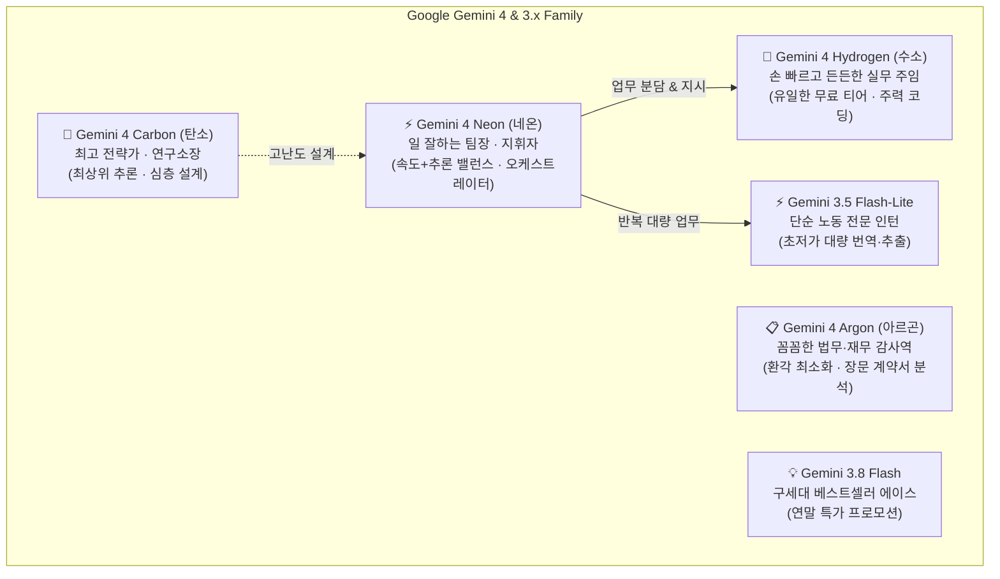

# [시니어 직장인의 AI 탐구기 #29] 이름부터 바뀐 '제미나이 4(Gemini 4)' 완벽 해부: 내 지갑과 업무에 딱 맞는 모델 고르기

> **핵심 요약**: Gemini 4의 Carbon·Neon·Hydrogen 등 모델 역할과 가격·무료 티어, OpenCode `/connect` 및 Plan/Build별 비용 최적화 조합을 정리합니다.
> **준비물**: OpenCode Desktop, Google 계정 · **소요 시간**: 약 8분  
> **작성 기준일**: 2026년 11월 21일

그런데 며칠 전까지 우리가 [#03편](오픈코드03.md)과 [#05편](오픈코드05.md)에서 익숙하게 부르던 구글의 **제미나이 Pro, Flash**라는 이름이 갑자기 사라지고, 2026년 10월~11월을 기점으로 **Argon(아르곤), Carbon(탄소), Hydrogen(수소), Neon(네온)**이라는 낯선 화학 원소 이름들이 쏟아져 나왔습니다.

> *"아니, AI 공부하기도 바쁜데 갑자기 학창 시절 주기율표까지 외워야 하나요?"*

당황하실 필요 전혀 없습니다. 구글이 모델 성능과 역할을 직관적으로 구분하기 위해 '원소 별명(펫네임)'을 붙였을 뿐, **우리 직장인이 실제로 기억해야 할 핵심 원리와 '토큰 가계부' 전략**은 오히려 더 명확해졌습니다.

오늘 편에서는 이 새로운 제미나이 4 시리즈를 회사 직급에 비유해 3분 만에 이해하고, 오픈코드(OpenCode)에 가장 가성비 좋게 세팅하는 법을 알아보겠습니다.

---

## 1. 회사 직급으로 이해하는 제미나이 4 시리즈 (핵심 4인방 + 막내 2인)

어려운 기술 스펙표 대신, 우리 부서의 **역할 분담**으로 머릿속에 그려보겠습니다. *(Gemini 4 계열은 모두 책 수십 권 분량인 **100만 토큰(1M)**을 한 번에 읽고 쓸 수 있는 거대한 작업 책상을 기본으로 제공합니다.)*



### [표] 제미나이 모델 패밀리 직급별 역할 및 투입 시점

| 모델명 | 회사 직급 비유 | 핵심 강점 및 특징 | 언제 투입하나요? |
| :--- | :--- | :--- | :--- |
| **Gemini 4 Carbon (탄소)** | **최고 전략가 · 연구소장** | 가장 머리가 좋고 깊게 고민하는 최상위 추론 모델 | 프로젝트 전체 아키텍처 설계, 난치병 버그·보안 취약점 분석, 복잡한 수학·알고리즘 해결 |
| **Gemini 4 Neon (네온)** | **일 잘하는 팀장 · 지휘자** *(11/18 최신 출시)* | Carbon의 두뇌를 닮았으면서도 **속도가 빠르고 균형 잡힌 최신 에이스** | Antigravity([#03편](오픈코드03.md))나 오픈코드 서브에이전트([#20편](오픈코드20.md))에서 계획을 짜고 팀원에게 분배하는 오케스트레이터 |
| **Gemini 4 Hydrogen (수소)** | **손 빠르고 든든한 실무 주임** | 기존 Flash의 뒤를 잇는 고속 주력 모델, **유일하게 무료 티어(Free Tier) 지원** | 일상 업무 자동화, 단위 기능 코딩, 반복적 에이전트 실행 등 일상 개발 전반 |
| **Gemini 4 Argon (아르곤)** | **꼼꼼한 법무·재무 감사역** | 환각(Hallucination)을 줄이고 정밀한 사실 관계 검증에 특화 | 수백 페이지의 계약서, 재무제표, 규정집 등 긴 기업 문서를 정밀하게 검토할 때 |
| **Gemini 3.8 Flash** | **구세대 베스트셀러 에이스** | 이전 세대 최고 가성비 모델, 연말까지 특별 할인 프로모션 진행 중 | Hydrogen의 백업 모델 또는 연말 특가 기간 중 일상 코딩 작업 |
| **Gemini 3.5 Flash-Lite** | **단순 노동 전문 인턴** | 생각하는 시간 없이 번개처럼 처리하는 초저가 모델 | 번역, 엑셀 데이터 분류, 영수증 텍스트 추출 등 대량 텍스트 단순 반복 작업 |

---

## 2. 시니어 직장인의 '토큰 가계부': 가격표와 특가 일정

API 비용을 아끼는 [#05편](오픈코드05.md)의 원칙을 이어받아, 2026년 11월 현재 기준 **100만 토큰당 요금(USD)**을 한눈에 비교해 드립니다.  
*(※ 출력 요금에는 AI가 답을 내기 전 혼자 속으로 고민하는 'Thinking 토큰'이 포함됩니다.)*

### [표] 제미나이 주요 모델 가격 및 무료 티어 현황 (100만 토큰 기준)

| 모델명 (API ID) | 입력 단가 | 출력 단가 | 캐시 입력 | 무료 티어 | 직장인 한줄 메모 |
| :--- | :---: | :---: | :---: | :---: | :--- |
| **Gemini 4 Neon** (`gemini-4-neon`) | **$3.00** | **$15.00** | $0.15 | ❌ 없음 | **속도+성능 밸런스 최강 (최신 주력)** |
| **Gemini 4 Carbon** (`gemini-4-carbon`) | **$2.00** *(12/1~ $4)* | **$10.00** *(12/1~ $20)* | $0.10 | ❌ 없음 | **⚠️ 11/30까지 50% 반값 특가!** |
| **Gemini 4 Argon** (`gemini-4-argon`) | **$2.00** *(12/1~ $4)* | **$10.00** *(12/1~ $20)* | $0.10 | ❌ 없음 | **⚠️ 11/30까지 50% 반값 특가!** |
| **Gemini 4 Hydrogen** (`gemini-4-hydrogen`) | **$1.50** | **$7.50** | $0.075 | ✅ **있음** | **일상 업무 & 무료 테스트 추천 1순위** |
| **Gemini 3.8 Flash** (`gemini-3.8-flash`) | **$0.75** *(1/1~ $1.5)* | **$3.75** *(1/1~ $7.5)* | $0.075 | ✅ **있음** | **⚠️ 12/31까지 프로모션 특가!** |
| **Gemini 3.5 Flash-Lite** (`gemini-3.5-flash-lite`) | **$0.30** | **$2.50** | $0.03 | ✅ **있음** | **단순 번역·데이터 분류 최저가** |

### 💡 지갑을 지켜주는 실전 절약 팁 3가지

1. **11월 30일과 12월 31일 데드라인 챙기기**:  
   최상위 모델인 `Carbon`과 `Argon`은 **12월 1일부터 정가($4/$20)로 인상**됩니다. 대규모 프로젝트 설계가 있다면 11월 말 특가 기간을 적극 활용하세요. 연말까지 반값인 `3.8 Flash` 역시 지금 쓰기에 탁월한 가성비를 자랑합니다.
2. **자동 95% 절약! 암시적 캐싱(Implicit Caching)**:  
   제미나이 4 시리즈는 프로젝트의 `AGENTS.md`나 긴 문서 파일을 반복해서 참조할 때, 구글이 자동으로 이전 문맥을 인식해 **캐시 입력 단가(최대 95% 할인)**를 자동 적용합니다. (`Neon` 기준 $3.00 → **$0.15**로 대폭 절감!)
3. **대용량 파일 배치는 Batch API(50% 할인)**:  
   당장 1초 만에 응답받을 필요 없는 수백 개 문서 일괄 정리는 Batch API를 활용하면 모든 요금이 절반으로 줄어듭니다.

---

## 3. 오픈코드(OpenCode) 실전 세팅: '팀장+실무자' 황금 조합

비싼 `Carbon`이나 `Neon`만 계속 켜두고 "오늘 점심 메뉴 추천해 줘" 같은 질문을 하는 것은 전무님께 복사 심부름을 시키는 것과 같습니다.  
[#17편](오픈코드17.md)의 **Plan 모드**와 [#20편](오픈코드20.md)의 **서브에이전트(Subagents)** 개념을 결합해 아래처럼 역할을 나누어 보세요.

### 1단계: 오픈코드에 모델 연결 확인 (`/connect`)

[#08편](오픈코드08.md)에서 배운 대로 오픈코드 채팅창에 아래 명령어를 입력해 Google 계정 또는 Antigravity 로그인을 갱신하고 최신 모델 목록을 불러옵니다.

```text
/connect
```

연결이 완료되면 오픈코드 모델 선택 드롭다운에서 `gemini-4-neon`, `gemini-4-hydrogen`, `gemini-3.5-flash-lite`가 정상적으로 표시되는지 확인합니다.

---

### 2단계: 상황별 '오케스트라' 스위칭 전략

* **Step A. 기획 및 아키텍처 설계 (`Plan 모드` + `Gemini 4 Neon`)**  
  새로운 업무 자동화 도구나 웹페이지([#28편](오픈코드28.md) Firebase ClientVault 같은 프로젝트)를 처음 기획할 때는 `Plan 모드`를 켜고 **Gemini 4 Neon**에게 전체 설계를 맡깁니다.
  > *"우리 부서 주간보고서 취합 웹앱을 만들려고 해. 내가 가진 폴더 구조를 보고, 가장 안전하고 깔끔한 컴포넌트 설계와 데이터 흐름 계획서만 먼저 작성해 줘."*

* **Step B. 실제 코드 구현 및 단위 수정 (`Build 모드` + `Gemini 4 Hydrogen` 또는 `3.8 Flash`)**  
  설계도가 탄탄하게 나왔다면 작업 모델을 가성비 뛰어난 **Gemini 4 Hydrogen**(또는 연말 특가인 **3.8 Flash**)으로 전환합니다. 이미 명확한 가이드라인이 주어졌기 때문에 실무자 모델도 군더더기 없이 코드를 척척 작성합니다.

* **Step C. 문서 100개 요약 및 데이터 전처리 (`Gemini 3.5 Flash-Lite`)**  
  [#19편](오픈코드19.md) MarkItDown으로 변환한 수많은 참고 자료에서 키워드를 뽑거나 분류할 때는 초저가 모델인 **3.5 Flash-Lite**를 호출하여 커피 한 잔도 안 되는 비용으로 작업을 끝냅니다.

---

### 📋 [복사해서 쓰세요] `AGENTS.md`에 적어두는 토큰 절약 수칙

프로젝트 폴더의 `AGENTS.md`([#16편](오픈코드16.md))에 아래 규칙을 넣어두면, 에이전트가 불필요한 추론 토큰을 낭비하는 일을 사전에 방지할 수 있습니다.

```markdown
## 모델 및 토큰 절약 수칙
- 단순 텍스트 추출, 번역, 파일명 정리 등 반복 작업은 가급적 간결하게 응답한다.
- 불필요한 전체 파일 재작성을 피하고, 수정이 필요한 부분(Diff) 위주로 편집한다.
- 새로운 기능을 구현하기 전에는 반드시 Plan 모드에서 작업 범위를 먼저 합의한다.
```

---

## 4. 실습 완료 체크리스트

* [ ] **원소 이름 매핑**: Carbon(연구소장), Neon(팀장/에이스), Hydrogen(실무자/무료), Lite(인턴)의 역할을 이해했다.
* [ ] **토큰 가계부 인지**: 무료 티어가 제공되는 Hydrogen과 연말 특가(Carbon/Argon/3.8 Flash) 일정을 확인했다.
* [ ] **모델 목록 갱신**: 오픈코드에서 `/connect`를 통해 최신 Gemini 4 모델 목록이 나타나는지 확인했다.
* [ ] **역할 분담 습관화**: 설계는 Neon(Plan 모드), 구현은 Hydrogen(Build 모드), 대량 처리는 Lite로 나누는 전략을 숙지했다.

---

## 🎯 오늘의 핵심 요약 (3줄 정리)

1. **원소 이름으로 재편된 제미나이 4**: 최상위 추론의 **Carbon**, 오케스트레이션 에이스 **Neon**, 무료 티어를 지원하는 실무 주력 **Hydrogen**의 3인방 체제로 개편되었습니다.
2. **놓치면 아쉬운 특가 일정**: **11월 30일까지 Carbon/Argon 반값**, **12월 31일까지 3.8 Flash 프로모션**이 진행되므로 대규모 설계 작업은 지금 진행하는 것이 가장 유리합니다.
3. **가장 똑똑한 오픈코드 조합 공식**: **"설계는 Neon, 구현은 Hydrogen, 대량 정리는 Flash-Lite"** 원칙을 지키면 작업 속도와 품질은 올리면서 토큰 비용은 1/5로 절감할 수 있습니다.

---

[← 이전 글: [#28편] Firebase 콘솔로 ClientVault 만들기: 에뮬레이터 없이 무료 클라우드로 구축하는 실전 파일 포털](오픈코드28.md) · [다음 글: [#30편] OpenCode에 Alibaba 오픈소스 코드 리뷰어(OCR) 붙이기: 공식 플러그인 연동부터 위임·네이티브 모드와 오탐 검증까지](오픈코드30.md) · [전체 연재 목차](README.md)
