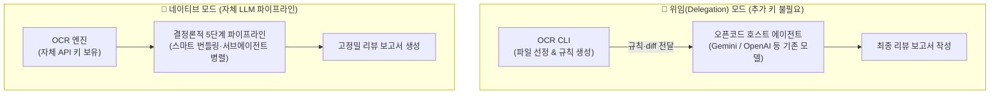

# [시니어 직장인의 AI 탐구기 #30] OpenCode에 Alibaba 오픈소스 코드 리뷰어(OCR) 붙이기: 공식 플러그인 연동부터 위임·네이티브 모드와 오탐 검증까지

> **핵심 요약**: Alibaba Open Code Review(OCR)의 OpenCode 공식 플러그인 설치, 별도 키 없는 위임 모드와 네이티브 모드, AI 리뷰 오탐 검증 방법을 안내합니다.
> **준비물**: OpenCode Desktop (v2.x), Node.js/npm, Git 저장소 · **소요 시간**: 약 10분  
> **작성 기준일**: 2026년 11월 22일
> *"AI가 코드를 빠르게 짜주긴 했는데, 내가 모르는 보안 취약점이나 엉뚱한 버그가 숨어있으면 어쩌지?"*  
> *"깃허브에 올리기 전에 사수처럼 코드를 한 줄 한 줄 꼼꼼하게 검토해 주는 전용 리뷰어가 있으면 좋겠는데..."*

AI가 작성한 코드에 버그나 보안 문제가 숨어 있는지 확인하려면 전문 **AI 코드 리뷰어(Code Reviewer)**가 도움이 됩니다. Alibaba의 오픈소스 **`open-code-review(OCR)`**를 OpenCode에 연동해 보겠습니다.

---

## 1. 결론부터: marketplace는 없다, 하지만 공식 플러그인이 있다

알리바바가 사내에서 2년간 쓰다가 오픈소스로 공개한 AI 코드 리뷰 도구 **Open Code Review**(`alibaba/open-code-review`, CLI 명령은 `ocr`)는 GitHub 스타 5만이 넘는 검증된 도구입니다.

보통 Claude Code나 Codex에서는 아래처럼 marketplace 명령어로 플러그인을 붙입니다.

```bash
/plugin marketplace add alibaba/open-code-review   # Claude Code
codex plugin marketplace add alibaba/open-code-review  # Codex
```

그래서 많은 분들이 *"오픈코드에서도 marketplace 명령으로 추가할 수 있나요?"*라고 질문하십니다.

결론부터 말씀드리면, **오픈코드(OpenCode)에는 marketplace 명령어가 없습니다.** 대신 오픈코드는 훨씬 유연한 두 가지 확장 방식을 지원합니다:

1. `opencode plugin add`로 npm 패키지나 Git 저장소를 직접 등록하는 방식
2. `~/.config/opencode/plugins/` 폴더에 플러그인 스크립트 파일을 직접 배치하는 방식

그리고 가장 반가운 사실은, **`alibaba/open-code-review` 저장소가 오픈코드를 공식 지원**한다는 점입니다. 오픈코드 V1과 V2 런타임을 모두 지원하는 공식 플러그인 파일(`open-code-review.ts`)이 리포지토리에 배포되어 있어 손쉽게 연동할 수 있습니다.

---

## 2. 설치: 터미널 명령 네 줄 (또는 오픈코드에 "진행해줘" 한마디)

macOS 및 OpenCode v2 기준, 터미널에서 아래 4단계 명령어를 입력하면 설치가 완료됩니다.

```bash
# 1단계: OCR 전용 글로벌 CLI 설치
npm install -g @alibaba-group/open-code-review

# 2단계: 공식 오픈코드 플러그인 파일 다운로드
mkdir -p ~/.config/opencode/plugins
curl -fsSL \
  https://raw.githubusercontent.com/alibaba/open-code-review/main/plugins/open-code-review/opencode/open-code-review.ts \
  -o ~/.config/opencode/plugins/open-code-review.ts

# 3단계: V2 런타임 의존성 패키지 설치
cd ~/.config/opencode
npm init -y   # package.json이 없는 경우에만 실행
npm install @opencode-ai/plugin @opencode/plugin@beta

# 4단계: 오픈코드 백그라운드 서비스 재시작
opencode service restart
```

> 💡 **오픈코드 채팅창 활용 꿀팁**:  
> 터미널에 일일이 명령어를 복사해 넣기 번거롭다면, 오픈코드 채팅창에 *"OpenCode에 alibaba/open-code-review 연결하고 싶어"*라고 물어본 뒤, 오픈코드가 설치 계획을 제시하면 **`진행해줘`** 한마디만 입력하세요. 오픈코드가 위 설치 과정을 알아서 척척 실행해 줍니다.

설치 및 서비스 재시작이 끝나면 오픈코드에 아래 기능들이 자동으로 활성화됩니다:

* **도구(Tools)**: `ocr_review`, `ocr_health`
* **슬래시 명령어**: `/ocr-review`, `/ocr-health`

오픈코드 채팅창이나 터미널에서 `ocr_health`를 실행해 보면 OCR 도구 버전과 LLM 연결 상태가 정상인지 즉시 점검할 수 있습니다.

---

## 3. 핵심 개념: '위임(Delegation) 모드' vs '네이티브 모드'

이 도구를 제대로 활용하려면 한 가지 핵심 질문을 이해해야 합니다:  
👉 **"코드 리뷰를 판단하는 LLM은 누가, 어떤 자격으로 호출하는가?"**



### [표] 위임 모드 vs 네이티브 모드 한눈에 비교

| 구분 | 위임(Delegation) 모드 | 네이티브 모드 |
| :--- | :--- | :--- |
| **리뷰 주체** | 지금 사용 중인 **오픈코드 호스트 에이전트** | OCR 전용 리뷰 에이전트 + 독립 파이프라인 |
| **LLM 호출자** | 오픈코드가 기존 연결된 모델로 직접 호출 | OCR 엔진이 자체적으로 호출 |
| **모델 및 인증** | **OpenCode가 이미 쓰는 모델·구독** 활용 | OCR 자체 provider 설정 (**별도 API 키 필요**) |
| **사전 준비물** | **없음 (추가 설정 전혀 불필요!)** | 모델 엔드포인트 + 자격증명(API 키) |
| **추천 대상** | **복잡한 설정 없이 바로 시작하고 싶은 분** | 대규모 프로젝트에서 최고 정밀도가 필요한 분 |

---

### 모드 A. 위임 모드 — 별도 API 키 없이 0초 만에 시작하기

위임 모드에서는 역할이 절반으로 나뉩니다:

* **OCR CLI (엔지니어링 계층)**: 리뷰 대상 파일 자동 선별, 불필요 파일 제외, 리뷰 규칙 생성, diff 수집, 보고 양식 정의
* **호스트 에이전트 (OpenCode)**: 전달받은 규칙과 diff를 읽고 실제 코드 분석 및 보고서 작성

OCR 쪽에 API 키를 등록할 필요가 전혀 없으므로, **처음 시작할 때는 무조건 위임 모드로 출발**하는 것이 가장 안전하고 편리합니다.

---

### 모드 B. 네이티브 모드 — 결정론적 파이프라인 × 전용 에이전트

`ocr review`를 실행하면 OCR 엔진이 5단계 전용 파이프라인을 가동합니다:

1. **결정론적 파일 선정**: 어떤 파일을 리뷰하고 제외할지 엔지니어링 로직이 엄격히 판단
2. **스마트 번들링**: 관련된 파일(예: 다국어 파일 쌍, 소스코드와 테스트 파일)을 한 묶음으로 구성
3. **규칙 주입**: 파일 언어·특성에 맞는 리뷰 규칙을 템플릿 엔진으로 정밀하게 주입
4. **번들당 서브에이전트**: 격리된 컨텍스트에서 병렬 리뷰 수행 (대용량 변경에서도 안정적)
5. **위치 보정 모듈**: 코멘트 줄 번호와 지적 내용의 오차를 체계적으로 보정

네이티브 모드를 쓰려면 터미널에서 대화형 명령어로 API 키를 1회 등록해 주면 됩니다:

```bash
ocr config provider    # Google Gemini, OpenAI 등 제공자 선택
ocr config model       # 사용할 모델 선택 (예: gemini-3.6-flash 등)
ocr llm test           # 연결 상태 자동 점검
```

설정 내용은 `~/.opencodereview/config.json`에 저장되며, LM Studio·Ollama 같은 로컬 LLM 엔드포인트도 자유롭게 연결할 수 있습니다.

---

## 4. 실전 테스트 1: 위임 모드로 파일 13개 중 5개 골라내기

실제 커밋이 아직 없는 신규 프로젝트 저장소(전부 untracked 상태)에서 위임 모드를 돌려보았습니다.

```bash
$ ocr delegate preview

# Files (5 reviewable / 13 total)
- mode: workspace
- total_insertions: 1909

~~- `.DS_Store` [binary] +0/-0 (excluded: binary)~~
  - `.gitignore` [added] +10/-0
  - `hello.py` [added] +42/-0
~~- `관찰자는 관찰되는 모든 것이다.mp3` [binary] (excluded: binary)~~
...
```

바이너리 파일(음원 mp3, macOS `.DS_Store`)과 미지원 확장자(문서, 자막 등)를 알아서 걸러내고, **리뷰가 필요한 핵심 5개 파일만 1초 만에 선별**해 냈습니다.

이어서 규칙을 내려받습니다:

```bash
ocr delegate rule .gitignore hello.py main.py pyproject.toml .python-version
```

설정 파일에는 보안·유지보수 규칙이, 파이썬 코드에는 자원 관리와 예외 처리 패턴이 담긴 체크리스트가 내려옵니다. 이 규칙을 쥐고 오픈코드 에이전트가 코드를 점검한 결과, 아래와 같은 실무 결함을 짚어냈습니다:

* 🟡 **`.gitignore`에 macOS `.DS_Store` 제외 규칙이 누락됨** (실제로 폴더에 `.DS_Store`가 굴러다니고 있었음)
* 🟡 **`pyproject.toml` 프로젝트 설명이 기본 플레이스홀더(`Add your description here`) 상태로 방치됨**

사람의 눈으로는 무심코 넘어가기 쉬운 설정 파일의 빈틈을 정확하게 잡아낸 것입니다.

---

## 5. 실전 테스트 2: 네이티브 모드 실행과 'AI 오탐'의 교훈

이번에는 구글 Gemini를 OCR provider로 연결하고, 동일한 작업 공간에 네이티브 리뷰를 돌려보았습니다.

* **소요 시간**: 39초
* **결과**: 5개 파일 커버, 토큰 45,227개 소모, 1건의 지적 사항 도출

그런데 나온 지적 내용이 심상치 않았습니다:

> 🔴 **HIGH 경고 — `pyproject.toml:8`**:  
> `pyside6>=6.12.0`은 오타일 가능성이 매우 높습니다. PySide6 버전은 Qt6 릴리스(6.5, 6.7, 6.8)를 따르는데, `6.12.0`은 PyPI 저장소에 존재하지 않아 설치가 실패할 수 있습니다.

매우 전문적이고 그럴듯한 분석입니다. 하지만 터미널에서 Python 패키지 저장소(PyPI)를 직접 조회해 보았습니다:

```text
PyPI 최신 5개 버전: ['6.11.0', '6.11.1', '6.11.2', '6.11.3', '6.12.0']
6.12.0 실제 존재 여부? True
```

**AI의 오탐(False Positive)이었습니다!**  
`6.12.0`은 실제로 존재하는 최신 버전이었지만, 리뷰를 담당한 LLM 모델의 학습 지식 컷오프 시점이 과거였기 때문에 AI가 "아직 안 나온 버전"으로 착각한 것입니다.

---

## 6. 두 모드가 발견한 차이점 & 시니어 직장인을 위한 3대 실무 교훈

같은 코드를 두 가지 방식으로 리뷰한 결과는 사뭇 달랐습니다.

### [표] 위임 모드 vs 네이티브 모드 실제 리뷰 결과 비교

| 구분 | 위임 모드 (OpenCode 호스트 모델) | 네이티브 모드 (Gemini 전용 파이프라인) |
| :--- | :--- | :--- |
| **찾아낸 내용** | `.DS_Store` 무시 규칙 누락, description 플레이스홀더 | `pyside6>=6.12.0` 버전 의심 (오탐) |
| **놓친 내용** | pyside6 패키지 버전 의존성 | `.DS_Store`, 프로젝트 설명 누락 이슈 |

이 실전 테스트에서 얻을 수 있는 **가장 값진 실무 교훈 3가지**를 꼭 기억해 두세요:

1. **AI의 리뷰 결과는 '참고용'이며, 최종 검증은 사람의 몫이다**:  
   심각도 빨간불(HIGH)과 화려한 근거가 붙어 있어도, 단 몇 초의 웹 검색이나 패키지 조회로 반증될 수 있습니다. AI가 지적했다고 해서 무조건 코드를 고치지 말고, 실제 맞는지 한 번 더 검증하세요.
2. **두 모드는 경쟁 관계가 아니라 상호 보완 관계다**:  
   결정론적 파이프라인(파일 선별, 규칙 추출)은 동일하지만, 판단하는 모델이 다르면 시야도 달라집니다. 큰 프로젝트에서는 두 모드를 함께 돌려보면 사각지대를 크게 줄일 수 있습니다.
3. **시작은 위임 모드로 가볍게, 필요할 때 네이티브로 확장하라**:  
   별도의 API 키가 필요 없는 위임 모드(`ocr delegate`)로 일상적인 코드 품질을 챙기고, 이후 더 전문적인 파이프라인 검증이 필요할 때 네이티브 모드를 도입하는 것이 가장 경제적입니다.

---

## 7. 설치부터 실행까지 명령어 치트시트

```bash
# [1] 플러그인 설치 (최초 1회)
npm install -g @alibaba-group/open-code-review
mkdir -p ~/.config/opencode/plugins
curl -fsSL https://raw.githubusercontent.com/alibaba/open-code-review/main/plugins/open-code-review/opencode/open-code-review.ts \
  -o ~/.config/opencode/plugins/open-code-review.ts
cd ~/.config/opencode && npm init -y
npm install @opencode-ai/plugin @opencode/plugin@beta
opencode service restart

# [2] 위임 모드 실행 (별도 키 불필요)
ocr delegate preview           # 리뷰 대상 파일 미리보기
ocr delegate rule <파일목록>    # 파일별 최적 규칙 추출

# [3] 네이티브 모드 세팅 (선택 사항)
ocr config provider && ocr config model && ocr llm test
```

설치가 끝난 후 오픈코드 채팅창에서 `/ocr-review` 또는 `/ocr-health`를 입력하기만 하면 즉시 코드 리뷰가 시작됩니다.

---

## 8. 실습 완료 체크리스트

* [ ] **플러그인 등록**: `open-code-review.ts` 파일을 플러그인 폴더에 배치하고 오픈코드 서비스를 재시작했다.
* [ ] **도구 활성화 확인**: 오픈코드에서 `ocr_health` 또는 `/ocr-health`가 정상 동작하는 것을 확인했다.
* [ ] **위임 모드 체득**: 추가 API 키 없이도 `ocr delegate preview`로 바이너리 파일을 거르고 핵심 파일만 선별해 보았다.
* [ ] **AI 오탐 대처법 인지**: AI가 HIGH 경고를 주더라도 실제 패키지 버전이나 사실관계를 사람이 한 번 더 확인하는 습관을 다졌다.

---

## 🎯 오늘의 핵심 요약 (3줄 정리)

1. 오픈코드에는 공식 marketplace 명령어가 없지만, `~/.config/opencode/plugins/` 경로를 통해 알리바바의 **공식 OCR 플러그인**을 완벽하게 연동할 수 있습니다.
2. 추가 API 키가 없다면 오픈코드의 현재 모델을 그대로 활용하는 **위임(Delegation) 모드**로 가볍고 안전하게 시작할 수 있습니다.
3. AI 코드 리뷰어의 지적 사항은 언제나 **오탐(False Positive)의 가능성**이 있으므로, 최종 판단은 사람의 팩트 체크를 거치는 것이 고품질 소프트웨어를 만드는 비결입니다.

---

[← 이전 글: [#29편] 이름부터 바뀐 '제미나이 4(Gemini 4)' 완벽 해부: 내 지갑과 업무에 딱 맞는 모델 고르기](오픈코드29.md) · [전체 연재 목차](README.md)
