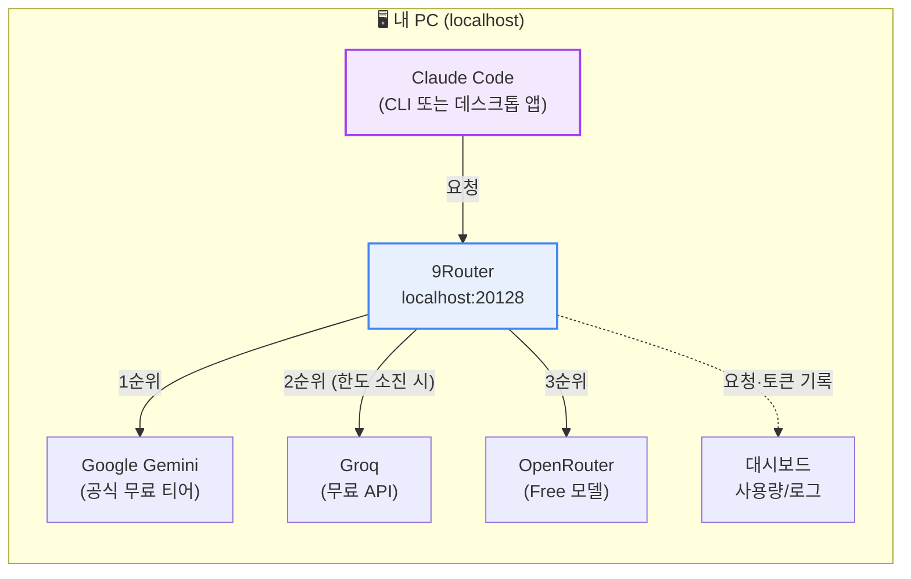

# [시니어 직장인의 AI 탐구기 #31] 클로드 코드(Claude Code) 구독료 0원으로 쓰기: 9Router 로컬 게이트웨이 + 무료 공식 API 조합

> **핵심 요약**: 내 PC에서만 도는 중계기 **9Router**를 설치하고, 구글 Gemini AI Studio·Groq·OpenRouter의 **공식 무료 API 키**를 묶어 Claude Code와 Claude 데스크톱 앱에 연결하는 전 과정을 정리합니다.
> **준비물**: Claude 데스크톱 앱(무료 계정), Node.js 18 이상, Git, 무료 API 키 2~3개 · **소요 시간**: 약 25분  
> **작성 기준일**: 2026년 11월 26일
> *"오픈코드로 업무 자동화는 잘 하고 있는데, 회사 동료들이 쓰는 클로드 코드(Claude Code)는 어떤 느낌인지 궁금하다."*  
> *"잠깐 써보자고 월 20달러를 결제하기는 부담스럽고, 무료 계정으로는 실행이 막힌다는데 방법이 없을까?"*

이번 편은 지난 30편에서 다룬 오픈코드(OpenCode) 시리즈의 **곁들여 쓰기 편**입니다. 오픈코드를 버리고 갈아타는 이야기가 아니라, **같은 무료 API 재료로 클로드 코드라는 다른 조리 도구도 한 번 써보는** 이야기입니다.

---

## 0. 먼저 짚고 갑니다: 이 글은 '우회'가 아니라 '중계'입니다

클로드 코드를 쓰는 방법은 크게 세 가지입니다.

### [표] 클로드 코드를 쓰는 세 가지 비용 경로

| 경로 | 비용 | 장점 | 단점 |
| :--- | :---: | :--- | :--- |
| **① Claude Pro/Max 구독** | 월 $20~ | 가장 안정적, 모든 기능·최신 모델 | 매달 고정 지출 |
| **② Anthropic API 크레딧** | 사용량 과금 | 필요한 만큼만, 자동화에 유리 | 코딩은 토큰 소모가 커서 예상보다 빨리 소진 |
| **③ 로컬 게이트웨이 + 무료 API** | **0원** | 카드 등록 없이 체험 가능, 모델 자동 전환 | 무료 한도·속도 제한, 일부 기능 미지원 |

이 글에서 다루는 것은 **③번**입니다. 9Router(나인라우터)는 내 PC에서만 작동하는 **로컬 AI 중계기(Proxy/Gateway)** 로, 클로드 코드가 보내는 요청을 받아 구글 Gemini·Groq·OpenRouter 같은 외부 AI에게 대신 전달합니다.

> ⚠️ **이것만은 꼭 지켜 주세요 (매우 중요)**
>
> - 각 플랫폼이 **공식적으로 발급하는 정식 무료 API 키**만 사용합니다.
> - 웹 브라우저 로그인 세션(OAuth)을 빌려 쓰는 편법, CLI 우회 로그인, 유료 구독 계정 공유는 **이용약관 위반**이 되어 계정이 제재될 수 있습니다.
> - 클로드 코드는 Anthropic의 소프트웨어입니다. 비-Anthropic 모델을 끼워 쓰는 구성은 Anthropic의 공식 지원 범위를 벗어날 수 있고, 앱 업데이트에 따라 언제든 동작이 바뀔 수 있습니다.
> - **회사 기밀·고객 개인정보는 절대 넣지 마세요.** 무료 티어는 입력 데이터가 서비스 개선에 활용될 수 있습니다. 사내 규정상 허용된 도구만 사용하시기 바랍니다.

### 오픈코드 시리즈와 이어지는 지점

이번 글은 앞선 편들과 재료를 공유합니다. 이미 읽으셨다면 훨씬 수월합니다.

- **무료 모델 감각 익히기**: [#06편](오픈코드06.md)에서 오픈코드 내장 무료 모델(DeepSeek V4.1 Flash Free)을 써봤다면, "공짜 모델도 일상 코딩은 충분하다"는 감을 이미 잡으신 셈입니다.
- **무료 티어의 현실**: [#29편](오픈코드29.md)에서 정리한 것처럼 무료 티어는 모델·한도·정책이 자주 바뀝니다. 이 글의 숫자도 **2026년 11월 기준**으로만 읽어 주세요.
- **CLI 도구 연동 경험**: [#30편](오픈코드30.md)에서 CLI 도구를 게이트웨이에 붙이는 방식을 다뤘습니다. 9Router도 원리가 똑같습니다.
- **Git/GitHub 기본기**: [#27편](오픈코드27.md)의 Git 설정이 되어 있어야 클로드 코드의 변경 이력 기능을 제대로 쓸 수 있습니다.

---

## 1. 원리: 9Router는 내 PC 안의 'AI 교통정리 센터'



핵심은 세 가지입니다.

1. **주소만 바꿔치기**: 클로드 코드가 바라보는 API 주소를 `http://localhost:20128/v1`로 바꿉니다. 클라이언트 입장에서는 "조금 특이한 Anthropic 호환 서버"일 뿐입니다.
2. **형식 번역**: 클로드 코드는 Anthropic 형식으로 말하고, Gemini·Groq는 저마다 다른 형식으로 듣습니다. 9Router가 중간에서 통역합니다.
3. **자동 전환(Fallback)**: 하나의 무료 모델이 일일 한도에 걸리면 다음 모델로 자동으로 넘깁니다. 9Router의 **Combo(콤보)** 기능이 이 역할을 합니다.

> 💡 **오픈코드와 똑같은 원리**: [#08편](오픈코드08.md)의 `/connect`도 결국 오픈코드가 여러 제공자를 한 인터페이스로 부르는 구조였습니다. 9Router는 그 '제공자 묶음'을 클로드 코드에도 씌워주는 도구라고 이해하시면 됩니다.

---

## 2. 사전 준비: Git·Node.js·Claude 앱

터미널(macOS) 또는 PowerShell(Windows)을 열고 아래 순서대로 준비합니다.

### STEP 1. Claude 데스크톱 앱 설치

[Claude 공식 다운로드 페이지](https://claude.ai/download)에서 본인 OS에 맞는 설치 파일을 받아 설치하고, **무료 계정으로 로그인**해 둡니다. (CLI만 쓰실 분은 이 단계를 건너뛰어도 됩니다.)

### STEP 2. Git 설치

```bash
# macOS
brew install git

# Windows (PowerShell)
winget install --id Git.Git -e --source winget
```

설치 확인:

```bash
git --version
```

### STEP 3. Node.js & npm 설치

9Router와 Claude Code CLI는 모두 Node.js로 실행됩니다. **LTS 버전**을 권장합니다.

```bash
# macOS
brew install node

# Windows (PowerShell)
winget install OpenJS.NodeJS.LTS
```

설치 확인:

```bash
node -v
npm -v
```

> 💡 **설치 후에는 터미널을 완전히 닫고 새로 여세요.** PATH가 갱신되지 않아 `node: command not found`가 뜨는 경우가 가장 흔합니다.

### STEP 4. Claude Code CLI 설치 (CLI로 쓸 분만)

데스크톱 앱과 별개로, 터미널에서 `claude` 명령을 쓰려면 CLI를 설치합니다.

```bash
npm install -g @anthropic-ai/claude-code
claude --version
```

---

## 3. 9Router 설치와 첫 로그인

### STEP 1. 글로벌 설치

```bash
npm install -g 9router
```

> **Windows PowerShell에서 빨간 글씨(스크립트 실행 차단)가 뜬다면:**
>
> ```powershell
> Set-ExecutionPolicy -Scope CurrentUser -ExecutionPolicy RemoteSigned
> ```
>
> 실행 권한을 허용한 뒤 다시 설치합니다.

### STEP 2. 실행

```bash
9router
```

잠시 후 브라우저가 자동으로 열리며 대시보드가 나타납니다.

- **주소**: `http://localhost:20128` (대시보드는 `/dashboard`)
- **초기 비밀번호**: `123456`
- **설정·데이터 저장 위치**: `~/.9router` (SQLite DB 포함)

> 🔐 **로그인 직후 비밀번호를 반드시 바꾸세요.** 9Router는 기본 비밀번호가 공개되어 있습니다. 같은 공유기(카페·사무실 Wi-Fi)에 있는 사람이 접근할 수 있으므로, 대시보드 설정에서 즉시 변경하는 것이 원칙입니다.
>
> 🌐 **포트를 바꾸고 싶다면**: `9router --port 8080`처럼 실행할 수 있습니다. 이 경우 이후 모든 설정의 주소도 함께 바꿔야 합니다.
>
> 🚫 **인터넷에 노출하지 마세요.** 이 게이트웨이는 내 PC용입니다. 공유기 포트포워딩으로 외부에 열어두면 API 키와 대화 내용이 그대로 노출될 수 있습니다.

### STEP 3. 첫 화면 점검

| 확인 항목 | 정상 상태 |
| :--- | :--- |
| 대시보드 접속 | `http://localhost:20128` 로그인 성공 |
| 비밀번호 | 초기값 `123456`에서 변경 완료 |
| Providers 메뉴 | 등록된 제공자 0개 (이제부터 추가) |
| Endpoints & Keys | 로컬 API 키 1개 이상 존재 |
| CLI Tools | Claude Code 항목 표시 |

---

## 4. 무료 API 키 발급과 Provider 등록

### 추천 무료 API 3종

| 서비스 | 무료 티어 특징 | 잘 맞는 작업 | 주의할 점 |
| :--- | :--- | :--- | :--- |
| **Google AI Studio (Gemini)** | 넉넉한 컨텍스트, 무료 티어 제공 | 긴 파일 읽기, 계획 수립, 코드 설명 | 무료 티어는 입력이 서비스 개선에 활용될 수 있음 |
| **Groq** | 압도적으로 빠른 응답 속도 | 짧은 코드 생성, 반복 수정, 초안 작성 | 모델 종류가 상대적으로 적음 |
| **OpenRouter** | 다양한 오픈소스 모델, `:free` 태그 | 모델 비교, 백업용 폴백 | 무료 모델은 한도·대기열이 자주 변동 |

> 💡 무료 한도는 **분당 요청 수(RPM)·일일 토큰** 기준으로 수시로 바뀝니다. 각 콘솔의 최신 안내를 확인하세요. 카드 등록 없이 쓸 수 있는 범위에서만 사용하는 것이 안전합니다.

### 9Router에 등록하는 순서

1. 대시보드 좌측 메뉴에서 **`Providers`** 클릭
2. **`Add Connection`** 클릭
3. 연결할 서비스 선택 (예: `Google Gemini`, `Groq`, `OpenRouter`)
4. 각 서비스 콘솔에서 발급받은 **API Key**를 붙여넣기
5. **`Check`** 클릭 → 초록색 **`Valid`** 확인
6. **`Save`** 저장
7. 해당 제공자의 모델 목록에서 **`Test`**를 돌려, 정상 응답하는 무료 모델만 활성화

> **API 키 발급처 바로가기**
>
> - Google AI Studio: [aistudio.google.com](https://aistudio.google.com/) → `Get API key`
> - Groq: [console.groq.com](https://console.groq.com/) → `API Keys`
> - OpenRouter: [openrouter.ai](https://openrouter.ai/) → `Keys` (모델명에 `:free`가 붙은 모델만 무료)
>
> ⚠️ API 키는 비밀번호와 같습니다. 블로그·GitHub·스크린샷에 그대로 노출되지 않도록 주의하고, 유출이 의심되면 즉시 폐기 후 재발급하세요.

---

## 5. Combo 만들기: 한도가 차면 다음 일꾼에게 바통

9Router의 진짜 무기는 **Combo(폴백) 모델**입니다. 무료 모델 하나가 막혀도 작업이 멈추지 않습니다.

### 만드는 순서

1. 좌측 메뉴에서 **`Combos`**(또는 `Combo & Vision Adapter`) 선택
2. **`Create Combo`** 클릭
3. 이름 입력 (예: `free-claude-combo`)
4. **`Add Model`**로 무료 모델을 순서대로 추가
5. **Fallback Order**가 켜져 있는지 확인
6. **`Save`**

### [표] 추천 폴백 순서 예시

| 순위 | 모델 계열 | 역할 | 이유 |
| :---: | :--- | :--- | :--- |
| **1순위** | Gemini 4 Hydrogen 등 Gemini 무료 모델 | 주력 실무자 | 컨텍스트가 길고 무료 티어가 있음 |
| **2순위** | Llama 3.3 70B (Groq) | 속도 담당 | 응답이 매우 빨라 짧은 수정에 유리 |
| **3순위** | Qwen·DeepSeek 계열 (OpenRouter `:free`) | 백업 | 앞의 두 곳이 모두 막혔을 때 |

> 💡 **모델 ID는 손으로 적지 마세요.** 대시보드 모델 목록에 실제로 표시되는 ID만 선택하세요. 제공자별 모델 이름은 수시로 바뀝니다.
>
> 🧪 **콤보 테스트 방법**: 대시보드의 테스트 창에서 짧은 프롬프트를 보내고, 요청 로그(Request Logs)에서 **어떤 모델이 응답했는지** 확인합니다. 1순위 모델을 일시적으로 비활성화하면 2순위로 넘어가는지도 검증할 수 있습니다.

---

## 6. 클로드 코드에 연결하기

연결 방법은 두 가지입니다. **CLI 설정 파일 방식(A)** 이 가장 단순하고 재현하기 쉽습니다. 데스크톱 앱을 꼭 쓰셔야 한다면 **B**를 따라 하세요.

### 6-1. 방법 A — Claude Code CLI에 설정 파일로 연결 (권장)

먼저 대시보드에서 연결 정보를 확인합니다.

- **`Endpoints & Keys`** 메뉴로 이동
- **로컬 주소**: `http://localhost:20128/v1` (끝의 `/v1`까지 포함)
- **API Key**: 로컬 중계용 키 복사

그다음 Claude Code 설정 파일을 엽니다.

```bash
# macOS / Linux
mkdir -p ~/.claude
[ -f ~/.claude/config.json ] || echo '{}' > ~/.claude/config.json
open -e ~/.claude/config.json   # 또는 원하는 편집기로 열기
```

```json
{
  "anthropic_api_base": "http://localhost:20128/v1",
  "anthropic_api_key": "여기에_9Router_로컬_API_키"
}
```

> ⚠️ **주소 끝의 `/v1`은 붙여야 합니다.** 9Router의 OpenAI/Anthropic 호환 엔드포인트는 `/v1`까지가 주소입니다. (반대로 데스크톱 앱의 '게이트웨이 URL' 칸은 `/v1`을 **빼고** 넣는 경우가 많습니다. 아래 B 방법을 참고하세요.)
>
> 🔁 기존에 Claude 구독으로 쓰던 분은 설정 파일을 백업해 두세요. `cp ~/.claude/config.json ~/.claude/config.json.bak` 처럼 보관하면 원복이 쉽습니다.

설정 파일 대신 **환경 변수**로 지정하는 방법도 있습니다. 특정 프로젝트에서만 잠깐 시험할 때 편리합니다.

```bash
export ANTHROPIC_BASE_URL="http://localhost:20128/v1"
export ANTHROPIC_API_KEY="여기에_9Router_로컬_API_키"
claude
```

터미널에서 실행합니다.

```bash
claude
```

정상이라면 무료 계정 업그레이드 안내 없이 세션이 시작됩니다.

### 6-2. 방법 B — Claude 데스크톱 앱 개발자 모드 + Gateway

1. **Claude 앱** 실행
2. 우측 상단 **더보기(`...`)** → **`Help`** → **`Troubleshooting`** → **`Enable Developer Mode`**
3. 앱이 자동으로 재시작됨
4. 다시 **더보기(`...`)** → **`Developer Options`**
5. **Third-party inference / Gateway** 항목 설정
   - **유형**: `Gateway`
   - **게이트웨이 URL**: `http://127.0.0.1:20128` (`/v1` 제외)
   - **자격 증명 방식**: `Static API Key` + `Bearer`
   - **API Key**: 9Router에서 복사한 키
6. **`Save Changes`** → 앱 재시작

> 💡 **메뉴 이름은 앱 버전에 따라 다릅니다.** `Developer Mode`, `Third-party inference`, `Gateway` 같은 표현이 보이지 않으면 앱을 최신 버전으로 업데이트한 뒤 다시 확인하세요. 이 화면은 실험적 기능이라 예고 없이 위치가 바뀔 수 있습니다.
>
> 💡 저장 직후 연결 테스트가 **빨간색**으로 보여도 당황하지 마세요. 저장 후 앱을 완전히 종료했다가 다시 실행하면 정상 연결되는 경우가 많습니다.

### 6-3. 대시보드의 CLI Tools 메뉴로 한 번에 설정하기

9Router 대시보드에는 CLI 도구 설정을 대신 써주는 기능도 있습니다.

1. **`CLI Tools`** 메뉴 → **`Claude Code`** 선택
2. 모델 목록에서 방금 만든 **Combo** 지정
3. **`Apply`** 클릭
4. 상단에 초록색 **`Connected`** 표시 확인

이 방식은 설정 파일을 직접 편집하지 않아도 되지만, 기존 설정을 덮어쓸 수 있으므로 **먼저 백업**하는 습관을 권합니다.

### [표] CLI 방식 vs 데스크톱 앱 방식

| 구분 | 방법 A: CLI 설정 파일 | 방법 B: 데스크톱 앱 Gateway |
| :--- | :--- | :--- |
| **난이도** | 낮음 (JSON 2줄) | 중간 (메뉴 탐색) |
| **주소 표기** | `http://localhost:20128/v1` | `http://127.0.0.1:20128` (`/v1` 제외) |
| **안정성** | 높음 (문서화된 방식) | 실험적 기능, 버전에 따라 변동 |
| **추천 대상** | 터미널이 익숙한 분 | GUI를 선호하는 분 |

---

## 7. 연동 확인과 실전 테스트

모든 설정이 끝났습니다. 아래 순서로 확인해 보세요.

### STEP 1. 연결 상태 확인

```bash
claude
```

세션이 열리면 `/status`를 입력해 현재 모델과 API 주소를 확인합니다. 9Router 대시보드의 **Request Logs**에도 방금 보낸 요청이 찍혀야 합니다.

### STEP 2. 첫 실무 프롬프트

> 💬 **시니어 실무 추천 프롬프트:**
> *"현재 폴더의 파일 목록을 보고, 이 프로젝트가 무엇을 하는지 3줄로 요약해 줘. 그다음 README.md 초안을 작성하되, 기존 파일은 수정하지 말고 새 파일로 만들어 줘."*

이 프롬프트가 좋은 이유는 세 가지입니다.

- **읽기 → 요약 → 쓰기** 흐름이라 모델의 기본기를 한 번에 점검할 수 있습니다.
- "기존 파일은 수정하지 말라"는 안전장치를 넣어, 처음 테스트에서 저장소를 망가뜨릴 위험을 줄입니다.
- 결과물이 눈에 보이므로, 모델이 실제로 파일을 다룰 수 있는지 바로 확인됩니다.

### STEP 3. 폴백 동작 확인

대시보드에서 1순위 모델을 잠시 비활성화한 뒤 같은 프롬프트를 다시 보냅니다. 요청 로그에 2순위 모델이 찍히면 콤보가 정상 작동하는 것입니다.

### [표] 정상 동작 체크리스트

| 확인 항목 | 정상 신호 | 문제 신호 |
| :--- | :--- | :--- |
| 앱 실행 | 업그레이드 팝업 없이 세션 시작 | 결제 안내 반복 |
| API 주소 | `/status`에 `localhost:20128` 표시 | `api.anthropic.com` 그대로 |
| 요청 기록 | 9Router Request Logs에 요청 증가 | 로그가 비어 있음 |
| 모델 응답 | 콤보 1순위 모델이 응답 | 401/403 또는 무한 대기 |
| 파일 작업 | 읽기·쓰기 도구 정상 동작 | 도구 호출 형식 오류 |

---

## 8. 오픈코드(OpenCode)와 나란히 쓰기

9Router는 클로드 코드 전용이 아닙니다. **오픈코드도 같은 게이트웨이에 붙일 수 있습니다.** 대시보드의 `CLI Tools`에서 `OpenCode`를 선택하거나, 오픈코드의 제공자 설정에 `http://localhost:20128/v1`을 OpenAI 호환 엔드포인트로 추가하면 됩니다.

다만 오픈코드 사용자에게는 이미 더 간단한 길이 있습니다.

- **무료로 시작**: [#06편](오픈코드06.md)의 내장 무료 모델
- **구독 연동**: [#08편](오픈코드08.md)의 `/connect`
- **최신 모델 선택**: [#29편](오픈코드29.md)의 Gemini 4 계열

### [표] 어떤 도구를 언제 쓸까?

| 상황 | 추천 도구 | 이유 |
| :--- | :--- | :--- |
| 오픈코드만으로 충분한 일상 자동화 | **OpenCode + 무료 모델** | 설정이 가장 단순, 0원 |
| 클로드 코드의 화면·동작을 꼭 체험하고 싶다 | **Claude Code + 9Router** | 구독 없이 체험 가능 |
| 여러 AI를 한도에 맞춰 자동 전환하고 싶다 | **9Router + Combo** | 폴백·사용량 추적 |
| 회사 공식 승인 도구로만 작업해야 한다 | **승인된 구독/API** | 정책 준수 우선 |

> 💡 **한 줄 조언**: "무료로 써보는 것"과 "회사 업무를 무료로 처리하는 것"은 다릅니다. 개인 학습·사이드 프로젝트는 9Router로 충분하지만, 고객 정보가 오가는 업무는 반드시 사내 승인 도구를 사용하세요.

---

## 9. 자주 묻는 질문(FAQ) 및 문제 해결

### Q1. `9router` 명령어를 찾을 수 없다고 나옵니다

Node.js 설치 직후 터미널을 닫지 않고 실행했을 때 자주 발생합니다. 터미널(PowerShell)을 **완전히 종료**한 뒤 새로 열어 다시 실행하세요. 그래도 안 되면 `npm config get prefix`로 글로벌 설치 경로가 PATH에 있는지 확인합니다.

### Q2. 대시보드가 열리지 않습니다

- 주소가 `http://localhost:3000`이 아닌 **`http://localhost:20128`**인지 확인하세요.
- 다른 프로그램이 포트를 쓰고 있다면 `9router --port 8080`으로 실행합니다.
- 방화벽이 로컬 포트를 막고 있지 않은지 확인하세요.

### Q3. 401 / 403 오류가 납니다

- 대시보드의 **로컬 API 키**와 설정 파일의 키가 같은지 확인
- 주소 끝 `/v1` 포함 여부 확인 (CLI는 포함, 데스크톱 게이트웨이 URL은 제외)
- 키를 바꾼 뒤에는 **앱을 완전히 재시작**

### Q4. 무료 모델의 답변 품질이 Claude보다 떨어지는 것 같습니다

사실입니다. 무료 모델은 Claude 원본과 뉘앙스·긴 문맥 유지·도구 호출 안정성에서 차이가 날 수 있습니다. 일상적인 스크립트 작성·버그 수정·문서 초안에는 충분하지만, 복잡한 리팩터링이나 보안이 중요한 작업은 유료 모델이나 사람의 검토를 병행하세요. [#30편](오픈코드30.md)에서 배운 **AI 오탐 검증 습관**이 여기서도 그대로 필요합니다.

### Q5. 정말 1원도 안 드나요?

무료 티어 범위 안에서는 결제가 발생하지 않습니다. 단, **한도·속도 제한·대기열**이 있고, 정책은 예고 없이 바뀝니다. 또한 무료 티어의 데이터 처리 정책은 유료와 다를 수 있으므로, 민감 정보는 넣지 마세요.

### Q6. 연결 테스트가 빨간색인데 저장해도 되나요?

저장 후 앱을 완전히 재시작해 보세요. 그래도 실패하면 9Router 로그에서 요청이 들어오는지 확인합니다. 요청 자체가 없으면 클라이언트 주소 설정 문제, 요청은 있는데 실패하면 API 키·모델 ID 문제일 가능성이 큽니다.

### Q7. 원래대로 되돌리고 싶습니다

- Claude Code: 백업해 둔 `~/.claude/config.json.bak`을 복원
- 데스크톱 앱: Gateway 설정을 비우고 저장 후 재시작
- 9Router: `npm uninstall -g 9router` 후 `~/.9router` 폴더 정리 (API 키·로그가 들어 있으므로 필요 시 백업)

---

## 10. 실습 완료 체크리스트

- [ ] **9Router 실행**: `9router`로 대시보드(`localhost:20128`)에 접속하고 초기 비밀번호를 변경했다.
- [ ] **무료 키 2개 이상 등록**: Gemini·Groq·OpenRouter 중 최소 2곳을 `Valid` 상태로 만들었다.
- [ ] **콤보 구성**: 1·2·3순위 모델을 지정하고 폴백 순서를 켰다.
- [ ] **클로드 코드 연결**: CLI 설정 파일 또는 데스크톱 Gateway로 연결하고 `/status`에서 주소를 확인했다.
- [ ] **실전 테스트**: 파일 읽기·요약·새 파일 작성 프롬프트를 성공시켰다.
- [ ] **안전 점검**: 회사 기밀을 넣지 않았고, API 키를 외부에 노출하지 않았다.

---

## 🎯 오늘의 핵심 요약 (3줄 정리)

1. **9Router는 클로드 코드의 요청을 무료 공식 API로 중계하는 내 PC 전용 게이트웨이**입니다. 대시보드는 `localhost:20128`, 초기 비밀번호는 `123456`이므로 로그인 직후 반드시 변경하세요.
2. **핵심은 Combo(폴백)** 입니다. Gemini·Groq·OpenRouter 무료 모델을 1·2·3순위로 묶어두면, 한 곳의 한도가 차도 작업이 끊기지 않습니다.
3. **0원은 '체험'에 강하고 '업무'에는 조건부**입니다. 무료 한도·데이터 정책·기능 차이를 이해하고, 민감 정보는 승인된 유료 도구로 다루는 것이 시니어의 안전한 선택입니다.

---

## 📚 참고 자료 및 출처

- **원작자**: cocojuan코코쥬안
- **원본 영상**: [클로드 코드(Claude Code) 평생 무료 사용법 | 구독료 0원 세팅 가이드](https://www.youtube.com/watch?v=OT4P_kmYFT0)
- **9Router 공식**: [npm 패키지](https://www.npmjs.com/package/9router) · [GitHub 저장소](https://github.com/decolua/9router) · [공식 사이트](https://9router.com)
- **무료 API 콘솔**: [Google AI Studio](https://aistudio.google.com/) · [Groq Console](https://console.groq.com/) · [OpenRouter](https://openrouter.ai/)
- **Claude 공식**: [Claude 다운로드](https://claude.ai/download)

> ⚠️ **변동 안내**: 이 글의 포트·비밀번호·메뉴 이름·무료 한도는 **2026년 11월 26일 기준**입니다. 9Router와 각 AI 서비스는 업데이트가 잦으므로, 실제 설치 시에는 공식 문서와 대시보드 안내를 우선하세요. 본 글은 특정 서비스의 이용약관 위반을 권장하지 않으며, 모든 판단과 책임은 사용자에게 있습니다.

---

[← 이전 글: [#30편] OpenCode에 Alibaba 오픈소스 코드 리뷰어(OCR) 붙이기: 공식 플러그인 연동부터 위임·네이티브 모드와 오탐 검증까지](오픈코드30.md) · [다음 글: [#32편] 사진 한 장이 8초 쇼츠로! OpenCode + Google Flow로 AI 영상과 한글 자막 만들기](오픈코드32.md) · [전체 연재 목차](README.md)
