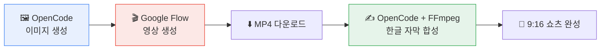

# [시니어 직장인의 AI 탐구기 #32] 사진 한 장이 8초 쇼츠로! OpenCode + Google Flow로 AI 영상과 한글 자막 만들기

> **핵심 요약**: OpenCode로 인물 이미지를 만들고, Google Flow로 걷는 영상을 생성한 뒤, 다시 OpenCode에서 FFmpeg로 한글 자막을 합성하는 4단계 숏폼 제작 과정을 정리합니다.
> **준비물**: OpenCode Desktop, Google 계정(Flow 이용 권한·크레딧), FFmpeg, 웹 브라우저 · **소요 시간**: 약 30분  
> **작성 기준일**: 2026년 11월 27일
> *"사진 한 장으로 사람이 움직이는 영상을 만들고, 내가 원하는 문구까지 넣을 수 있을까요?"*
> *"쇼츠를 만들어 보고 싶은데, 촬영도 편집도 배우지 않아서 엄두가 나지 않습니다."*

가능합니다. 이번 글에서는 실제로 **OpenCode에서 이미지를 만들고 → Google Flow에서 산책 영상으로 바꾸고 → 다시 OpenCode에서 한글 자막을 넣었던 과정**을 순서대로 정리합니다.

완성할 장면은 **공원을 산책하는 아름다운 50대 한국 여성**이고, 영상에는 다음 문구를 넣습니다.

> 갈등을 잊고  
> 오늘도 우리를 위해서

코드를 직접 작성하지 않아도 따라 할 수 있도록 **복사해서 쓸 요청 문장**과 **화면에서 직접 해야 할 작업**을 함께 안내합니다.

> ⚠️ **기준과 주의사항**  
> 이 글은 2026년 11월 27일의 실제 작업 기록을 바탕으로 작성했습니다. 모델 이름, 메뉴 위치, 무료 크레딧과 비용은 계정·지역·시점에 따라 달라질 수 있습니다. 본인의 화면에 표시되는 조건을 우선 확인하세요. **모든 단계가 무조건 무료인 것은 아닙니다.**
>
> 실존 인물의 사진을 사용하면 초상권·퍼블리시티권 문제가 생길 수 있습니다. AI 생성물을 공개할 때는 플랫폼의 AI 콘텐츠 표시 정책을 따르고, 음원·이미지·글꼴의 이용 권한을 확인하세요.

---

## 0. 이 글의 위치: 한 도구에 다 맡기지 않는 이유

오픈코드 시리즈에서 우리는 이미 **브라우저를 AI에게 맡기는 법**을 배웠습니다. [#23편](오픈코드23.md)의 내장 `@browser`와 [#24편](오픈코드24.md)의 실제 Chrome 연결 `browse`가 그것입니다. 이번 편은 그 연장선에서 **이미지 생성 → 영상 생성 → 자막 편집**을 각각 가장 잘하는 도구에 나눠 맡깁니다.

- **이미지**: OpenCode의 이미지 생성 도구 — 인물과 구도를 원하는 대로 지정
- **영상**: Google Flow — 사진을 바탕으로 실제 걷는 동작 생성
- **자막**: OpenCode + FFmpeg — 한글 문구를 정확한 위치와 글꼴로 합성

[#31편](오픈코드31.md)에서 "클로드 코드와 오픈코드를 상황에 맞게 나눠 쓰는 법"을 다뤘다면, 이번에는 **도구 분업**을 콘텐츠 제작에 적용하는 셈입니다.

---

## 1. 전체 과정을 먼저 이해하기

작업은 **OpenCode에서 이미지 생성 → Google Flow에서 영상 생성 → 영상 다운로드 → OpenCode에서 자막 삽입**의 네 단계입니다.



각 도구가 하는 일은 다음과 같습니다.

| 도구 | 담당하는 작업 |
| :--- | :--- |
| **OpenCode** | 이미지 생성 도구 호출, 브라우저 작업 보조, 영상 파일 확인 및 편집 |
| **이미지 생성 모델** | 인물·배경이 있는 원본 사진 생성 |
| **Google Flow** | 사진을 바탕으로 실제 움직임이 있는 영상 생성 |
| **FFmpeg** | 영상에 자막 이미지를 합쳐 최종 MP4 저장 |

여기서 중요한 차이가 있습니다. 사진을 확대하거나 좌우로 움직이는 **켄 번즈(Ken Burns) 효과**와, 인물이 실제로 걷는 동작을 생성하는 **AI 영상**은 서로 다릅니다. 이번에는 Flow로 걷는 동작을 만들었습니다.

---

## 2. 시작 전에 준비할 것

- 이미지 생성 도구를 사용할 수 있는 OpenCode 환경
- Google 계정과 Google Flow 이용 권한
- Flow에서 사용할 수 있는 크레딧
- 이미지를 올리고 영상을 내려받을 브라우저
- 자막 편집용 FFmpeg

이번 작업 컴퓨터는 macOS였고, FFmpeg는 이미 설치되어 있었습니다. 다른 컴퓨터에서는 먼저 OpenCode에 이렇게 요청하면 됩니다.

```text
내 컴퓨터에서 이미지 생성 도구를 사용할 수 있는지 확인해줘.
영상 자막 편집에 사용할 FFmpeg도 설치되어 있는지 확인해줘.
추가 설치나 비용이 발생하는 작업은 먼저 알려줘.
```

> 💡 **Windows 사용자**: 바탕화면 경로와 글꼴 위치가 macOS와 다릅니다. 아래의 Mac 경로를 그대로 입력하기보다 "내 바탕화면"이라고 요청하는 편이 쉽습니다. FFmpeg가 없다면 [FFmpeg 공식 사이트](https://ffmpeg.org/)의 설치 안내를 따르거나, OpenCode에 "FFmpeg 설치 방법을 알려줘"라고 물어보세요.

---

## 3. OpenCode에서 이미지 생성 모델 확인하기

### 채팅 모델과 이미지 모델은 별개입니다

OpenCode에서 대화하는 모델을 바꿨다고 해서, 그림을 만드는 모델까지 자동으로 같아지는 것은 아닙니다. [#29편](오픈코드29.md)에서 모델별 역할을 나눈 것처럼, 이미지 생성도 **별도의 모델 선택**이 필요합니다.

이번 작업에서도 채팅 모델과 별도로 이미지 생성 모델을 지정했습니다. 먼저 다음처럼 요청하세요.

```text
현재 이미지 생성 도구에서 선택할 수 있는 모델을 확인해줘.
프로바이더와 정확한 모델 이름을 함께 알려줘.
아직 이미지는 생성하지 마.
```

확인했습니다. **현재 이미지 생성 도구에서 선택 가능한 주요 모델**입니다.

| 프로바이더(연결 경로) | 이미지 모델 |
| :--- | :--- |
| Google | Nano Banana 2.1 |
| Google | Nano Banana 2 Lite |
| Google | Nano Banana Pro |
| OpenCode | GPT Image 2.5 Sunburst |
| OpenCode | Grok Imagine Image 2.0 |
| OpenRouter | GPT Image 2.6 Sunburst, FLUX 3 Image 등 |

**OpenAI 직접 연결로 제공되는 이미지 모델은 현재 목록에 없습니다.** 다만 OpenCode 또는 OpenRouter를 통해 GPT 이미지 모델을 선택할 수 있습니다. 실제 생성 가능 여부와 비용은 인증·잔액에 따라 달라집니다.

이번 여성 이미지를 만든 모델은 다음과 같습니다.

- **연결 프로바이더:** OpenCode
- **모델 이름:** GPT Image 2.5 Sunburst
- **모델 식별자:** `opencode/gpt-image-2.5-sunburst`

이 식별자는 당시 환경에서 확인된 값입니다. 다른 환경에서 보이지 않는다면 없는 모델을 임의로 지정하지 말고, **현재 목록에서 이용할 수 있는 이미지 모델**을 선택하세요.

> **OpenAI API 직접 호출과는 다릅니다**  
> OpenCode 경로로 GPT 이미지 모델을 사용하는 것과 Python에서 OpenAI API를 직접 호출하는 것은 별개의 연결 방식입니다. 이번 대화에서 OpenAI API 직접 호출도 시도했지만, API 키가 없어 생성하지 못했습니다. 최종 여성 사진은 OpenCode의 이미지 생성 도구로 만들었습니다. ChatGPT 구독이나 채팅 모델 연결만으로 별도 이미지 API 이용료가 포함된다고 생각하면 안 됩니다.

---

## 4. 공원을 산책하는 여성 이미지 만들기

### 그대로 복사해 사용할 요청 문장

```text
현재 사용 가능한 이미지 모델을 확인하고,
OpenCode의 GPT Image 2.5 Sunburst를 사용할 수 있다면 그 모델로 생성해줘.

이미지 내용:
아름다운 50대 한국 여성이 햇살이 비치는 공원을 산책하는 모습.
자연스러운 중년의 얼굴과 미소, 어깨 길이의 짙은 머리,
베이지색 가디건과 흰색 바지, 편안한 운동화, 어깨에 멘 가방.
나무와 꽃이 있는 공원 길, 부드러운 오후 햇빛.
자연스러운 실사 사진 스타일로 전신이 보이게 해줘.
글자나 로고는 넣지 마.

바탕화면에 korean_woman_park.png로 저장해줘.
```

### 왜 이렇게 구체적으로 적을까요?

- **나이와 자연스러운 피부 표현**을 적으면 지나치게 어려 보이는 인물을 줄이는 데 도움이 됩니다.
- **전신 구도**를 요청하면 다음 단계에서 걷는 장면을 설명하기 쉽습니다.
- **의상·가방·머리 모양**을 정해두면 영상에서도 유지할 기준이 생깁니다.
- **글자·로고 제외**를 적으면 원치 않는 문자 장식을 줄일 수 있습니다.

다만 프롬프트가 모든 결과를 보장하지는 않습니다. 손, 얼굴, 발 모양 등을 확인한 뒤 영상 제작에 사용하세요.

### 생성이 시작되면 기다리기

이미지 생성은 백그라운드에서 진행될 수 있습니다. "작업을 시작했다"는 메시지와 "파일이 저장되었다"는 메시지는 다릅니다.

완료 알림이 오기 전에는 같은 요청을 반복하지 않는 것이 좋습니다. 중복 생성과 추가 비용이 생길 수 있습니다.

이번에는 바탕화면에 다음 파일이 저장되었습니다.

```text
korean_woman_park.png
```

실제 저장 확장자가 요청한 것과 달라질 수도 있으므로 완료 메시지의 파일명을 확인하세요.

---

## 5. Google Flow 로그인하기

[Google Flow 열기](https://labs.google/fx/tools/flow)

### 가장 간단한 방법: 평소 쓰는 Chrome에서 로그인

1. Chrome에서 Flow 주소를 엽니다.
2. Google 계정으로 로그인합니다.
3. Flow의 프로젝트 화면이 보이는지 확인합니다.

비밀번호와 2단계 인증 코드는 직접 입력하고, **OpenCode 채팅에는 절대 보내지 마세요.**

### OpenCode가 브라우저를 조작하도록 요청하기

[#24편](오픈코드24.md)에서 설치한 `browse` 도구가 연결되어 있다면 다음처럼 요청할 수 있습니다.

```text
browse로 Google Flow를 열어줘.
로그인되어 있는지 확인하고, 로그인이나 인증이 필요하면 내가 직접 하도록 안내해줘.
아직 영상은 생성하지 마.
```

### 이번 작업에서 겪었던 로그인 문제

이번에는 OpenCode 내부의 `@browser` 창에서 Google 로그인을 진행하기 어려웠습니다. 해당 창을 닫고, **Chrome을 조작하는 별도 `browse` 도구**로 접속하자 기존 Google 로그인 상태를 사용할 수 있었습니다.

두 이름이 비슷하지만 이번 환경에서는 다른 도구였습니다.

| 구분 | 이번 환경에서의 역할 |
| :--- | :--- |
| `@browser` | OpenCode 내부 Review 창의 브라우저 ([#23편](오픈코드23.md)) |
| `browse` | 확장 프로그램을 통해 연결된 Chrome 조작 ([#24편](오픈코드24.md)) |

`browse`가 연결되지 않는다면 해당 확장 프로그램이 설치된 Chrome 프로필을 열고, 확장 프로그램이 켜져 있는지 확인하세요. 설치·연결되어 있지 않다면 웹사이트 작업을 직접 진행해도 됩니다.

> 🔐 내부 창에서 로그인이 안 된다고 보안 설정을 해제하거나 인증을 우회하지 마세요. 일반 브라우저에서 직접 로그인하는 방법을 사용하면 됩니다.

---

## 6. Flow에서 여성 사진 업로드하기

1. Flow에서 **새 프로젝트**를 누릅니다.
2. 프롬프트 입력창 근처의 **소재 추가** 버튼을 누릅니다.
3. **미디어 업로드**를 선택합니다.
4. 바탕화면의 `korean_woman_park.png`를 선택합니다.
5. 업로드가 끝나면 사진을 선택하고 **프롬프트에 추가**를 누릅니다.

**확인할 것:** 파일을 프로젝트에 올리는 것과, 생성에 사용할 참고 이미지로 선택하는 것은 다를 수 있습니다. 프롬프트 근처에 사진이 연결되어 있는지 확인하세요.

이번 화면에서는 `소재` 방식으로 이미지를 연결했습니다. UI에 따라 시작 프레임 또는 참고 이미지 방식이 제공될 수도 있습니다. 사진을 첫 장면으로 고정하려면 시작 프레임 기능을 확인하고, 인물·의상을 참고하게 하려면 소재 기능을 확인하세요.

---

## 7. 영상 모델·세로 비율·수량 설정하기

이번에 생성 전에 맞춘 설정은 다음과 같습니다.

| 항목 | 설정 |
| :--- | :--- |
| 생성 종류 | 동영상 |
| 이미지 연결 방식 | 소재 |
| 화면 비율 | 9:16 |
| 모델 | Veo 3.1 - Lite |
| 생성 수량 | x1 |
| 화면에 표시된 비용 | 10 Flow 크레딧 |

**9:16**은 스마트폰으로 보는 세로형 쇼츠에 적합합니다. 처음에는 **x1**로 테스트하세요. x2 이상이면 여러 결과가 생성되며 크레딧 사용량도 늘 수 있습니다.

이번 환경에서는 처음에 다른 모델과 x2가 선택되어 더 높은 크레딧이 표시됐습니다. 모델과 수량을 변경한 뒤 10크레딧 표시를 확인했습니다.

### 무료 크레딧으로도 가능한가요?

작업 당시 확인한 [Google Flow 크레딧 공식 안내](https://support.google.com/flow/answer/16526234?hl=ko)에서는 비구독자에게도 **매일 50 Flow 크레딧**을 제공한다고 설명했습니다.

하지만 아래 사항을 구분해야 합니다.

- 무료 크레딧이 있다고 모든 모델과 기능이 무료인 것은 아닙니다.
- 생성 비용은 모델·길이·해상도·수량 등에 따라 달라집니다.
- 혼잡 시간(UTC 기준 오후 2시~5시)에는 비구독자의 영상 생성이 제한될 수 있습니다.
- 일일 미사용 크레딧은 이월되지 않는다고 안내되어 있었습니다.
- 이번 계정에서 차감된 크레딧이 무료분인지 구독분인지까지 확인한 것은 아닙니다.
- Flow의 웹 크레딧과 Google 영상 API 요금은 별개입니다.

> 💳 **생성 버튼을 누르기 직전에 본인 화면의 비용을 확인하세요.** 크레딧이 부족하면 먼저 중단하고, 의도하지 않은 결제나 구독을 진행하지 않습니다.

---

## 8. 자연스러운 산책 동작을 프롬프트로 요청하기

다음 문구를 입력합니다.

```text
업로드한 사진 속 50대 한국 여성이 햇살이 비치는 공원 길을
미소 지으며 천천히 산책하는 자연스러운 실사 영상.

사진 속 얼굴, 나이, 헤어스타일, 베이지색 가디건,
흰색 바지와 가방을 일관되게 유지한다.

카메라는 여성의 앞에서 부드럽게 뒤로 이동하며 전신을 따라간다.
나뭇잎과 머리카락이 산들바람에 살짝 움직인다.

단일 연속 장면, 자연스러운 걸음걸이와 손 모양,
과장 없는 움직임. 세로 9:16 쇼츠용.
자막, 로고, 대사 없이.
```

핵심은 **인물 유지 + 간단한 동작 + 카메라 움직임**입니다. 첫 시도부터 뛰기, 회전, 복잡한 손동작, 여러 장면 전환을 동시에 요구하지 않는 편이 결과를 확인하기 쉽습니다.

자막은 이 단계에서 생성하지 않고, 나중에 영상 편집으로 넣습니다. 그래야 한글 오타를 피하고 문구·위치·글꼴을 정확하게 조절할 수 있습니다.

설정을 확인한 뒤 **생성 시작**을 누릅니다. 이번 작업에서는 사용자가 Flow 화면에서 직접 생성을 진행했습니다.

---

## 9. 완성된 영상 확인하고 바탕화면에 저장하기

생성이 끝나면 재생해서 확인합니다.

- 얼굴과 의상이 크게 바뀌지 않았는가?
- 걸음걸이와 손·발의 움직임이 자연스러운가?
- 장면이 갑자기 바뀌거나 인물이 추가되지 않았는가?
- 소리가 있다면 의도에 맞는가?

프롬프트를 잘 써도 AI 특유의 왜곡이 생길 수 있으므로 직접 확인하는 과정이 필요합니다. [#30편](오픈코드30.md)에서 배운 "AI 결과는 참고용, 최종 검증은 사람" 원칙이 영상에도 그대로 적용됩니다.

마음에 들면 **미디어 다운로드**를 눌러 저장합니다. 브라우저가 다운로드 폴더에 저장한다면 바탕화면으로 옮겨도 됩니다.

이번에 저장한 파일은 다음과 같습니다.

```text
Woman_walking_in_park_81eab58c.mp4
```

이름 끝의 문자열은 결과마다 달라질 수 있습니다. 파일명이 같을 필요는 없고, 다음 단계에서 **실제 저장된 이름**을 알려주면 됩니다.

이번 영상의 파일 정보를 확인한 결과는 다음과 같습니다.

| 항목 | 실제 결과 |
| :--- | :--- |
| 길이 | 약 7.93초 |
| 해상도 | 720×1280 |
| 비율 | 세로 9:16 |
| 프레임 속도 | 24fps |
| 오디오 | 오디오 트랙 포함 |

이미 세로 비율이므로 별도로 화면을 잘라낼 필요가 없었습니다. 오디오 트랙이 있다는 사실과 소리의 내용·품질은 별개이므로 재생해서 확인하세요.

---

## 10. OpenCode에서 원하는 한글 자막 넣기

OpenCode 채팅에 다음처럼 요청하세요.

```text
바탕화면에 있는 Woman_walking_in_park_81eab58c.mp4에
다음 자막을 넣어줘.

갈등을 잊고
오늘도 우리를 위해서

영상 전체에 하단 중앙 두 줄로 표시해줘.
흰색 글자와 어두운 반투명 배경으로 읽기 쉽게 해줘.
화면 맨 아래에 붙이지 말고 여백을 남겨줘.
기존 소리는 유지하고 배경음악은 추가하지 마.
원본은 덮어쓰지 말고 바탕화면에
Woman_walking_in_park_captioned.mp4로 저장해줘.
```

이렇게 요청하면 문구뿐 아니라 **위치·가독성·소리·원본 보존**까지 분명해집니다.

### 실제로 사용한 자막 처리 방식

이번 환경에서는 Python의 **Pillow**로 한글 자막이 들어간 투명 PNG를 만들고, **FFmpeg**로 영상 위에 합성했습니다.

1. 원본과 같은 720×1280 크기의 투명 이미지 만들기
2. Mac에 있는 한글 글꼴로 두 줄 문구 그리기
3. 흰 글자·검은 외곽선·어두운 반투명 배경 적용
4. FFmpeg로 자막 이미지를 영상 전체에 합성
5. 기존 오디오는 복사하고 새 MP4로 저장

FFmpeg 설치본에 따라 글자를 직접 그리는 필터가 없을 수 있어, 자막을 이미지로 만들어 합치는 방식을 사용했습니다. 사용자가 이 코드를 직접 작성할 필요는 없습니다.

> ✍️ **자막은 영상에 영구적으로 합쳐집니다.** 재생기에서 자막만 끄는 형태가 아닙니다. 나중에 문구를 바꾸려면 원본 영상에서 다시 출력하면 되므로 원본을 보관하세요.

이번 최종 파일은 다음과 같습니다.

```text
Woman_walking_in_park_captioned.mp4
```

**원본 파일과 기존 소리는 유지했으며, 별도의 배경음악은 추가하지 않았습니다.**

---

## 11. 완성 영상 최종 점검

OpenCode에 다음처럼 요청하면 결과 확인까지 이어갈 수 있습니다.

```text
완성된 자막 영상을 미리보기로 열어줘.
영상 길이와 세로 비율, 오디오 트랙이 유지됐는지도 확인해줘.
```

직접 재생하며 다음을 확인하세요.

- [ ] "갈등을 잊고 / 오늘도 우리를 위해서"가 정확하게 표시된다.
- [ ] 한글이 네모로 깨지거나 화면 밖으로 잘리지 않는다.
- [ ] 얼굴을 가리지 않고 배경 위에서도 읽기 쉽다.
- [ ] 쇼츠의 버튼·설명 영역과 겹치지 않는지 업로드 미리보기에서 확인한다.
- [ ] 원본과 비슷한 길이이며 소리가 의도대로 남아 있다.
- [ ] 원본과 자막 버전이 서로 다른 파일로 저장됐다.

업로드 플랫폼의 UI는 달라질 수 있으므로, 자막을 하단에 넣었더라도 최종 업로드 화면에서 가려지는지 한 번 더 확인하는 것이 좋습니다.

---

## 12. 자주 막히는 부분과 해결법

### Q1. OpenCode에서 요청했는데 이미지 모델이 없다고 나와요

이미지 생성 도구나 프로바이더 연결이 환경마다 다릅니다. "현재 사용할 수 있는 이미지 모델부터 확인해줘"라고 요청하세요. 채팅 모델을 바꾸는 것만으로 이미지 생성 권한이 생기는 것은 아닙니다.

### Q2. OpenAI API 키를 입력해야 하나요

이번 최종 이미지 생성은 OpenCode 연결 경로를 사용했습니다. OpenAI API를 직접 호출하려면 별도 API 키와 과금 설정이 필요할 수 있습니다. 비밀 키를 채팅이나 스크립트에 그대로 넣지 마세요.

### Q3. Google 로그인이 내부 브라우저에서 안 됩니다

일반 Chrome에서 직접 로그인하거나, 연결된 `browse` 도구를 이용하세요. 이번 작업에서도 내부 브라우저 대신 Chrome 연결로 진행했습니다. 자세한 설정은 [#24편](오픈코드24.md)을 참고하세요.

### Q4. 무료인데 왜 크레딧을 차감하나요

무료 제공분도 크레딧 단위로 사용합니다. "무료"는 무제한이 아니라 **제공된 크레딧과 기능 범위 안에서 사용한다**는 뜻입니다.

### Q5. 사진을 올렸는데 다른 인물이 나와요

사진이 프롬프트에 실제 연결되어 있는지 확인하세요. 얼굴·머리·의상을 유지하도록 적고, 필요하면 시작 프레임 기능을 사용하세요. 그래도 완전한 동일성이 보장되지는 않습니다.

### Q6. 자막이 깨집니다

한글 지원 글꼴이 필요합니다. 이번에는 Mac의 Apple SD Gothic Neo를 사용했습니다. 다른 운영체제에서는 사용 가능한 한글 글꼴로 바꿔달라고 요청하세요.

### Q7. 영상에 음악도 넣고 싶어요

사용 권한이 있는 음원 파일을 준비한 뒤 추가 요청하면 됩니다. 원래 소리를 유지할지 줄일지도 함께 정하세요. 이번 결과에는 새 음악을 넣지 않았습니다.

### Q8. 약 8초보다 긴 쇼츠를 만들려면요

같은 인물을 참고해 서로 다른 장면을 여러 개 만든 뒤 연결하는 방법이 있습니다. 다만 장면별 생성 크레딧이 필요하고 인물의 일관성이 달라질 수 있습니다. 먼저 한 장면으로 품질을 확인한 뒤 확장하는 편이 좋습니다.

---

## 13. 다음에 다시 만들 때 쓸 요청문 요약

### ① 이미지 생성

```text
현재 가능한 이미지 모델을 확인하고,
공원을 산책하는 아름다운 50대 한국 여성의 실사 이미지를 만들어줘.
전신 구도로 만들고 바탕화면에 저장해줘.
선택한 모델과 실제 저장 경로도 알려줘.
```

### ② Flow 영상 설정

```text
browse로 Google Flow를 열어줘.
방금 만든 여성 사진을 참고 이미지로 연결하고
자연스럽게 공원을 걷는 세로 9:16 영상 1개를 설정해줘.
생성 전에 사용할 모델과 차감 크레딧을 알려줘.
별도 결제나 구독은 진행하지 마.
```

### ③ 생성과 다운로드

화면에 표시된 비용을 확인하고 생성한 뒤, 재생해서 결과를 점검합니다. 마음에 들면 다운로드하고 실제 파일명을 OpenCode에 알려주세요.

### ④ 자막 편집

```text
바탕화면의 [실제 영상 파일명].mp4에
"갈등을 잊고 / 오늘도 우리를 위해서"를
하단 중앙 두 줄 자막으로 넣어줘.
기존 소리와 원본은 유지하고 자막 버전을 별도 MP4로 저장해줘.
완성 파일을 미리보기로 열어줘.
```

---

## 14. 실습 완료 체크리스트

- [ ] **이미지 모델 확인**: 채팅 모델과 별개로 이미지 생성 모델을 조회하고 선택했다.
- [ ] **원본 이미지 생성**: 전신·의상·배경을 구체적으로 지정해 PNG 파일을 저장했다.
- [ ] **Flow 연결**: Chrome 로그인 상태로 Flow에 접속하고 사진을 소재로 연결했다.
- [ ] **영상 설정 확인**: 9:16·x1·모델·차감 크레딧을 생성 전에 확인했다.
- [ ] **결과 검수**: 얼굴·손·발·장면 전환을 재생해 확인하고 MP4로 다운로드했다.
- [ ] **자막 합성**: 원본을 보존한 채 한글 자막 버전을 별도 파일로 만들었다.
- [ ] **권리·표시 확인**: 실존 인물·음원·글꼴 권리와 AI 생성물 표시 정책을 확인했다.

---

## 🎯 오늘의 핵심 요약 (3줄 정리)

1. **이미지·영상·자막은 도구를 나눠야 품질이 올라갑니다.** OpenCode는 이미지와 편집, Flow는 걷는 동작 생성, FFmpeg는 정확한 한글 자막에 강합니다.
2. **비용은 생성 버튼 직전에 확인하세요.** Flow는 무료라도 크레딧 단위로 차감되며, 모델·수량·혼잡 시간에 따라 조건이 달라집니다.
3. **AI 영상은 반드시 사람이 검수해야 합니다.** 얼굴·손·발의 왜곡, 자막 위치, 업로드 화면에서의 가림 여부까지 확인하는 것이 완성도를 결정합니다.

---

## 📚 참고 링크 및 출처

- [Google Flow](https://labs.google/fx/tools/flow)
- [Google Flow 크레딧 공식 안내](https://support.google.com/flow/answer/16526234?hl=ko)
- [Google Flow에서 동영상 만들기](https://support.google.com/flow/answer/16353334?hl=ko)
- [FFmpeg 공식 사이트](https://ffmpeg.org/)
- [Pillow 공식 문서](https://pillow.readthedocs.io/)

### 함께 읽으면 좋은 이전 강좌

- [#23편](오픈코드23.md) — OpenCode 내장 `@browser` 사용법
- [#24편](오픈코드24.md) — 실제 Chrome을 연결하는 `browse` 완벽 가이드
- [#29편](오픈코드29.md) — Gemini 4 모델 선택과 토큰 가계부
- [#30편](오픈코드30.md) — AI 코드 리뷰 결과의 오탐 검증 교훈
- [#31편](오픈코드31.md) — 9Router로 클로드 코드를 0원에 체험하기

> ⚠️ **게시 전 확인**: 본인 계정의 최신 이용 조건과 비용을 확인하세요. 생성물 공개 시에는 플랫폼의 AI 콘텐츠 표시 정책을 따르고, 실제 인물의 사진이나 음원을 쓸 경우 필요한 권리를 확보하세요.

---

[← 이전 글: [#31편] 클로드 코드(Claude Code) 구독료 0원으로 쓰기: 9Router 로컬 게이트웨이 + 무료 공식 API 조합](오픈코드31.md) · [전체 연재 목차](README.md)
